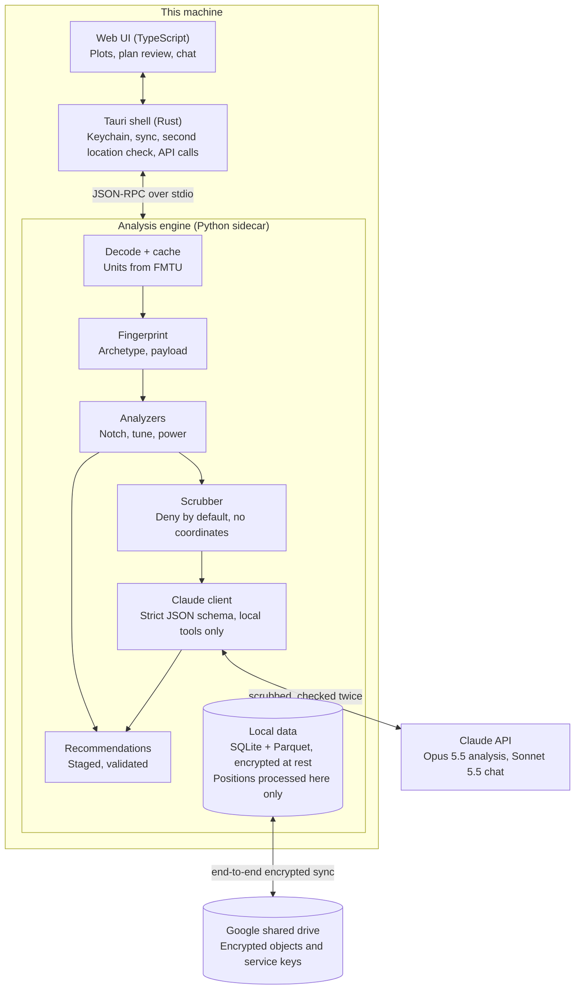
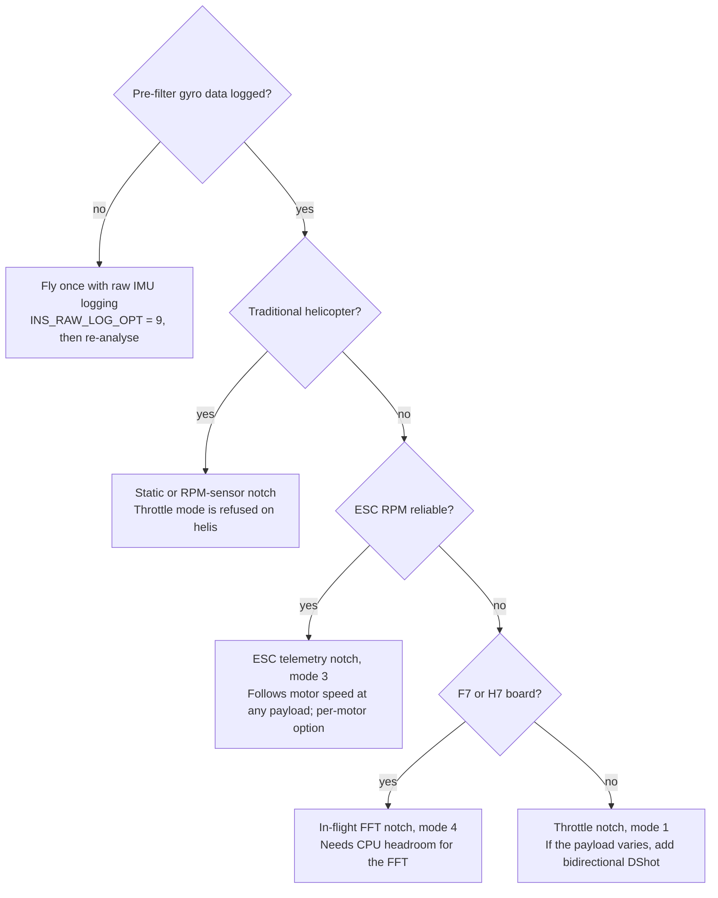

# ArduPilot Flight Analyzer — Design Spec

> **Snapshot of the master spec.** The master copy lives in Claude Docs (revision 108, exported 2026-10-20). When the master changes, re-export it here; when code work changes the design, update this file in the same pull request and flag it so the master is updated too.

Oct 17, 2026 · @Phoenix

## Purpose and scope

The app turns ArduPilot onboard logs, ground-station tlogs and parameter files into a ranked, evidence-backed set of parameter changes that measurably improve how a specific airframe flies. It ships for Windows and Linux first, covers Copter, Plane, QuadPlane/VTOL and Helicopter, and calls the Claude API on every analysis to reason over results the local engine computes.

**Goals**

- Identify the airframe from the log alone: vehicle type, frame, propulsion, ESC protocol and telemetry, sensors, weight class and payload behavior.
- Audit every parameter in the log against firmware defaults, the airframe's archetype and what the flight data shows.
- Measure rather than guess: gyro spectra before and after filtering, notch tracking, step response per axis, vibration, power and estimator health.
- Produce a staged tuning plan: what to change, why, the evidence, the expected effect, and the test flight that confirms it.
- Track each airframe across flights so every change is verified against the next log, not assumed.
- Tie every flight to its exact parameter set, and attribute changes in performance to the parameter changes behind them.
- Cover the whole system, not only the airframe: telemetry and RC links, GNSS, the ground station and operator actions, from onboard logs and tlogs together.
- Account for every watt and every component's condition: power losses, ESC and motor health, and the chain of events behind each failsafe, judged against sourced reference ranges.
- Find errors and settings that are wrong for each type of aircraft, and propose the fix with its reasoning.
- Keep every flight and every result permanently, shared across the team's laptops and encrypted end to end.
- Assume GNSS will be lost: measure how well each aircraft holds position and gets home without it, and show how to improve that.

**Non-goals for v1**

- Writing parameters to the vehicle. v1 exports a .param file for a person to load; MAVLink write-back comes later, behind explicit confirmation.
- Ground-control functions or live telemetry dashboards. Mission Planner and QGroundControl already do these.
- Anything outside flight-performance tuning: mission planning, payload control, navigation logic.
- Replacing Autotune. The app says when and how to run it, then checks the result.

**Users:** engineers and technicians tuning airframes in-house, from first hover through fleet maintenance. They know ArduPilot parameters; every recommendation still explains itself.

## Landscape and the gap

ArduPilot's own tools already measure most of what matters, but none connects the measurements into one diagnosis for a specific airframe. The app reuses their methods and closes that gap.

| Tool | What it does well | What it leaves to the user |
| --- | --- | --- |
| [Filter Review](https://firmware.ardupilot.org/Tools/WebTools/FilterReview/) | Applies candidate filter settings to logged pre-filter gyro data and estimates the post-filter spectrum without another flight | Choosing the settings; very large raw-IMU logs can be too big for the browser tool |
| [Filter Tool and PID Review](https://ardupilot.org/copter/docs/common-webtools.html) | Bode plots of filter attenuation and phase lag; frequency-domain review of the rate tune | Interpretation; both are labelled advanced-user tools |
| [Hardware Report, MAGFit, UAV Log Viewer](https://ardupilot.org/copter/docs/common-webtools.html) | Hardware and firmware inventory, compass fitting, plotting | Any diagnosis |
| [Methodic Configurator](https://github.com/ArduPilot/MethodicConfigurator) | A proven, linear configuration sequence for ArduCopter with parameter docs and upload | Post-flight diagnosis; Plane, Heli and Rover support is still very incomplete |
| Mission Planner | Initial parameter helper by prop size, log browsing | Diagnosis across subsystems |

**The gap this app fills**

1. **Fusion.** One diagnosis across filters, tune, power, navigation and parameters. Example: notch tracking fails because ESC telemetry dropped out, not because the notch is set wrong.
2. **Airframe awareness.** Advice shaped by archetype, weight class and payload behavior, not one default for every vehicle.
3. **Version awareness.** 4.7 renamed and rescaled many parameters, for example `ATC_ACCEL_R_MAX` became `ATC_ACC_R_MAX` with centidegrees replaced by degrees, and `PSC_ACCZ_IMAX` became `PSC_D_ACC_IMAX`, 1000x smaller ([release notes](https://discuss.ardupilot.org/t/copter-4-7-0-released/144650)). Reading the wrong name or unit produces wrong advice.
4. **Explanation.** Every change carries its evidence, expected effect and the test flight that confirms it.
5. **Fleet memory.** Each flight is compared against earlier flights of the same airframe.

**Reuse methods, not code, unless GPL is acceptable.** Methodic Configurator is GPLv3, so copying its code would make this app GPLv3. Re-implement the published methods (post-filter estimation, frequency-domain PID review) in the analysis engine instead. Licensing of the other WebTools is an open question for legal review.

## System architecture

A Tauri v2 desktop shell runs a Python analysis engine as a bundled sidecar process. Python owns everything numeric: parsing, signal processing, analyzers, recommendations, and building and scrubbing the AI requests. Rust owns process lifecycle, files, the OS keychain, updates and encrypted sync with the shared Google Drive. The web UI owns presentation.



*Only encrypted objects and scrubbed features leave this machine.*

Everything numeric happens inside the engine on the user's machine; data leaves only as encrypted sync objects that only enrolled laptops can read, or as scrubbed AI packets sent to the Claude API, and Claude's answers come back through the same validator as the rule-based recommendations.

The split follows the ecosystems. Python has the ArduPilot tooling (pymavlink's DataFlash reader, the language of Methodic Configurator and MAVExplorer) and SciPy for FFTs, filter design and system identification. Tauri gives small native installers, a web UI suited to dense interactive plots, and a later path to macOS and mobile front ends. Tauri's sidecar feature is built for exactly this: bundling a [PyInstaller-built Python program](https://v2.tauri.app/develop/sidecar) so users install nothing else.

| Layer | Technology | Responsibilities |
| --- | --- | --- |
| UI | TypeScript, Svelte 5; uPlot for time series; WebGL for spectrograms | Views, plots, recommendation review, flight comparison, chat |
| Shell | Tauri v2 (Rust) | Windows, sidecar start/stop/restart, file dialogs, keys and sign-in tokens in the OS keychain, encrypted Google Drive sync, outbound Claude and weather requests, signed auto-update |
| Engine | Python 3.12+, frozen with PyInstaller or Nuitka | Ingestion, columnar cache, fingerprint, analyzers, recommendation engine, location scrubber, Claude client |
| Knowledge pack | Versioned data files, updatable without an app release | Parameter metadata per firmware version, rename and rescale tables, rule packs, curated doc excerpts |
| Storage | SQLite plus Parquet files in the user data folder | A full working copy of the shared record: airframes, flights, findings, parameter snapshots, decoded log columns |

**Engine interface.** JSON-RPC 2.0 over the sidecar's stdin/stdout carries commands, progress and results. Bulk arrays (spectra, decimated time series) go as Apache Arrow IPC files in the cache folder, referenced by path. The engine opens no network port, so nothing else on the machine can call it. The same engine also ships as a CLI (`analyze <log> --json`) for batch runs, CI tests and a later server deployment.

**Packaging**

- **Windows:** NSIS or MSI from the Tauri bundler, code-signed. Bump the version on every build: a reported Tauri v2 bug leaves the old sidecar in place on same-version reinstalls ([issue 15134](https://github.com/tauri-apps/tauri/issues/15134)).
- **Linux:** RPM and AppImage for recent Fedora and similar distributions, built on the oldest Fedora release still supported so glibc matches field laptops.
- **Sidecar size:** a frozen Python with NumPy and SciPy runs to tens of megabytes. Acceptable for a desktop tool; keep optional heavy dependencies out of the core build. The engine leaves out the parts of its libraries it never uses, such as pyarrow's Flight RPC and cloud filesystems.
- **Versions and checks:** every CI build is numbered 0.1.<build number>, so each installer carries a new version. The knowledge pack ships beside the app, outside the frozen engine. Before a package is kept, CI installs it on a clean system and runs its bundled engine on a fixture log, including an encrypted import.

**Path to other platforms**

- **macOS:** same stack. Tauri appends the target triple to sidecar names, so each architecture gets its own engine build; add notarization.
- **Linux ARM64:** a second engine build for ARM field computers.
- **Mobile:** a Python sidecar cannot ship on Android or iOS. The mobile app becomes a viewer that reads the shared Drive and decrypts on the phone with its own enrolled key. Keeping the engine transport-agnostic now makes that a deployment change, not a rewrite.

## Data ingestion and processing

DataFlash .bin logs are the primary input because they describe themselves: FMT messages define each message's layout, and FMTU, UNIT and MULT give every field its unit and multiplier ([log message reference](https://ardupilot.org/copter/docs/logmessages.html)). The parser is driven by those, not by hard-coded tables, so fields added in new firmware decode without an app update. This matters now: 4.7 moved Copter's position-controller and CTUN climb-rate logging to SI units.

| Input | Use | Phase |
| --- | --- | --- |
| DataFlash .bin log | Everything onboard | v1 |
| tlog from Mission Planner or QGroundControl | Link, ground-station and operator analysis; parameter edits; the record left after a loss | Decoded from Phase 0; analyzers in Phase 2 |
| Parameter files (Mission Planner `.param`, QGroundControl `.params`) | Parameter history; audit without a flight | v1 |
| Methodic Configurator vehicle folder | Planned changes and their reasons | v1 |
| wfb-ng link statistics | Per-antenna RSSI, FEC recovered and lost packets | Later |
| IP mesh radio logs (Doodle Labs, Silvus, DigiQ SkyPulse) | Each radio's own signal quality, throughput and retransmissions | Later: the format work needs sample logs from the radios |
| Download from the vehicle over MAVLink | Convenience | Later |

**Pipeline**

1. **Register.** Hash the file; a duplicate is recognised and skipped.
2. **Decode to columns.** One vectorized pass turns each message type into an Arrow table in SI units, split per instance (IMU, ESC, battery). pymavlink's DFReader is the reference decoder for tests; a NumPy decoder built from the FMT offsets handles large raw-IMU logs. Target: 500 MB decoded in under 60 s on a 4-core laptop.
3. **Cache.** Parquet per message type; re-analysis never re-parses.
4. **Validate.** Flag logging dropouts (DSF write rejections, timestamp gaps), raw-IMU sample loss, clock resets and multiple boots in one file. Filter analysis on a log with dropped IMU samples gives false spectra, so this check gates it.
5. **Segment.** Arm and disarm (including an arming the log missed, see "Linking every flight to its exact parameters"), flight modes, then phases: spool-up, takeoff, hover, cruise, aggressive manoeuvres, Autotune, landing, VTOL transitions, rotor run-up. Steady hover windows feed filter analysis; manoeuvres feed tune analysis.
6. **Extract configuration.** The full parameter set at boot plus any in-flight changes, firmware and board from the version messages, and embedded files such as Lua scripts.

**Parameter dialects.** A normalization layer maps every parameter name and unit to one canonical internal form: the names of the newest release in the knowledge pack.
- **Metadata:** each release's parameter metadata is generated by ArduPilot's own generator (`param_parse.py`, which also produces ground stations' `apm.pdef.json`) from that release's source.
- **Renames:** a rename is accepted only with proof from both releases' source: the old and the new name stored in the same place in the parameter tables, so the value carries over. A rescale also needs the firmware's conversion code, cited by a person. ArduPilot's [parameter name changes](https://ardupilot.org/copter/docs/common-param-name-changes.html) page is a cross-check, not the source. 4.7.1 renamed `PSC_JERK_D`/`PSC_JERK_NE` (Plane: `Q_P_JERK_*`) this way, so 4.7.0 and later releases differ.
- **Supplement:** a curated supplement adds the few parameters the generator leaves out, each cited from its documentation comment in the source.

Analyzers read canonical names only. Recommendations are written back in the dialect of the vehicle's firmware, so a vehicle never receives a name its firmware does not have.

Human-written tables are not enough: the 4.7 release-notes table labels the new `ATC_ACC_*_MAX` parameters m/s/s, while its own change list says deg/s/s. The dialect layer is generated from machine-readable metadata and covered by tests on real logs from each version. The fleet's oldest firmware is 4.7.0, so analyzers are validated on 4.7 and later; older logs still decode, because the format describes itself. Custom builds that follow ArduPilot's logging conventions decode the same way: unknown messages are kept and shown raw, and parameters missing from the metadata are flagged as unknown rather than wrong.

**Accuracy over speed.** Analysis uses every sample at its logged rate; nothing is decimated, skipped or approximated to save time. Logs larger than memory stream from the columnar cache, the engine uses every CPU core, and long analyses run in the background with progress shown, so the interface never waits on them. Plots may thin points to draw them, never to compute. Results are cached and shared through sync, so no laptop repeats work another has done. Recommended hardware is a recent 8-core processor, 32 GB of memory and a fast SSD; slower laptops reach the same results, only later.

### Mission Planner and QGroundControl

Switching ground stations loses nothing important. The onboard log is written by the autopilot, so it is identical whichever station downloads it, and both stations write tlogs in the same MAVLink format. What differs is when each station records, which messages it asks the vehicle to stream, and how it saves parameter files; the app normalizes all of that.

| Item | Mission Planner | QGroundControl | What the app does |
| --- | --- | --- | --- |
| Onboard .bin log | Downloaded over MAVLink | Downloaded from the Analyze view | Same file from the autopilot; identical analysis |
| tlog format | MAVLink packets with timestamps | Same format; pymavlink reads both | One decoder |
| When a tlog is recorded | Every connection | By default only after the vehicle arms; two settings, save after each flight and save even if not armed, control it ([QGC logging](https://docs.emlid.com/edge/qgc/logging/)). On mobile, saving is off by default and happens at disconnect ([forum](https://discuss.ardupilot.org/t/android-no-telemetry-logs/47797)) | Flags flights with no tlog and bench sessions that went unrecorded |
| Messages and rates streamed | Requests its own rates unless its telemetry rates are set to −1 | Requests its own rates unless "Controlled by vehicle" is on ([ArduPilot: requesting data](https://ardupilot.org/dev/docs/mavlink-requesting-data.html)) | Records the rate of every message; normalizes link metrics by rate; warns when a comparison mixes rate setups |
| The station's own outgoing commands | Check per file | Has varied between versions ([forum](https://discuss.ardupilot.org/t/log-of-mavlink-messages-sent-by-qgroundcontrol/63773)) | Detects station-sent packets in each tlog; where absent, rebuilds commands from the vehicle's replies and the onboard log's record of commands it executed |
| Parameter files | `.param`, one NAME,VALUE per line | `.params`, tab-separated: vehicle ID, component ID, name, value, type ([format](https://deepwiki.com/mavlink/qgroundcontrol/2.4-parameter-editor-interface)) | Reads both; keeps component IDs, since CAN peripherals and gimbals have parameters of their own |
| Mission files | `.waypoints` | `.plan` (JSON) | Read on the machine for mission-execution checks only; coordinates never leave it |
| Station system ID | 255 by default | 255 by default | Recommends a different ID per station, so commands and parameter edits are attributed correctly |

**Setup so both stations produce the same data**

1. **Let the vehicle set telemetry rates** with its stream-rate parameters (renamed from `SRn_` to `MAVn_` in 4.7), and stop both stations overriding them: telemetry rates at −1 in Mission Planner, "Controlled by vehicle" in QGroundControl. Both then receive the same messages at the same rates, and link metrics stay comparable.
2. **Turn on both QGroundControl save settings** (after each flight, and even if not armed) on every install, tablets included, and set a fixed save folder.
3. **Give each station its own MAVLink system ID.**
4. **Download the onboard log after every flight,** from whichever station is in use; it stays the primary record.
5. **Point the app at each station's save folders.** It finds new logs, tlogs and parameter files in all of them automatically and offers them for import; nothing is stored until the user confirms the batch. Each file is recorded against the station whose folder it came from, so the timeline can show, for example, a parameter edit made from QGroundControl on a field tablet. A file the user chooses not to import is set aside and not offered again.

## Vehicle fingerprinting

Every recommendation depends on knowing what is flying, so the engine builds a fingerprint from parameters and flight data before any analyzer runs. The user confirms or corrects it once per airframe, and it is stored with that airframe's profile.

| Attribute | Where it comes from | Why it matters |
| --- | --- | --- |
| Vehicle, firmware, board | Version and boot messages | Selects the analyzer set and parameter dialect |
| Frame | `FRAME_CLASS`, `FRAME_TYPE`; `Q_ENABLE`, `Q_FRAME_CLASS`, tilt and tailsitter params; heli build | Motor count, coaxial pairs, yaw authority, VTOL type |
| Compute class | Board name mapped to MCU (F4, F7, H7); IMU count and sample rates | In-flight FFT needs F7/H7; loop-rate notch updates need H7; notch count is CPU-bound |
| Motor protocol | `MOT_PWM_TYPE`, `SERVO_BLH_BDMASK` and related | Whether bidirectional DShot RPM exists |
| RPM sources | ESC messages (RPM, error %), RPM sensors, `FFT_ENABLE` | Which notch tracking mode is possible and how reliable it is |
| Propulsion signature | Motor fundamental at hover from ESC RPM or the gyro spectrum | Prop-size class, notch frequencies, filter starting points |
| Power system | Cell count from voltage, capacity, logged battery resistance, peak current | Sag compensation, failsafe sanity, endurance |
| Thrust margin | Hover throttle (CTUN, learned hover value) against the thrust model | Weight class, control headroom |
| Payload behaviour | Steps in hover thrust within a flight; spread across flights; gripper and winch events | Variable-payload strategy |
| Mission profile | Time in hover, forward flight, aggressive flight; modes used | What the tune must be good at |
| Navigation sensors | GPS count and RTK, compasses, rangefinder, flow, external nav, EKF source sets | Which estimator checks apply |

**Archetypes.** A rule-based scorer ranks archetypes with a confidence for each: small agile copter, mid-size utility copter, heavy-lift copter, heavy-lift with variable payload, coaxial X8; small and large fixed-wing, electric or ICE; QuadPlane standard, tiltrotor or tailsitter; electric or ICE single-rotor heli, dual-rotor heli. Thresholds live in the rule pack and are calibrated on the labelled log corpus (see Testing). ArduPilot's own starting values scale with prop diameter across 5, 10, 20 and 30 inch classes ([setup guide](https://ardupilot.org/copter/docs/setting-up-for-tuning.html)), so prop class is the first split. The user can enter prop diameter, take-off weight and payload range to replace estimates with facts.

**Payload estimation without a scale.** ArduPilot linearizes thrust with `MOT_THST_EXPO`: a motor's thrust, as a share of its full thrust at `MOT_BAT_VOLT_MAX`, follows from its output and the voltage it sees. The aircraft's weight is what the vertical part of its motors' thrust holds in steady hover, and a rotor's thrust at a given speed is in proportion to air density, so the hover thrust is scaled to standard air:

```math
T(x) = (1-e)\,x + e\,x^{2}, \quad x = u\,\frac{V}{V_{\max}}, \qquad W = \overline{T(x_i)}\,\cos\phi\,\cos\theta\,\frac{\rho}{\rho_0}, \qquad \frac{m_2}{m_1} = \frac{W_2}{W_1}
```

Here u is a motor's output normalized between `MOT_SPIN_MIN` and `MOT_SPIN_MAX` (from `RCOU` through `MOT_PWM_MIN` and `MOT_PWM_MAX`), V the battery voltage the motors see (`BAT.Volt`, not the firmware's resting estimate), V\_max is `MOT_BAT_VOLT_MAX` (a full charge of the pack's cells when voltage compensation is off), e is `MOT_THST_EXPO`, the mean is over the motors, φ and θ are roll and pitch from `ATT`, ρ is the density from the barometer's pressure and temperature, and ρ₀ is 1.225 kg/m³. A ratio of throttle demands is not a mass ratio: battery voltage, air density and the curve's shape all move throttle at the same weight.

W (`payload.hover_thrust`, in percent) is the median over the fingerprint's steady-hover windows 3 m or more above take-off, where ground effect adds under 0.3% for a 30-inch rotor, with the pilot's stick inputs taken out and samples left out where a motor sits within 1% of either end of its range. It needs 10 s of such hover. Two flights' values give their mass ratio, for example before and after a payload change, and one known take-off weight turns ratios into kilograms. The simulator's heavy-lift octocopter (ArduPilot's Callisto model, 32.5 kg, then carrying 8 kg more) is recovered within 1%; its motors scale thrust with the voltage squared rather than inside the curve, which accounts for the difference. The barometer reads the board's temperature, a little above the air's; between flights of one airframe that offset largely cancels, and the weather record's air temperature replaces it once weather is in. In thinner air a motor also spins a little faster at the same output, so scaling by density over-corrects slightly; across one airframe's flights density moves by a few percent, and where ESC RPM is logged the thrust-model check below can measure it. In wind the rotors gain lift from the airflow and a hover reads light, which is why the tune-check card asks for wind under 4 m/s. The density is worked out on the laptop and never leaves it: the estimate reads the barometer's pressure, which the location policy coarsens, so the AI path withholds the estimate with it.

**Checking the thrust model itself.** With ESC RPM telemetry, static thrust scales with RPM squared for a fixed prop. Fitting throttle against RPM² across a flight tests whether `MOT_THST_EXPO` is right, and estimates a better value when it is not. A wrong expo degrades throttle-based notches and makes the tune vary with throttle, so this check feeds both analyzers.

## Platforms, airframes and build configuration

Every airframe has a build profile listing its components. It is set up once when the airframe is registered, carried forward to every new flight automatically, and versioned whenever a component changes.

**Three levels**

- **Platform:** a drone model the team builds or flies, with a reference build (bill of materials) and shared ideal ranges. Example: a heavy-lift octocopter design.
- **Airframe:** one physical aircraft of that platform, with its own name or tail number and its actual current build, which may differ from the reference.
- **Flight:** always records the build version and the parameter snapshot it flew with.

| Component | Recorded | Detectable from logs |
| --- | --- | --- |
| Frame | Platform model, wheelbase, motor layout | Motor count and layout from frame parameters |
| Flight controller | Board, firmware version, mounting and dampers | Yes: board, firmware, IMU and compass IDs |
| ESCs | Model, firmware family and version, protocol, bidirectional DShot, current rating | Protocol and telemetry presence; not model or firmware |
| Motors | Model, KV, position | Not directly; the throttle-to-RPM curve shifts when they change |
| Propellers | Diameter, pitch, blade count, material, direction | Not directly; the motor noise frequency at hover shifts |
| Batteries | Chemistry, cells, capacity, C rating, pack ID | Cell count from voltage; pack resistance |
| Power module | Model, calibration | Calibration parameters |
| GNSS and compass | Model, antenna, mounting | Yes: receiver type, compass IDs |
| Telemetry radio | Type (SiK, RFD, IP mesh such as Doodle Labs, Silvus or DigiQ SkyPulse, wfb-ng), antennas, firmware | Partly: SiK radios name themselves in the tlog's radio status messages |
| RC receiver | Protocol, model | Protocol |
| CAN peripherals | Node name, firmware version | Yes: DroneCAN node information is logged ([log messages](https://ardupilot.org/copter/docs/logmessages.html)) |
| Video, companion computer, gimbal, payload mount | Model, mounting, power source | Mostly no |
| Plane and heli extras | Airspeed sensor, servos, engine; rotor blade counts, tail gear ratio | Partly |

Serial numbers and unique IDs stay on the machine; the scrubber already removes them from AI packets.

**Setting up a new platform.** Before a platform's first flight, a guided setup walks through every part of the aircraft in order, so nothing is missed:

1. **Platform:** name, vehicle type, frame and motor layout, and the configuration questions (payload, mission, priority, temperatures, non-GNSS sources).
2. **Flight controller:** board, firmware, mounting and vibration isolation.
3. **Propulsion:** each motor's model, KV, position and direction; propeller diameter, pitch, blades and material; ESC model, firmware, protocol, telemetry and temperature protection setting.
4. **Power:** battery chemistry, cells, capacity and pack IDs, with datasheet limits for current and temperature; power module and its calibration; avionics supply.
5. **Navigation sensors:** GNSS receivers and antennas, compasses, barometers, rangefinder, optical flow and visual odometry.
6. **Links:** RC receiver and protocol, telemetry radio and video link, and every antenna on the aircraft: model, type, gain, polarisation, placement, orientation and cable. Ground-side equipment has its own profile (see Ground station profiles).
7. **Payload and peripherals:** payload mounts and release, gimbal and camera, companion computer, CAN nodes.
8. **Weights:** empty, typical take-off and maximum take-off.
9. **Review:** a completeness check lists every gap and what it prevents; for example, no prop diameter means no starting filter values, and no ESC temperature setting means no ESC temperature limits.
10. **First parameter file:** the file the aircraft will fly with goes through the configuration review before the first flight.

Each step can start from a template or another platform, and pre-fills from a parameter file or bench log where it can; every field says why it is asked. A platform can be saved incomplete, but the fleet view shows it as not ready for first flight until the review step passes. Airframes built from the platform inherit its reference build and record only their differences.

**Carrying the build forward.** Each new log attaches to the airframe's current build automatically; nobody re-enters components. The build changes only when someone records a change or confirms one the app detected.

**Recording changes.** A component change creates a new build version with an effective date and first flight, the old and new component, and a reason: failure, upgrade or test. Earlier flights keep the build they flew with. Batteries and payloads that rotate between airframes are chosen per flight at import, which is a quick pick rather than a build change, so each pack's history (cycles, resistance trend) follows it across airframes.

**Detecting changes nobody recorded**

- **Direct:** a different board ID, IMU or compass ID, GNSS receiver, CAN node or firmware version. The app asks whether the component changed.
- **Indirect:** a step in hover motor frequency at the same payload (props), a shifted throttle-to-RPM curve (motors or props), a step in battery resistance (new pack), a changed vibration signature. The app shows the evidence and asks for confirmation.
- **Declared versus observed:** the profile says bidirectional DShot but no RPM telemetry appears, or says eight motors while the outputs show six. These become configuration findings.

**Every import asks which airframe and what changed.** One dialog covers a whole batch of logs:

1. **Airframe.** The app proposes an airframe for each log from the board's ID and the parameters, with its confidence. The user confirms it, picks another, or creates a new airframe, which opens setup from its platform.
2. **Changes.** "Has anything changed since this airframe's last flight?" Detected changes, such as a new board, IMU or compass, different firmware or CAN nodes, a shift in motor noise frequency or a step in battery resistance, are listed with their evidence for confirmation, followed by a checklist of every part category for anything else. Each confirmed change creates a new build version.
3. **Batteries and payload** and the ground station for each flight, as quick picks, with the take-off weight in kilograms where the aircraft was weighed before the flight (above 0 and up to 1000 kg; a decimal comma is read as a point). The ground station fills in automatically when logs are imported on the ground station computer itself.

A log that the app cannot match, for example a new board whose parameters look like an existing airframe's, is held until the user decides whether the flight controller was replaced or this is a different aircraft.

**How a log is matched.** A board ID the fleet already knows gives its airframe with high confidence. Without a board ID, a log whose tuning parameters match an airframe's last flight on at least 90% of them is proposed with medium confidence. A new board with matching tuning, on an airframe that flew with another board, is a decision for the user. A log that matches nothing is held until the user picks an airframe or creates one. Held flights are stored, cached and counted, and join their airframe once decided. Accepting a new board on an existing airframe always records a build change, even if nobody ticked it. A tlog joins the flights of the vehicle boot it recorded, found from the vehicle's own system-time messages, whichever file arrives first. The same flight in a second file, such as a truncated copy, is recognised by its natural identity and linked, not imported twice. The board's system-ID message is never written to the column cache.

**New airframes are checked against their siblings.** A new airframe's first flights are compared with the other airframes of its platform and with the reference build, so assembly faults show up early: an ESC running hotter than on its siblings, extra vibration, or a hover throttle that does not match the recorded weight.

**Why it matters for analysis.** The fingerprint (inferred) and the build profile (declared) check each other. Recommendations use declared facts such as prop size, KV and ESC firmware instead of estimates. Build changes sit on the same timeline as parameter change sets (see Parameter history), so an improvement is credited to the right cause.

**Component life.** Flight hours and flight count per component, plus the trends tied to it (motor temperature, ESC errors, pack resistance), support maintenance: replace a pack whose resistance has left its range, inspect a motor whose vibration contribution is rising.

## Ground station profiles

Link and MAVLink performance depend as much on the ground side as on the aircraft, so each ground station has a profile that is tracked over time, like an airframe's build.

| Part | Recorded | Filled in automatically |
| --- | --- | --- |
| Computer | Make and model; operating system and version; processor brand, model, cores and clock speed; memory; disk capacity and free space; battery or mains power; power plan and USB power-saving settings | Yes, when the app runs on that computer |
| Ground station software | Mission Planner, QGroundControl or other, with version; any MAVLink forwarding in use | Yes for software installed on that computer; otherwise picked by hand |
| Radios | Telemetry radio, RC transmitter module and video receiver: model, firmware, frequency band, power, air data rate, and settings such as net ID and error correction | Connected USB radios and adapters by vendor and model, where the device reports them; SiK and RFD settings read on request while the radio is connected and not in use; otherwise entered |
| Connections | Serial port and baud rate, USB hub or direct, Ethernet or Wi-Fi for UDP or TCP telemetry | Yes, while the app is open during a session |
| Antennas | Model, type (omni, patch, helical, Yagi), gain, polarisation, cable type and length, connectors, mast height, tracker | Entered once; the setup walks through each one |
| Clock | Time synchronisation of the computer, which time-stamps the tlogs | Yes |

**Versions and flights.** Any change, such as a new antenna, radio firmware, an operating system update or a different laptop, creates a new ground station version. Each flight records the ground station version it was flown with, so link changes are attributed the same way as parameter and build changes. A version can be edited freely while it is being set up, until a flight or file refers to it. Values that change from minute to minute, such as free disk space, clock speed, battery or mains power, and clock synchronisation, are refreshed on the current version and never create one on their own.

**Recognising the computer.** The app recognises the computer it runs on from its host name, which is stored only as a keyed hash, never as the name itself. The hash uses the same key as board IDs, so it is made again when the laptop joins a fleet. The software detected there is filled in from the computer's own install records. A person's own choice of ground station program stands over what is detected.

**Session monitor.** While the app is open on the ground station computer during a flight, it records, once a second and locally, processor load, memory in use, disk activity, serial and USB errors, and network status. Tlog gaps can then be told apart: computer-side stalls (a busy processor, a USB port put to sleep, the laptop suspending) versus link losses that the radio's own statistics confirm.

**What the profiles are used for**

- **Link budget.** With transmit power, antenna gains and cable losses known at both ends, the app predicts signal strength against distance and compares it with what was measured. A shortfall points to a damaged antenna, cable or connector, or a wrongly recorded part.
- **Comparing ground stations** on link quality, outages and command latency by station, antenna set and radio settings, at matched distance and altitude.
- **Configuration checks:** serial baud rate against stream rates and the radio's air data rate, power-saving settings that can interrupt serial links, and MAVLink version and framing.
- **Explaining tlog gaps** with the session monitor's records.

**Privacy.** Computer names and serial numbers stay on the machine, hashed for matching. Specs and settings are synced like any other record, and the AI layer receives specs and statistics only, never identifiers or positions.

## Configuration review

The app reviews every parameter file, and the parameters of every flight, against what the aircraft is, how it is used and what its logs show. It finds errors, settings that are wrong for this kind of aircraft, and better options the aircraft could use, explains why with evidence, and proposes the fix. This is where ArduPilot's guidance and the team's tuning knowledge are applied to each airframe.

### Questions about the aircraft

The right settings depend on facts a log only partly shows. The app fills in what it can detect, asks for the rest once per platform, and lets an airframe override any answer. Each answer is marked detected or answered, and changing one re-runs the review.

| Question | Why it matters | What the app detects |
| --- | --- | --- |
| Vehicle and frame | Selects the analyzers and rules | Frame parameters and outputs |
| Prop size, motors and ESCs | Starting filters, gains and acceleration limits scale with prop size; ESC telemetry decides how the notch can track motor speed | Build profile, motor noise frequency, telemetry present |
| Payload: none, fixed, or varying between flights, and its weight range | A varying payload moves hover throttle, thrust headroom and motor noise frequency, so filters and gains must work across the whole range | Hover throttle spread across flights |
| Does the payload change in flight (drop, winch, spray)? | A sudden mass change needs controller and failsafe settings that tolerate it | Gripper and winch outputs, steps in hover thrust |
| Main mission | Hover and slow survey, long cruise and agile flight need different tunes | Time in each mode and speed band |
| Priority | Endurance, stability or responsiveness decides the trade-offs between filtering, gains and speed | Asked only |
| Operating temperatures | Battery derating, ESC and motor margins | Weather records |
| Which non-GNSS sources are fitted (optical flow, rangefinder, visual odometry)? | GNSS loss is always assumed, so these decide how the aircraft holds position and gets home without it | Estimator source parameters |
| Links in use | Failsafe timing and telemetry rates | Parameters and tlogs |

**Checking a parameter file.** A `.param` or `.params` file gets the same review before it is flown: setup step 10's first parameter file, or any change someone proposes.

- **How it is read:** as a flight with no log behind it, through the parameter audit and Better options, against the airframe's answers. Analyzers that need a log do not run.
- **Firmware:** the file does not name its firmware version. It is read in the version the airframe last flew, or the newest the knowledge pack knows when there is no flight; the result says which.
- **Defaults:** a file records no defaults. They are borrowed from the log of a flight on the same firmware and vehicle, the airframe's own first. Without one, values left at default can be flagged too, and the result says so.
- **The simulator:** a file holding `SIM_` parameters is treated as the simulator's, as a SITL log's board is.
- **Unknown, not false:** what only a log shows (ESC telemetry and its reliability, raw IMU logging) is unknown, so Better options asks about it rather than assuming.
- **Nothing is kept:** the result is findings and a staged plan, nothing is stored, and nothing reaches the aircraft.

### What the review finds

| Category | Examples |
| --- | --- |
| Errors | Values outside the documented range; an enable parameter set but its dependent settings missing; settings that contradict each other; a failsafe with no action; `FS_THR_VALUE` breaking its rules |
| Wrong for this type of aircraft | Throttle-based notch tracking on a variable-payload aircraft that has ESC RPM telemetry; hover-throttle learning off while the payload varies; starting values meant for a different prop class |
| Contradicted by the logs | Notch centre away from the measured motor peak; `MOT_THST_HOVER` far from the measured hover; `BATT_CAPACITY` unlike the measured pack; current scale off against charger records |
| Never tuned | Values still at the firmware default where this type of aircraft needs its own |
| Logging gaps | Pre-filter gyro data not logged, so filter changes cannot be verified; one log per power-up instead of one per flight |
| Leftovers | Settings for hardware the build no longer has, such as an output still assigned to a gripper |
| Better option available | A setup that works but is not the best this aircraft could have: throttle notch tracking where the ESCs could report RPM over bidirectional DShot; PWM outputs to ESCs that speak DShot; harmonic notches on the primary IMU only when the estimator uses several (see Better options) |

Each finding states what is wrong, why it matters for this aircraft (citing the answers and the log evidence), the proposed value in the firmware's own parameter names, the expected effect, and the flight that confirms it. Fixes join the tuning plan in stage order, so filters are settled before gains.

**Example: heavy-lift with a variable payload.** For this set of answers, the review checks, among other things, that:

- the notch follows motor speed from ESC RPM telemetry or in-flight FFT rather than throttle, so it stays on the motor peak at every payload;
- hover-throttle learning is on, so the thrust model follows the payload;
- starting filters, gains and acceleration limits match the prop class;
- the tune holds at both the lightest and the heaviest payload, with separate gain sets switched by payload where the spread is wide;
- hover throttle at the heaviest payload stays inside 0.2–0.6, leaving headroom for control and wind;
- the low-battery reserve covers the return trip at the heaviest payload.

### Better options

A setup can be free of errors and still not be the best this aircraft could fly with. For every part of the configuration, the review also asks whether a better option exists, and tells the user, with the evidence, the benefit and what it would take. Throttle-based notch tracking that works is still reported when the ESCs could send RPM over bidirectional DShot, because RPM tracking follows the motors at every payload.

**The options catalog.** Every better option the app knows is an entry in a catalog in the knowledge pack, versioned with the rule pack. Each entry states:

| Part | Content |
| --- | --- |
| Area and scope | The subsystem it improves, and the vehicles, archetypes, prop classes and answers it applies to |
| Current choice | How the app tells what the aircraft does now, from parameters, the fingerprint and the logs |
| Better choice | The configuration that would serve this aircraft better |
| What it needs | The capability it depends on, and how the app tells whether the aircraft has it: board class from the board table, ESC protocol and telemetry seen in the logs, sensors present, firmware version |
| Benefit | What improves and how much, simulated where the engine can (filters, CPU budget) and qualitative where it cannot |
| Cost and risk | Reboot, CPU and memory, parts to buy, wiring, re-calibration, the flights needed to verify it |
| Sources | ArduPilot documentation, maker data or the team's own measurements, as for the reference range library |

**Three outcomes.** Each entry that applies ends in one of these:

- **Available now:** the aircraft already has what the better option needs, so it becomes a parameter change that passes the same validator as every other recommendation and joins the plan in stage order. Example: ESC telemetry already arrives over a serial port, so the notch can track it with `INS_HNTCH_MODE` = 3.
- **Needs hardware:** the better option needs a part the aircraft lacks, such as ESCs whose firmware supports bidirectional DShot, or an H7 board for in-flight FFT. It is shown as a hardware recommendation with its benefit and cost, never applied automatically, and joins the plan at its stage once the user records the build change.
- **Unknown:** the app cannot tell whether the aircraft could support it. It asks one question, such as "Do the ESCs run BLHeli\_32, AM32 or Bluejay firmware?", and keeps the answer with the platform's answers, so it is asked once per platform.

**Ranking.** Better options are ranked by expected benefit for this aircraft's mission and priority answers, then by cost. Each shows what it improves, the evidence that it applies, and the trade-off, so the user can decide. Safety findings and errors always come first.

**Covering every part of the configuration.** The catalog grows with each phase, starting with Copter filters, propulsion, power and logging in Phase 1: notch tracking source (ESC RPM, then in-flight FFT, then throttle), DShot rather than PWM, bidirectional DShot or serial ESC telemetry, loop-rate notch updates on H7, notches on every IMU the estimator uses, the fast-rate loop where the processor has room (one processor-heavy change per flight), the main loop back at Copter's default 400 Hz where a slower `SCHED_LOOP_RATE` was set and the processor would still have room (its load scaled up to 400 Hz stays under 70%), gyro rate and fast sampling, raw IMU logging and one log per flight, battery voltage scaling and per-ESC current, ESC temperature and status over bidirectional DShot (Extended DShot Telemetry: `SERVO_DSHOT_ESC` 3 for BLHeli_32 and AM32, 4 for Bluejay), the ESCs' telemetry as a second battery monitor (`BATT2_MONITOR` 9) where they report current, hover learning on variable-payload aircraft, and `MOT_THST_EXPO` fitted from RPM. A coverage table lists every configurable subsystem in this spec against its catalog entries. The configuration review ends with this coverage: each subsystem with its better options and the other findings that check it. A subsystem with neither is shown as not yet covered, with the phase its own analysis comes in, so a gap is visible rather than silent. Each opportunity in the review shows its procedure.

**How it is built.** The engine works out facts about the aircraft, each true, false or unknown: whether ESC RPM is reliable, the board family, whether the outputs speak DShot and bidirectional DShot is on, whether the ESC firmware can do either (from the platform answer), whether the payload varies, CPU headroom outside the simulator, and so on. The catalog (`knowledge/options/*.json`) declares each option in terms of those facts and the parameters: when it applies, when the aircraft is set up the weaker way, and its outcomes in order, each with the facts it needs and the parameter changes it makes. A fact that would decide an option but is unknown becomes one question per fact, tied to the platform setup field that answers it; once that field is answered and still settles nothing (an ESC firmware entered as "other"), the question is not asked again. Cases another analyzer already reports with its fix, such as a throttle notch while reliable ESC RPM exists, stay with that analyzer, so the user is never told the same thing twice. Each option's wording lives in the catalog in English and Ukrainian, and the coverage table (`knowledge/options/coverage.json`) maps every subsystem to its options and to the other analyzers' findings that cover it.

**Deeper reasoning.** After the rules run, the AI layer reviews the full parameter set together with the answers, the findings and the flight evidence, looking for problems that span subsystems, for example a narrowed notch and a hot ESC that both began at the same flight. Its findings are labelled as hypotheses, and every change it proposes passes the same validator as the rule-based ones.

## Weather and wind

Every flight gets a weather record from an accurate numerical weather model, checked against the wind the aircraft itself measured, without the flight's location ever being sent to a weather provider.

**How the location stays private.** The app downloads weather for a whole region from an online weather API and works out each flight's exact weather on the laptop. The provider learns only the region and the download times, never a flight's position or time.

- **Region from the logs:** on the laptop, the app snaps each flight's positions to a fixed grid of large tiles, 2° by 2° (roughly 140 by 220 km at mid-latitudes), and adds that tile and its neighbours to the download list, permanently. The provider learns which large tiles the fleet works in, never a position.
- **Grid:** weather at evenly spaced points across each tile, every 0.1° (about 11 km), about 440 points per tile; Open-Meteo returns up to 1,000 points in one request ([multiple locations](https://openmeteo.substack.com/p/weather-data-for-multiple-locations)).
- **Fixed schedule:** known tiles are downloaded on a timer, every 6 hours for recent data and daily for reanalysis, whether or not anyone flew, so request times do not reveal flight times. A newly added tile is backfilled in whole months after a random delay, so that request does not point at a flight date either.
- **Fetched once:** one laptop's download is encrypted and shared through Drive, so each tile and period is fetched once for the whole fleet.
- **Interpolated on the laptop:** between grid points, between hours and between model heights, to the flight's position, height and time.
- **Routed privately:** in the field, requests can go through the company VPN, so the provider does not see a laptop's network address. Without it, the provider sees only the address of the laptop's internet connection, which reveals at most an approximate area.

| Source | What it gives | Why it is used |
| --- | --- | --- |
| Open-Meteo commercial API, Professional plan | Hourly data from many forecast models, including ECMWF IFS HRES at its full 9 km resolution since ECMWF moved to fully open data on 1 October 2025; wind at 10, 80, 120 and 180 m, gusts, temperature, humidity, pressure, cloud and precipitation; an archive of past forecasts | One provider for forecast-grade records within hours. The free API is for non-commercial use only, and historical data needs the Professional plan ([pricing and terms](https://open-meteo.com/en/pricing), [ECMWF open data](https://openmeteo.substack.com/p/ecmwf-transitions-to-open-data)) |
| ERA5 reanalysis, through the same API | Hourly, 0.25° grid, with 100 m wind, published about 5 days after the fact | Upgrades each flight's record to reanalysis quality ([ERA5](https://cds.climate.copernicus.eu/datasets/reanalysis-era5-single-levels)) |
| ECMWF open data and Copernicus downloads (fallback) | The same models as files; ECMWF's open files cover the whole globe | Backup route; downloading global files reveals no region at all |
| The aircraft | EKF wind estimate on planes; on multirotors, wind derived from the lean angle needed to hold position, calibrated per airframe on calm flights | Wind at the exact place, height and time of the flight |
| A ground measurement, if taken | Handheld or mast anemometer reading at take-off, entered or imported | Ground truth at the launch site |
| Space weather | NOAA's planetary K-index, 3-hourly; NOAA issues warnings from Kp 4 ([NOAA SWPC](https://swpc-drupal.woc.noaa.gov/products/planetary-k-index)) | Context for GNSS and compass anomalies; needs no location at all |

**The weather record per flight**

- Wind speed, direction and gusts at the surface and interpolated to the flight's height band (height above take-off from the log, model heights from the regional download).
- Temperature, humidity, pressure, and density altitude computed from them.
- Precipitation, cloud base, and boundary-layer height as a turbulence indicator.
- The aircraft-measured wind profile, and the difference between it and each model.
- Source, model run and quality tag for every value, so a forecast-grade record is visibly different from a reanalysis-grade one.

**What the app does with it**

- **Normalizes performance.** Power, position-hold error, tune metrics and link quality are compared at matched wind and density, so a windy day is never mistaken for a regression; attribution already lists weather as a possible cause, and now has real values for it.
- **Measures the wind envelope.** The lean angle each airframe needs to hold position is fitted against measured wind, per payload band. Extrapolated to the configured maximum lean angle and to thrust headroom, it gives the strongest wind the airframe can hold, with an uncertainty band.
- **Scores the models.** Over time the app learns which model best matches the wind your aircraft actually measured in your operating area, and weights it accordingly.
- **Explains anomalies.** A GNSS or compass anomaly during elevated geomagnetic activity is shown with that context instead of being blamed on the aircraft.

**Offline.** Each laptop keeps the region's data locally, so weather records fill in with no connection. A flight imported before its period was downloaded is completed at the next scheduled download, and upgraded to reanalysis about five days later.

## Analyzers common to all vehicles

Each analyzer is a pure function from decoded data, parameters and fingerprint to findings. A finding carries a severity, a confidence, the evidence (numbers plus plot references) and zero or more candidate parameter changes. Analyzers never write parameters; the recommendation engine merges and orders their output.

| Analyzer | Reads | Measures or detects |
| --- | --- | --- |
| Logging adequacy | `LOG_BITMASK`, `INS_RAW_LOG_OPT`, `INS_LOG_BAT_*`, `LOG_*_RATEMAX`, `LOG_FILE_BUFSIZE`, logging statistics | Missing pre-filter gyro data, dropped samples, messages needed by other analyzers; a harmonic notch whose inputs are logged less often than it moves, with the steps for a filter test flight that logs them at every update (fast harmonic notch logging: Copter `LOG_BITMASK` bit 21, Plane bit 22); a rate cap on a logging backend in use (`LOG_FILE_RATEMAX`, `LOG_BLK_RATEMAX`) below the loop rate, or below 1 kHz with raw IMU logging, which thins every streaming message (raw IMU, `RATE`, `ATT`, `PID*`, `ESC`, `FTN`) and is proposed at 0; for dropped messages, a bigger SD write buffer (`LOG_FILE_BUFSIZE`, by up to 64 KiB, to at most 200) while the flight's lowest free memory (`PM.Mem`) keeps 32 KiB spare, and a fast, genuine, freshly formatted card; the rate loop (`RATE` and the rate PIDs) logged too slowly for the tune check, at the 10 Hz Copter's default bitmask gives, with the bits that log it every loop (Copter `LOG_BITMASK` bits 0 fast attitude and 12 PID) for the tune-check flight only. A parameter file gets the checks its settings alone decide: messages `LOG_BITMASK` leaves out, rate caps, and the rate loop's logging |
| Gyro noise and filters | Raw and batch gyro data pre and post filter, ESC RPM, logged notch centre frequencies, `INS_*` filter params | Spectral peaks, motor harmonics, notch tracking error, attenuation achieved, phase lag added by filters |
| Vibration and clipping | VIBE, IMU, accel spectra | Levels against ArduPilot's guide (below 30 m/s/s normally fine, above 60 m/s/s nearly always a problem), clipping counts, axis pattern, aliasing signs |
| Power | BAT, cell voltages, ESC volts and amps | Sag under load, logged battery resistance, cell imbalance, current peaks, energy per minute |
| Motor and ESC health | Motor outputs, ESC telemetry, extended DShot status | Output spread (CG offset, twisted motor), saturation, desync and stall flags, temperatures, telemetry error rate |
| Estimator and sensors | EKF innovations and lane data, GPS accuracy, compass vs current, baro | Innovation spikes, lane switches, GPS glitches, compass interference from current, baro error from prop wash |
| System health | Performance monitor, errors, events, text messages | Loop-time overruns, CPU load, internal errors, failsafes triggered |
| Parameter audit | Full parameter set, per-version metadata and defaults, the platform setup answers | Out-of-range values (a documented range the firmware's own default falls outside is not used as a bound; calibration values for a sensor slot whose device ID is 0 are not judged), unexplained non-defaults, contradictions, disabled failsafes (on every battery monitor: a further monitor with a threshold whose failsafe only warns is flagged, without a change, since only its owner knows whether it watches a flight battery), values lost in a firmware upgrade; `BATT_CAPACITY` more than 10% from the pack's capacity in the platform setup (proposed at the answer); arming that never checks the pack's charge (`BATT_ARM_VOLT` and `BATT_ARM_MAH` both 0); an analog power module the setup says was never calibrated; no low-battery failsafe at all. Where the cell count and chemistry are known, missing low, critical and arming voltages are proposed from Mission Planner's initial parameters (`ConfigInitialParams.cs`): 0.3 V and 0.2 V a cell above empty, and arming at 0.3 V a cell above empty plus 0.1 V for each cell after the first. Failsafes the firmware ships on but found off (vibration `FS_VIBE_ENABLE`, dead reckoning `FS_DR_ENABLE`, the EKF threshold `FS_EKF_THRESH`) go back to the firmware's default where the log recorded it. A GCS failsafe that is off while `RC_OPTIONS` ignores the receiver (the ground station is the only control link) is a safety finding. Arming checks skipped (`ARMING_SKIPCHK`) are named and cleared, with a bench step to fix what fails at its cause. For an aircraft never tuned, starting values by propeller diameter (platform setup) are proposed for parameters still at the firmware's default. They use Mission Planner's Initial Parameter Setup formulas: `INS_GYRO_FILTER` (left to the filter analyzer where the log has raw gyro data), the rate filters at half of it (10 Hz for roll and pitch on 13-inch propellers and up, per ArduPilot's AutoTune guidance), `ATC_ACC_*_MAX` (only ever lowered), `MOT_THST_EXPO` (at most 0.75 without thrust-stand data, per the tuning guide) and `INS_ACCEL_FILTER` 10. Mission Planner's `ATC_RAT_YAW_FLTE` 2 is left out: 4.7's own default (2.5 Hz) replaces it. They are flown before AutoTune, whose procedure follows ArduPilot's AutoTune page: setup, how to fly it, when to abort, and how to save. A second GNSS receiver in the setup but not in the parameters, a compass on the flight controller with CompassMot never run, an aircraft that flies without GNSS with no second EKF source set, and a geofence that is off all carry procedures. Only the owner can choose the values these need |

**Parameter audit covers every parameter.** Per-version metadata comes from ArduPilot's generated `apm.pdef` files, published for the latest build on [autotest.ardupilot.org](https://ardupilot.org/dev/docs/mavlink-get-set-params.html) and generated per release tag. Each parameter gets one of four verdicts: default, changed with a reason the fingerprint explains, changed with no evident reason, or inconsistent with the hardware or flight data. Example contradictions: in-flight FFT enabled on an F4 board; throttle-based notch while bidirectional DShot RPM is present; `MOT_BAT_VOLT_MAX` set for a cell count the log does not show. The Configuration review section describes how these verdicts become explained fixes.

How the audit decides, in Phase 1:

- **Defaults.** Defaults come from the log itself: every 4.7 log's PARM messages record the firmware's default next to each value. They are kept with every parameter snapshot. A parameter file records none, so its values get no default verdict.
- **The four verdicts:**
  - **Default:** the value equals the firmware's default.
  - **Explained:** the change is a calibration, a learned value, a counter, hardware identity or a ground-station count, by the parameter classes. Or the fingerprint reads the parameter to describe the aircraft (frame, motor protocol, battery, sensors).
  - **Unexplained:** any other changed tuning value. It is reported as information only; nothing is wrong with a changed value, but its reason should be recorded.
  - **Inconsistent:** any value a finding below names.

  Two kinds of value are counted apart: one whose default is not recorded, and one this firmware does not know (a custom build's own, unknown, not wrong). A simulated flight's `SIM_*` settings are not judged.
- **Errors.** A value is checked against its documentation with the same rules the recommendation validator uses: range, listed values, bitmask bits.
  - A value equal to its firmware default is never an error, since ArduPilot ships some defaults outside their own documented range. Values that count on their own are not judged either.
  - Controller gains and limits (`ATC_*`, `PSC_*`) are reported apart, in the rate-tune stage, since a large or small aircraft can need them outside the documented range. Everything else is in the setup stage.
- **Failsafes (Copter):**
  - **Radio failsafe off** is a safety finding.
  - **`FS_THR_VALUE`** follows the firmware's own arming rule: at least 910, and more than 10 below the throttle channel's minimum (`RCMAP_THROTTLE` picks the channel).
  - **Report only:** an EKF failsafe that only reports, or crash check off.
  - **Battery**, with a monitor fitted: a low-battery failsafe that only warns; no critical threshold; a critical failsafe that only warns.
- **Settings made for another pack.**
  - A `BATT_LOW_VOLT` or `BATT_CRT_VOLT` threshold outside 2.5–4.35 V per cell of the cell count the log shows is a safety finding. As set, the failsafe would never fire or fire too early.
  - `MOT_BAT_VOLT_MAX` outside 3.4–4.45 V per cell, or `MOT_BAT_VOLT_MIN` outside 2.5–3.9 V per cell, is reported too, with the fix proposed when the battery chemistry is answered.
  - The bands are uncalibrated. They are there to catch a 3-cell value on a 12-cell aircraft, not to judge a reasonable threshold.
- **Never tuned:** roll and pitch rate P, I and D all still at their defaults, in the rate-tune stage.

Not yet in Phase 1: leftovers from removed hardware, values lost in a firmware upgrade, and starting values for the prop class.

### The filter analyzer in detail

This is the analyzer behind the most valuable recommendations, so its logic is specified here. ArduPilot recognises five ways to drive the harmonic notch centre frequency: static, throttle, RPM sensor, ESC telemetry and in-flight FFT ([notch guide](https://ardupilot.org/copter/docs/common-imu-notch-filtering.html)).

**Step 1: is there data to judge filters?** Without pre-filter gyro data, the first recommendation is a single test flight with it enabled. On H7 boards with 4.5 or later that means `INS_RAW_LOG_OPT` = 9 (primary gyro, pre and post filter) and at least 30 s of normal flight, not a gentle hover ([raw IMU logging](https://ardupilot.org/copter/docs/common-raw-imu-logging.html)); slower boards use the batch sampler. Until then the analyzer works from post-filter IMU data, VIBE and ESC RPM, and says its confidence is low.

**Step 2: pick the tracking source.** The choice follows the ArduPilot guidance, checked against what the log shows:

*Reliable ESC RPM decides the notch mode once pre-filter data exists.*



The checks run top to bottom; the first match sets the mode, and the details for each outcome follow.

- **Reliable ESC RPM telemetry** (bidirectional DShot or serial telemetry, low error rate, no dropouts, RPM matching the spectral peak): ESC mode, `INS_HNTCH_MODE` = 3, `INS_HNTCH_REF` = 1. ArduPilot calls this generally the best source because it adapts to payload changes automatically ([ESC notch setup](https://ardupilot.org/copter/docs/common-esc-telem-based-notch.html)).
- **No usable RPM, F7 or H7 board:** in-flight FFT, mode 4.
- **Neither:** throttle mode 1, which depends on correct `MOT_SPIN_MIN` and `MOT_THST_EXPO` and needs `INS_HNTCH_REF` re-set whenever the payload changes. For variable-payload aircraft this is the case where the app recommends adding bidirectional DShot as a hardware change.
- **Traditional helicopter:** static or RPM-sensor mode; throttle mode is not allowed on helis.

**Step 3: size the notches from the spectrum.**

- `INS_HNTCH_FREQ`: below the hover motor frequency and above `INS_GYRO_FILTER` in ESC mode; at the measured hover peak in throttle mode.
- `INS_HNTCH_BW`: half of FREQ for a single notch. With a notch per motor (`INS_HNTCH_OPTS` bit 1) start at a 4:1 FREQ to BW ratio, narrowing towards FREQ divided by motor count, because each extra notch adds phase lag.
- `INS_HNTCH_HMNCS`: only harmonics that carry real energy, usually two or three. An octocopter tracking three harmonics per motor already runs 24 notches; triple notches on top make 72, more than the CPU can afford.
- `INS_HNTCH_OPTS` bits: loop-rate updates (bit 2) only with bidirectional DShot on H7; fall back to minimum frequency if the RPM source fails (bit 5); triple notch (bit 4) for broad peaks, never together with double notch or multi-source.
- Second notch set (`INS_HNTC2_*`): only for a second, independent source such as a frame resonance or a QuadPlane's forward motor. Two close peaks often mean yaw imbalance, a mechanical fix. For a resonance the app proposes a static notch (mode 0) at the peak, a quarter of it wide, on the first further set that is off, and on every IMU when the first set is. Its procedure asks for a mechanical fix first.
- In-flight FFT (mode 4): the proposal also switches the FFT on (`FFT_ENABLE`, a reboot) and widens its search band to hold the motors. `FFT_MINHZ` comes down to the notch's floor (its default is 50 Hz). `FFT_MAXHZ` goes up to 1.5 times the hover motor frequency (its default is 450 Hz). The firmware caps `FFT_MAXHZ` at 48% of the FFT's sample rate, so the app proposes at most 480 Hz (`AP_GyroFFT.cpp`, 4.7.0).
- Gyro rate: the firmware drops any notch at or above 48% of the gyro rate (`HARMONIC_NYQUIST_CUTOFF`), and a harmonic in `INS_HNTCH_HMNCS` above it is never filtered. The app proposes a faster gyro only when three things hold:
  - the board is an F7 or H7;
  - it has processor time to spare;
  - the gyro's driver samples fast on its bus, judged from its device ID: Invensense, LSM6DSV and SCHA63T parts on SPI, in 4.7.0.

  The faster gyro means `INS_GYRO_RATE`, 2 kHz at most as the parameter's guidance advises, with fast sampling on for that IMU (`INS_FAST_SAMPLE`). Otherwise the harmonic comes out of the mask, so the setting says what the notch really does.
- Further sets (`INS_HNTC3_*`, `INS_HNTC4_*`): 4.7.0 builds three sets on boards with more than 1 MB of flash and two on the rest; the parameters describe four. The app models every set the log's parameters hold, in the firmware's order, and tunes only the first; the others stay as flown in every candidate.

**Thresholds the analyzer uses (app rules, calibrated on the labelled corpus).** A motor peak counts as clear noise to filter at 10 dB above the spectrum's local floor. In ESC and FFT modes the proposed `INS_HNTCH_FREQ` is 75% of the hover motor frequency, rounded down to 5 Hz and kept above `INS_GYRO_FILTER`. A notch is flagged as not tracking when its centre in hover is more than a quarter of its bandwidth from the measured peak (out of range past half). A harmonic is uncovered while, after the current filters, it still carries power within 30 dB of the 0-40 Hz control band's; the low-pass lowers a harmonic and the floor around it alike, so its height above the floor says nothing. A peak in hover is not from the motors when it lies more than 15% of the motor frequency from every harmonic of every motor's speed; it is flagged when, after the filters, it stands 10 dB above its floor above the control band and carries power within the same 30 dB. ESC RPM counts as reliable when every ESC reports RPM, errors stay under 1%, there are no dropouts, and RPM lands on the gyro's motor peak or a harmonic of it.

**Spectra.** Spectra are Welch estimates from full-rate raw gyro samples: Hann windows with 50% overlap at about 1 Hz resolution, in (deg/s)²/Hz. Windows are taken only inside unbroken runs of samples, so a lost sample never shifts one; each run's sample rate is its sample count over its span, as the Filter Review tool reads it.

**Step 4: simulate before recommending.** The engine applies the candidate low-pass and notch transfer functions to the logged pre-filter spectrum, the same method as ArduPilot's Filter Review tool, and reports predicted noise in the 0-40 Hz control band plus added phase lag. Among candidates it picks the least phase lag that meets the noise target, then checks the notch count against the board's CPU class.

*How the filters are modelled.* The engine reproduces ArduPilot's own filters: the low-pass and notch biquads with the firmware's coefficient formulas, every harmonic notch set the board has (up to four, applied in index order; each set's logged inputs are matched by its index `I`), and the harmonic notch's placement of every notch (harmonics, double and triple notches, the minimum frequency and fade-out, the 48%-of-sample-rate cut-off, the per-board notch limit). The notches follow what the flight's tracking mode followed, rebuilt from the log: throttle (`MOTB.ThrOut`), ESC RPM (mean or per motor), RPM sensor, or the logged centres for FFT. Screening many candidates uses the transfer-function method above, window by window. The final prediction, and the check of the model, run the filters sample by sample on the logged pre-filter gyro with the firmware's 200 Hz notch updates and 5% slew limit, because a notch that tracks a moving peak removes more than a window-averaged gain predicts. When the log holds the notch's own inputs at every update (`FTN`, one frequency per motor or source, or `FTNS`; logged at every update with fast harmonic notch logging, at 10 Hz otherwise), each notch follows exactly those, moving at the logged update times, whatever the tracking mode; a candidate that follows something else (another mode, reference, frequency or source option) is rebuilt as above. Averages over a stretch (the screening above) take logged inputs on a 10 ms grid.

*Checking the model.* On every flight with pre- and post-filter gyro data (`INS_RAW_LOG_OPT` = 9), the flight's own settings are run over its pre-filter data and compared with the post-filter data the firmware logged. The filter model error is the root mean square of the differences in 10 Hz band power, in dB, from 10 Hz up to 45% of the sample rate. `fi-engine filter-check --corpus DIR` reports it over a folder of logs by content hash only; this is the Phase 1 gate's filter prediction check. Each flight is held to the target of its class, from the knowledge pack's metric zones (`knowledge/metrics/filter.json`):

| Metric | When | Target |
| --- | --- | --- |
| Filter model error | everything the notches followed is known exactly: no harmonic notch, a fixed one, `REF` 0, or inputs logged at every update | under 0.1 dB |
| Filter model error, notch inputs rebuilt | a notch followed something the log holds less often than the firmware used it: ESC RPM at 100 Hz (bidirectional DShot arrives at the output rate), throttle or FFT centres at 10 Hz | under 1.5 dB |
| Filter model error, control band | 0 to 40 Hz, every flight | under 0.1 dB |

The targets are provisional, set on 2026-10-24 from three simulator logs (0.009 to 0.042 dB), two HL1 logs (0.007 dB with the notch off; 1.142 dB with sixteen per-motor ESC notches rebuilt from 100 Hz telemetry, 0.001 dB in the control band) and a simulator flight with fast harmonic notch logging (0.021 dB following the logged inputs, 0.284 dB rebuilt from ESC). They are revisited as more reference-airframe logs arrive. The Phase 1 gate was closed on them on 2026-10-25; the first HL2 flight and the first reference-airframe flight with fast harmonic notch logging confirm them, and the app checks its model on every flight with pre-filter data. A rebuilt flight's error is mostly what the log leaves out, not the model: on HL1 the model's notch centres differ from the firmware's logged centres by 0.8 Hz on average whichever way the 100 Hz telemetry is filled in.

*The search, as built.* Candidates vary the harmonics (those carrying energy, or the fundamental alone), single, double or triple notches, one notch per motor in ESC mode (single notches only, as above), the bandwidth (a quarter to a half of FREQ, a quarter per motor) and the low-pass cutoff, around the tracking source step 2 chose. Each is scored on the flight's own hover spectrum: the noise it lets through from 40 Hz to 45% of the sample rate, and the phase lag at 20 Hz. The notch count must fit the board class, and may not grow while the processor is busy (95th-percentile load of 70% or more). Until the platform noise target is calibrated, the target is the current settings' own noise, so a candidate never lets more through and the low-pass is raised only as far as better notching frees room. A candidate is proposed when it cuts at least 3° of lag, or 3 dB of noise without adding lag. The proposal carries the whole set of changes; the flags on the existing setup then explain it. These values live in the knowledge pack (`rules/filters.json`), marked uncalibrated.

**Step 5: take the payoff.** With motor noise notched out, a higher `INS_GYRO_FILTER` usually becomes possible, which lowers phase lag and allows a tighter tune. The analyzer proposes the highest cutoff whose predicted post-filter noise still meets the target, then hands the rate-loop D-term filters (`ATC_RAT_*_FLTD`) to the tune analyzer.

**What it flags on an existing setup:** notch disabled while clear motor peaks exist; throttle mode when RPM telemetry is present; ESC RPM that does not match the gyro's motor peak or one of its harmonics, which usually means a wrong motor pole count (`SERVO_BLH_POLES` and its equivalents) and is proposed as a fix; logged notch centre frequency not tracking the measured peak; `INS_HNTCH_FREQ` above the hover frequency in ESC mode; a dominant harmonic left uncovered; bandwidth so wide it costs more phase than it saves; notches applied only to the primary IMU when lane switches occur; FFT mode on a CPU that cannot carry it; a notch harmonic past 48% of the gyro rate; a resonance that is not from the motors still showing after the filters.

## Power and efficiency analysis

Every watt the battery delivers is traced to where it went (lift, forward motion, control effort, heat in packs and wiring, avionics), and the app ranks the settings and hardware changes that would cut the waste.

### Where the power goes

| Bucket | How it is measured | What it reveals |
| --- | --- | --- |
| Total electrical power | Battery volts times amps | The baseline for everything else |
| Propulsion | Sum of ESC input power, where ESC telemetry reports current | The share that reaches the motors |
| Avionics and payload | Total minus propulsion | Companion computers, video, payload loads; often larger than expected |
| Battery internal loss | Current squared times the battery resistance ArduPilot logs | Heat in the pack; rises with age and cold |
| Harness loss | Battery voltage minus ESC-reported voltage, times current | Connector and wiring resistance; a hot connector shows here first |
| Control noise | High-frequency content of motor commands and RPM, mapped to current through the thrust model | Power spent amplifying sensor noise instead of flying |
| Differential thrust | Spread between motor outputs in steady hover | Motors working against each other: CG offset, twisted motors, yaw imbalance |

### Efficiency metrics

**Hover figure of merit.** Momentum theory gives the minimum power needed to hover; dividing by measured electrical power gives one number that combines prop, motor and ESC efficiency and stays comparable across payloads and weather:

```math
P_{ideal} = \frac{T^{3/2}}{\sqrt{2\rho A}}, \qquad FM_{sys} = \frac{P_{ideal}}{P_{elec}}
```

T is the hover thrust (take-off weight scaled by the payload ratio), ρ is air density from logged pressure and temperature, and A is total disk area from the build profile. Coaxial pairs are flagged, because the lower rotor works in the upper rotor's wake and the simple area sum overstates A. The app tracks FM against the airframe's own baseline; a falling FM with no build change points to prop damage, bearing wear or added drag.

**Other measures**

- **Specific thrust (g/W) against the maker's bench data.** Motor makers publish thrust, current and g/W per throttle step; T-Motor's sheets, for example, give each step for a stated prop ([example datasheet](https://cdn.robotshop.com/media/T/Tmo/RB-Tmo-467/pdf/ligpower_at1040_130cc_kv90_datasheet.pdf)). Measured g/W well below the bench figure at the same thrust means losses outside the motor: prop wash on arms, damaged props, a frame that blocks airflow.
- **Energy per task:** Wh per minute of hover at a reference payload, Wh per km in cruise, Wh per kg-km for payload missions.
- **Projections:** endurance and range per payload band from measured power and usable pack energy.
- **Density correction:** for the same thrust, hover power scales with the inverse square root of air density, so hot or high days cost power. Trend charts show values corrected to standard density, with raw values alongside.

### Levers the app evaluates

| Lever | Evidence in the log | How the effect is estimated |
| --- | --- | --- |
| Better notch and low-pass settings | High-frequency energy in motor commands; warm motors at low load | Simulated post-filter noise predicts the drop in motor-command noise; the next flight confirms it |
| Vibration fixed at the source | Vibration level; with ESC RPM, the spectral peak that tracks one specific motor | Per-motor attribution names the prop or motor; less noise to filter allows higher cutoffs and less control effort |
| CG and motor alignment | Persistent output spread; yaw imbalance percentage | Differential-thrust waste from the thrust model |
| Gains and position-control aggressiveness | Constant small corrections in calm hover; position-controller oscillation | Correlation between tracking activity and power |
| Cruise speed (multirotor) | Power against airspeed over level segments | Power falls with forward speed, then rises; the minimum is best-endurance speed, the tangent from the origin is best-range speed. The app recommends a waypoint speed (`WP_SPD` in 4.7) |
| Climb and descent profile | Energy per metre climbed at different climb rates | Measured directly from matched segments |
| Props and motors | Figure of merit, g/W against bench data, hover throttle | Hardware recommendation; compared against alternatives only when the user enters candidate parts |
| Hover thrust | Measured hover throttle against `MOT_THST_HOVER` while hover learning is off (`MOT_HOVER_LEARN` 0) | More than 0.05 apart: the measured value is proposed, since the altitude controller starts from it (an app rule, uncalibrated) |
| Battery choice and condition | Sag, resistance trend, cold-weather behaviour, energy per kilogram | Pack replacement or a chemistry change (high-energy Li-ion against high-power LiPo) for this mission profile |
| Payload | Hover power against payload ratio | Endurance per payload; cost of carrying unused payload |
| Avionics load | Total minus propulsion | Equipment that can be powered down or moved to a separate pack |

**Other vehicle types.** Plane: power against airspeed gives the drag polar and best lift-to-drag speed; throttle pumping from TECS wastes energy; steady control-surface offsets at cruise indicate trim drag with a mechanical fix. QuadPlane: energy per transition, share of time in VTOL, energy spent in assist. Heli: power at each governed headspeed the operator has flown, so headspeed choices are compared on data.

### Electrical system health

- **Board voltage.** ArduPilot's pre-arm check expects 4.3 to 5.8 V ([pre-arm checks](https://ardupilot.org/copter/docs/common-prearm-safety-checks.html)). The app also flags in-flight dips that line up with servo or payload events, an early brownout sign.
- **Current sensor calibration.** Logged consumed mAh against the mAh the charger put back (entered after charging) gives the current sensor's scale error, and a corrected scale parameter. A miscalibrated sensor makes every capacity-based failsafe fire at the wrong time.
- **The battery monitor against the ESCs.** With real ESC telemetry (not the simulator's), the monitor is flagged when the ESCs draw more than 10% more current in hover than it reports (they cannot: the battery feeds them and the avionics), or when its voltage is more than 3% from theirs while at most a fifth of the hover current flows, so the harness drop is negligible. ESC sensors have errors of their own, so the finding proposes no scale. Its procedure calibrates the power module against a multimeter (`BATT_VOLT_MULT`) and the charger (`BATT_AMP_PERVLT`). The same procedure follows an analog power module the platform setup says was never calibrated. These are app rules, uncalibrated.
- **Return-energy margin.** ArduPilot suggests 20% of capacity as the capacity-based failsafe level ([battery failsafe](https://ardupilot.org/copter/docs/failsafe-battery.html)). The app replaces that rule of thumb with the measured energy needed to return from typical mission distances at RTL speed, plus a reserve, and proposes `BATT_LOW_MAH` from it.
- **Cold-weather derating.** Pack datasheets limit current at low temperature; one Tattu high-voltage pack allows at most 0.2C below 0 °C, 0.5C from 0 to 10 °C, and 5C above 10 °C ([pack listing](https://www.gensace.de/tattu-3-0-10500mah-53-2v-25c-14s1p-high-voltage-lipo-battery-pack-with-as150u-f-plug.html)). With pack temperature logged or entered, the app flags flights that exceeded the derated current for the pack in the build profile.

## ESC and motor health

With ESC telemetry, every motor reports its own RPM, current, voltage and temperature many times a second. The app compares each ESC and motor against its siblings, its own history and its limits, so a failing ESC, motor, prop or connection is caught flights before it fails.

| Source | What it carries |
| --- | --- |
| ESC telemetry | RPM, raw RPM, voltage, current, ESC temperature, consumed mAh, motor temperature where the ESC measures it, telemetry error rate ([log messages](https://ardupilot.org/copter/docs/logmessages.html)) |
| Extended ESC telemetry | Input and output duty cycle, power percentage, maker-specific flags |
| Extended DShot Telemetry v2 | Commutation stress, maximum stress since arming, and alert, warning and error bits such as demag, desync and stall; supported by Bluejay and AM32 ([ArduPilot EDT2 support](https://discuss.ardupilot.org/t/dev-call-feb-26-2024/113809)) |
| Motor commands and motor-battery data | What the autopilot asked for, for comparison with what the ESC delivered |
| Temperature sensors | Motor and PCB temperatures; 4.7 added support for both |

| Check | Method | What it flags |
| --- | --- | --- |
| Temperature against limits | Peak and sustained temperature against the ESC's configured protection threshold (from the build profile) and the maker's maximum | Approaching the threshold; protection active, seen as RPM capped while the command rises |
| Temperature against siblings | Same flight, similar current, one ESC hotter | Cooling, solder joints, a degrading MOSFET |
| Thermal prediction | A first-order heating model per ESC (rise against current squared, with a time constant) | Peak temperature predicted for a longer, hotter or heavier mission before anyone flies it |
| Command-to-RPM tracking | RPM per command per motor, and response lag | Slow response, desync (RPM collapses while the command stays high), stall |
| Stress and status bits | Stress trend and every warning or error bit, with time and motor | Demag, desync and stall events |
| Load per motor | Current against RPM squared at matched conditions, tracked over flights | Bearing wear (more current at the same RPM), a damaged prop (changed load), winding faults |
| Supply per ESC | ESC voltage against battery voltage under load | Resistance in one arm's wiring or connector |
| Telemetry quality | Error rate and dropouts per ESC | ESC Configurator treats 1% or more as usually a hardware problem ([as quoted](https://intofpv.com/t-bidirectional-dshot-errors-when-transmitter-on)); dropouts also break ESC-mode notch tracking, and the filter analyzer is told |
| Vibration per motor | With every motor's RPM known, the spectral peak that tracks one motor identifies it | Imbalanced or damaged prop, bent shaft, loose motor, named by position |
| Start-up | Motors starting late or failing to start; 4.7 logs spool state and adds an ESC start-up delay (`MOT_IDLE_SEC`) | Start failures and low-RPM sync problems |
| ESC settings audit | Settings recorded in the build profile | Protections that can cut power mid-flight, such as an ESC-side low-voltage cutoff that duplicates the autopilot's battery failsafe |

**Thresholds in the first release (app rules, calibrated on the labelled corpus).** A motor counts as saturated within 1% of the top of its output range (`MOT_PWM_MIN` to `MOT_PWM_MAX` scaled by `MOT_SPIN_MAX`); any saturation in steady hover is out of range, more than 1% of the flight a caution. Motor output spread in hover is the highest minus the lowest motor's median output as a share of the range: a caution from 10%, out of range from 20%, with the highest and lowest motor named. A desync or stall is a motor's RPM falling below half its hover RPM, after holding above it for half a second, for three telemetry updates in a row while its command is at least the hover level. A spool-up is not one: large propellers take seconds to reach speed while the take-off already commands more than hover, and a spool-up on the ground can read in bursts (ArduPilot's simulator swings between zero and full speed until lift-off), which is why one reading above half is not enough. An ESC 15 °C hotter than its siblings' median, or seeing 0.3 V less than theirs in hover, is flagged by motor. Extended DShot alerts are a caution, warnings and errors out of range. In the simulator, ESC temperature, voltage and current are placeholders and are not judged.

**Why thermal margin gets so much attention.** BLHeli\_32 starts limiting motor power when the ESC passes its programmed temperature threshold and limits harder about 15 °C above it ([BLHeli\_32 manual](https://git.bertfpv.com/englebert/BLHeli/raw/branch/master/BLHeli_32%20ARM/BLHeli_32%20manual%20ARM%20Rev32.x.pdf)). In one ArduPilot forum case, an 18-inch copter fell during Autotune after its ESCs reached about 120 °C and all ESC data stopped for roughly 1.5 seconds; the reviewer recommended a 90 to 100 °C threshold so power is reduced gradually first ([forum case](https://discuss.ardupilot.org/t/drone-falls-of-from-the-sky-during-autotune/99500)). The app is built to see that trajectory early: rising peak temperature flight over flight, and one ESC running hotter than its siblings.

**Motor temperature.** Where it is measured, the app compares like with like. T-Motor's AT-series sheets, for example, rate the magnets to 180 °C and the winding enamel to 220 °C, and separately report bell temperature after three minutes at full throttle ([example datasheet](https://cdn.robotshop.com/media/T/Tmo/RB-Tmo-467/pdf/ligpower_at1040_130cc_kv90_datasheet.pdf)). Windings run hotter than the bell, so a logged bell or case temperature is compared with the sheet's bell figure at similar load, not with the magnet rating.

**Early warning.** Each ESC and motor gets its own trend lines across flights: peak and mean temperature at a reference power, temperature rise rate, current per RPM squared at hover, telemetry error rate, maximum stress, share of vibration. A component that drifts while its siblings do not becomes an inspect finding with the evidence attached, before any threshold is crossed.

## Bus, interface and processor health

Every data path inside the aircraft (CAN, serial ports, sensor buses, the IO co-processor, logging) and the processor that schedules it all is checked on every flight. Their load and timing are tracked as metrics, so a parameter change that costs CPU or adds latency is caught the same way as one that costs performance.

### Buses and interfaces

| Interface | Logged evidence | What gets flagged |
| --- | --- | --- |
| CAN and DroneCAN | Bus statistics (transmit rejects, overflows, timeouts and aborts; receive overflows and errors; bus-off count; failed ESC and servo sends), heartbeat health and mode per node, node name and firmware ([log messages](https://ardupilot.org/copter/docs/logmessages.html)) | Error growth, bus-off events, a node dropping to warning, error or offline, ESC commands failing to send, node reboots seen as uptime resets, mismatched node firmware |
| Serial ports | Per-port data rates and dropped incoming data, logged since 4.7 ([release notes](https://discuss.ardupilot.org/t/copter-4-7-0-released/144650)) | Overrun ports (GPS, telemetry, ESC telemetry, companion computer), baud rates too low for the configured traffic |
| Sensor buses | IMU error counts, health flags and sample rates; unexpected IMU register changes; barometer, compass and airspeed health | Bus errors, sensor resets, sample-rate drops, intermittent health |
| IO co-processor | Read errors, protocol failures and delayed packets on Pixhawk-class boards | A failing link to the processor that drives the outputs |
| GPS link | Time between position updates; correction fragments used and discarded | Update gaps, lost RTK corrections |
| Logging | Write rejections, buffer free space, MAVLink log-streaming statistics | Dropped log data, which also marks affected analysis windows as unreliable |
| Peripheral power | DroneCAN power modules, servo and circuit error flags | Brownouts on a bus or peripheral |

**Finding the cause.** Every bus event lands on the incident timeline and is correlated with motor current (EMI on CAN or serial wiring), vibration (connector fretting), temperature, and specific events such as a payload powering on. Errors present from boot point to wiring or termination; errors that grow with current point to routing; errors on one bus across several flights become a hardware finding with the evidence attached.

**System snapshots.** When logs are downloaded over MAVLink, the app also saves the flight controller's system files: per-thread stack and CPU use (CPU load recorded accurately since 4.7), scheduler task timing, serial-port statistics, DMA and memory use, timers, and per-bus CAN statistics ([@SYS files](https://cocalc.com/github/Ardupilot/ardupilot/blob/master/libraries/AP_Filesystem/AP_Filesystem_Sys.cpp)). They are stored with the flight and compared across flights like any other data.

### Processor load, timing and latency

| Metric | Source | Why it matters |
| --- | --- | --- |
| Main loop: actual rate, share of slow loops, maximum loop time, CPU load, free memory | Performance-monitor log messages | Slow loops degrade control directly; ArduPilot's guidance is no more than 15% slow loops and a maximum loop time within 120% of the loop period outside arming ([ArduPilot logs](https://ardupilot.org/copter/docs/common-downloading-and-analyzing-data-logs-in-mission-planner.html)) |
| CPU per thread and per scheduler task | System snapshots | Names which feature is consuming the headroom |
| Sensor timing | IMU sample rates and timestamps, attitude-loop time step, GPS update interval, ESC telemetry rate, RC frame interval | Jitter and gaps that the estimator and controllers must absorb |
| Latency budget | Filter group delay computed from the filter settings, loop period, output protocol rate, and motor response lag measured from command against RPM | One end-to-end figure for how late the aircraft reacts, broken down by stage |
| Scripting load | Lua memory and runtime warnings | Scripts that crowd out flight code |

**Parameter changes and processor load.** CPU and timing metrics join the metric registry, and the parameter map links them to the settings that cost processor time: harmonic notch count and options, in-flight FFT, raw IMU and batch logging, the log bitmask, EKF lane and IMU masks, the scheduler loop rate, 4.7's fast-rate loop (`FSTRATE_ENABLE`, `FSTRATE_DIV`), scripting, telemetry stream rates, and DroneCAN rates. A rise in CPU load or slow loops is then traced to the change behind it exactly as a performance change is, and the fast-rate loop's latency gain is reported next to its CPU cost.

**One processor-heavy change per flight.** Changes that cost processor time are offered one finding at a time, and the next log's load (`PM`) says whether there is room for the next. That makes a table of each feature's estimated cost unnecessary. These changes are the fast-rate loop, a faster loop or gyro rate, fast sampling, the in-flight FFT, loop-rate and all-IMU notch options, and scripting. A change counts when it raises the value or sets a costly bit. The list is in `rules/recommend.json` (`processor`). The highest-priority finding's changes go out together: a problem before an option, then the option's rank. The others wait, each with a note saying why. A change that frees processor time never waits. Each option still needs room on the last flight's load to be offered at all.

**Budget before recommending.** The fleet's history gives the measured CPU cost of each feature per board type, for example the cost of one more notch per motor on an H7. The recommendation engine checks every proposed change against the airframe's remaining headroom and will not propose a filter or logging change that the board cannot carry.

**Simulator logs.** In ArduPilot's simulator, loop timing is the host computer's, so timing metrics are measured but not judged against these ranges.

**Spikes in context.** CPU and loop-time spikes are aligned with flight events (mode changes, mission uploads, parameter downloads, logging bursts, scripts starting), so a spike gets a named cause rather than a shrug.

## Copter analyzers

Copter analysis follows ArduPilot's own tuning order: setup parameters, a stable first tune, notch filters, manual tune or QuikTune, Autotune, then input shaping ([tuning process](https://ardupilot.org/copter/docs/tuning-process-instructions.html)). The app places each airframe at a step in that sequence and does not recommend step 6 while step 4 is unfinished.

| Analyzer | Reads | Measures or detects |
| --- | --- | --- |
| Rate-loop tune | Rate targets vs actual, PID terms (P, I, D, FF, slew modifier, limit flags), the attitude target | Attitude and rate tracking error per axis through the pilot's stick inputs, with 95% intervals (the tune check, below), and the AutoTune offer that follows it, with its heavy-lift preparation; frequency response per axis (bandwidth, sensitivity peak) and step response by deconvolution (overshoot, rise time, settling), both read through the attitude target (rate-loop responses, below); oscillation peaks not at motor frequency, I-term saturation, D-term noise share, slew limiter activity |
| Autotune review | Autotune mode, events and gain updates (`ATUN`), the gains before | Completion per axis, saved or discarded gains, failures, gain limits during the rate steps, rate D left at `AUTOTUNE_MIN_D`, ESC desyncs during the tune (see AutoTune review below); `AUTOTUNE_AGGR` outside 0.05-0.10 is the parameter audit's out-of-range check; the payload state during the tune comes from the flight's payload band |
| Attitude and input shaping | Desired vs actual attitude, `ATC_INPUT_TC` | Pilot feel; a user-modified `ATC_INPUT_TC` carried into 4.7 without the 33% reduction the release notes call for |
| Thrust headroom | Motor outputs, motor battery data, thrust-loss and yaw-imbalance messages | Saturation against `MOT_SPIN_MAX`, headroom at peak demand, output spread (CG offset, twisted or weak motor) |
| Payload | Motor outputs, battery voltage, attitude, barometer pressure and temperature in steady hover | Hover thrust at standard air, which gives the mass ratio between flights and, with one known take-off weight, kilograms (Vehicle fingerprinting, "Payload estimation without a scale") |
| Altitude control | CTUN, vertical position-controller logs, baro | Altitude and climb-rate tracking, hover-throttle learning, baro error from prop wash (4.7 adds `BARO1_THST_SCALE`) |
| Position control | Horizontal position-controller logs, navigation targets | Position, velocity and acceleration tracking; overshoot at waypoint stops |
| Endurance | Power, hover thrust, battery | Hover power, energy per minute, endurance per payload level, battery failsafe margin at maximum payload |
| Incident forensics | Crash and thrust-loss checks, errors, events | The first fault in the chain: motor or ESC failure, thrust loss, estimator failure or battery collapse |

### The tune check

How well each axis's rate loop follows its target, measured the same way on every flight of one profile, so a tuning change, or the same gains carrying a payload, can be compared with an interval and not by feel. It is the Phase 2 gate's measure.

- **What to fly** (the procedure `logging.tune_evidence` brings): in wind under 4 m/s with gusts under 6 m/s, AltHold at 10 to 15 m, nose into the wind. 30 s hands-off; on roll, 8 doublets at about 40% stick (1 s one way, 1 s the other, 3 s centred) then 4 at about 70%; pitch the same; 8 yaw doublets at about 40%; 20 s hover; land. Abort on oscillation, an attitude that has not settled 2 s after centring the sticks, an ESC temperature warning, or a battery caution. The flight logs `RATE`, `ANG` (the attitude target) and the rate PIDs every loop (`LOG_BITMASK` bits 0 and 12), with raw IMU logging off and no logging rate cap for it; the revert file puts them back as before.
- **Stick inputs** are found in the rate targets (`RATE.RDes`, `PDes`, `YDes`): runs past 10 deg/s, the two lobes of a doublet joined (gaps up to 0.6 s), lasting 0.3 s or more, from 0.2 s before to 1 s after (never overlapping the next). Thresholds are in the rule pack (`rules/tune.json`), uncalibrated.
- **An input counts only when it measures the rate loop and nothing else.** It is left out when the log has a gap in it (5 logging periods); it was flown outside Stabilize, Acro, AltHold or Sport, or across a mode change (AutoTune twitches on its own; Loiter and the autopilot modes shape their own targets); the aircraft was under 2 m above take-off (`CTUN.Alt` from arming); the axis's rate PID reported its output saturated (`PIDx.Flags` bit 0: the motors could not give what it asked, so the error says nothing about the gains); or the stick for that axis did not move past its dead zone (`RCIN`, through `RCMAP_*` and the channel's trim, range and dead zone), when a gust moved the aircraft.
- **Tracking error** of an input is RMS(target - actual) / RMS(target), in percent; an axis's value is the mean over its counted inputs, with a 95% percentile bootstrap interval over them, seeded, so every laptop gets the same interval. It needs 6 counted inputs and `RATE` logged at 200 Hz or more (90% of the loop rate on a slower loop). It has no fixed zones: it is judged against the airframe's own flights of the same profile and payload.
- **Attitude tracking error** (roll and pitch) is measured over the same counted inputs, from `ANG` (logged every loop with bit 0; `ATT` is only 10 Hz in 4.7): RMS(`DesRoll` - `Roll`) over the input, divided by the RMS of how far the input moved `DesRoll` from its value when the input began, so a trim angle held in wind is not counted as the pilot's command. Same mean, interval and minimum of 6 inputs. It is the tune's measure, and the Phase 2 gate's.
  - **Why attitude, not rate.** The rate target carries the attitude loop's corrections, so a stiffer attitude loop makes it busier, and a heavy aircraft's rate lag dominates the rate error whatever the gains. In SITL on the Callisto X8 with soft rate gains, AutoTune (roll, then pitch) took attitude error from 7.0% to 2.4% light and from 9.0% to 3.1% loaded (-66%), while rate tracking error moved only 4-10%: AutoTune also raised the angle P (7 to 20) and the acceleration limits. Putting the acceleration limits back changed attitude error by under 0.1 point, so it reads the tune, not the input shaping.
  - **Sources.** ArduPilot judges a tune by how closely the achieved attitude follows the desired in Stabilize or AltHold (the wiki's Roll/Pitch tuning page). The rotorcraft handling-qualities standard, ADS-33E-PRF, takes the attitude response to the pilot's input as its primary small-amplitude criterion, and Ivler et al. (VFS 2022) scale it to small multirotors. Its frequency-domain form needs frequency sweeps; stick doublets cannot reach a well-tuned loop's bandwidth (rate-loop responses, below), so the time-domain error is what a tune-check flight measures reliably.
  - **Rate tracking error** stays reported, as the inner loop's own measure, and guards the gate: it must not get clearly worse.
- **Too few inputs counted** on roll or pitch, after at least 6 were flown in a stick mode on some axis, is an info finding (`tune.few_inputs`) saying how many were left out for each reason, with the profile to fly again.
- **AutoTune offer.** A tune check that measured roll or pitch, in a flight with no AutoTune in it, offers AutoTune (`tune.autotune_offer`, info): ArduPilot's next step once the filters are set, measured by the next tune checks, light and loaded. Its procedure says how: AltHold on one switch position and AutoTune on a spare switch, calm air, one axis a pack where a battery cannot finish them all (`AUTOTUNE_AXES` 1 for roll, then 2 for pitch), `AUTOTUNE_AGGR` left at its default, land and disarm in AutoTune to save, and the abort criteria. `AUTOTUNE_AXES` is the procedure's to say, not a change kept, because it changes from pack to pack.
  - **On propellers of 13 inches or more** (setup's prop diameter), the roll and pitch rate filters (`ATC_RAT_*_FLTT`, `FLTD`) are proposed at 10 Hz first, as ArduPilot's AutoTune page says for large copters.
  - **With a payload that varies** (setup answer), `AUTOTUNE_GMBK` is proposed at 0.35, or kept if higher: more of the tuned gain is backed off for stability margin. 0.35 is an app starting value, uncalibrated, within the parameter's range.
  - **AutoTune itself stays an action**, alongside those changes: it is marked applied when the AutoTune review shows roll and pitch saved, over one flight or several, and graded on the next tune checks (Closing the loop, below). Once AutoTune was saved on the airframe's current build, later plans hold the offer back; a new build (motors, propellers) offers it again.

### Rate-loop responses

The same tune-check flight also gives each axis's rate loop as an engineer would draw it: a frequency response and a step response, with seeded 95% intervals, so before and after a tuning change, and light and loaded, can be compared (`analyzers/rate_tune.py`, `spectral/response.py`; numbers in `rules/tune.json` under `response`).

- **What is read.** The rate PID's own target and measurement (`PIDR`, `PIDP`, `PIDY`: `Tar`, the target after `ATC_RAT_*_FLTT`, and `Act`), where they measure the loop alone by the tune check's rules: a stick mode, 2 m or more above take-off, no gap in the log, and 0.25 s or more from the PID's saturation flag. `Tar` and `Act` carry no unit in the log, so only their ratio is used, and they must share one. The PIDs and `ANG` must be logged at 200 Hz or more (90% of the loop rate on a slower loop).
- **Read through the attitude target, not directly.** The rate loop sits inside the attitude loop, whose correction for the measured attitude puts every gust that moves the rate back into the rate target. Read directly, rate against target mixes the two loops and the gusts: on a simulated loop in 5 deg/s of gusts the step's settling came out above 1 s instead of 110 ms. Both responses are therefore read through an instrument the stick sets and gusts do not, the rate of change of the attitude target (`ANG.DesRoll`, `DesPitch`, `DesYaw`, unwrapped for yaw), which input shaping makes from the stick alone: the joint input-output estimate of a closed loop's response, and its instrumental-variable counterpart in the time domain (Ljung).
- **Frequency response** H = Giy / Gix (Welch, 5 s Hann windows, half overlapped, at least 8). Each bin's random error is estimated from the instrument's coherence with the target and with the rate and the number of windows (Bendat and Piersol); the measured band runs up from 0.3 Hz to the first bin whose error is over 10%. Coherence alone is not enough: checked against SystemID chirps on the simulated quad, bins a few windows made look coherent were 20-70% off. From the band: the -3 dB bandwidth and the phase there, the peak gain, and the peak of |1 - H|. With no feed-forward on the axis (`ATC_RAT_*_FF` and `D_FF` both 0, Copter's default) that peak is the loop's sensitivity peak Ms: under 2 is a reasonable margin (Astrom and Murray), 2 or more is a caution finding, `tune.low_margin`, which says to lower the axis's rate P and D by about a quarter or run AutoTune, then fly the tune check again. It counts only when the band reaches 1.2 times its frequency and |1 - H| falls to 90% of it on the way; a peak still rising at the top of the band lies above what the stick inputs measured and is not given. With feed-forward, |1 - H| is not the sensitivity and no peak is given.
- **Step response**: the impulse response, 1.5 s at the full sample rate, from the instrumental-variable Wiener-Hopf equations (the instrument's correlations with the target and the rate, lags across the whole stretch, with diagonal loading of 0.1%), summed; rise time 10-90%, overshoot, settling within 5%, and its final gain. On second-order loops with dead time inside a simulated attitude loop it recovers all three within a few percent in calm air and in light gusts. It is given only when the frequency response is measured past the bandwidth, since a step's rise and overshoot rest on the response up to it and beyond.
- **Intervals**: a seeded percentile bootstrap, 200 resamples, over the windows (frequency response) and over 5 s blocks (step response). Every sample is used; nothing is decimated.
- **What stick doublets can measure.** Their shaped input carries little above 10 to 20 Hz. On the default simulated quad, whose loop reaches past 20 Hz (a SystemID chirp puts its bandwidth near 26 Hz and its sensitivity peak at 2.5 near 20 Hz), the analyzer reports how far it measured and no bandwidth, margin or step, rather than a guess. Heavy-lift loops are far slower; at 0.4 of the default gains the simulated quad (`copter-quad-tune-low`) measures whole, with a bandwidth near 2.5 Hz. On the same quad with P and D at 0.4, doublets read the gain within about 5% of a SystemID chirp from 2 to 12 Hz.

### Rate-loop health in ordinary flight

Every flight that logs the rate PIDs also gets four checks of the rate loop's health (`analyzers/rate_health.py`; thresholds in `rules/tune.json` under `health`, starting values, uncalibrated). Flying time is armed and 2 m or more above take-off. Steady hover is the fingerprint's hover windows with the tune check's stick inputs taken out, so a doublet is never read as an oscillation.

- **I term at its limit**: the share of flying time each axis's rate I term spends at 95% of `ATC_RAT_*_IMAX` or more (`tune.i_at_limit_*`; Copter's default 10 Hz PID logging is enough). At 5% or more it is a finding in the mechanical stage (`tune.i_limit`). The I term is asking for more steady correction than it may give, so the cause comes first: an off-centre payload or battery, a tilted motor, or on yaw a twisted motor or a motor weaker than its neighbours. Raising IMAX only hides it.
- **Slew limiter**: with `ATC_RAT_*_SMAX` above 0 (Copter's default is 0, off), the share of flying time it cut P and D below 90% (`PIDx.Dmod`, `tune.slew_limited_*`). ArduPilot's limiter caps oscillation from excessive gain, so acting for 1% of ordinary flight or more is a finding (`tune.slew_limited`): lower P and D or run AutoTune, and check the filters, rather than raise SMAX.
- **D-term noise**: in steady hover, with the PIDs logged at 200 Hz or more and a D gain set, the share of the D term's power above 40 Hz (the band the filter analysis counts as noise), from 1 Hz up (`tune.d_noise_*`). Half or more is a finding in the filters stage (`tune.d_noise`): improve the notch first, then lower `ATC_RAT_*_FLTD` or D.
- **Oscillation in hover**: peaks of the measured rate (`RATE`, 200 Hz or more) from 1 to 40 Hz in steady hover, 10 dB or more above the spectrum around them, with 1 deg/s RMS or more within 1 Hz, and not within 5% of a harmonic of the motors' hover frequency (`tune.oscillation`, with the frequency and size). Below about 2 Hz it is usually the attitude loop or a swinging payload; from 2 to 20 Hz usually the rate gains; above that often a flexing arm or frame, or a loose mount. Each axis also gets its rate's RMS from 1 to 40 Hz in steady hover (`tune.hover_unsteady_*`), judged against the airframe's own flights.
- **Checked in the simulator**: the default quad with motor vibration and no harmonic notch puts 60% of its D term above 40 Hz; at twice the default roll and pitch P and D it oscillates at 23 Hz, about 41 deg/s RMS, and the finding names it.

### AutoTune review

Every flight that enters AutoTune gets a review of what the tune did (`analyzers/autotune.py`; `rules/autotune.json`, uncalibrated). A session is a span in AutoTune mode, to the next mode change or disarm. The log says how it ended through AutoTune's events (`EV`, named from the release's enum table) and what it tried through its gain updates (`ATUN`: axis, step, and the rate P and D tried). An axis is finished when a later axis starts or the session succeeds; its last update holds the tuned rate P and D (on yaw the D column is the yaw rate filter).

- **Saved** (`autotune.saved`, info): finished axes whose gains the firmware kept, logged as `AUTOTUNE_SAVEDGAINS` at disarm. The evidence lists each axis's rate P and D before (the flight's parameters) and as tuned, with the change. The next flight's parameter snapshot holds the gains as saved, including the `AUTOTUNE_GMBK` back-off.
- **Not saved** (`autotune.not_saved`, caution): an axis finished but nothing was kept. ArduPilot keeps AutoTune's gains only when the aircraft disarms still in AutoTune, or with the test-gains switch on the tuned gains; otherwise the original gains come back. The tuned values stay in the evidence.
- **Stopped** (`autotune.incomplete`, info): AutoTune left before every axis in `AUTOTUNE_AXES` finished, with the axes still to tune.
- **Failed** (`autotune.failed`, caution): `AUTOTUNE_FAILED`, the axis and step it gave up on. The causes are an aircraft that will not settle level between twitches, or a twitch that cannot be sized within the lean limit.
- **Gain limit in a rate step** (`autotune.rate_limit`, caution): `AUTOTUNE_REACHED_LIMIT` while tuning rate D or P. The response never bounced back, usually because gyro noise or a flexible frame hid it. A limit in the angle steps is ordinary and only noted in the evidence.
- **Rate D at its floor** (`autotune.d_at_min`, caution, filters stage): rate D within 5% of `AUTOTUNE_MIN_D` when the D search ends. This is read before the back-off, which can take the final D below the floor. AutoTune wanted less D than it may set, which points to noise reaching D, not to the gains.
- **ESC desync during AutoTune** (`autotune.desync`, out): the motor checks' RPM-collapse detection, inside a session. ArduPilot warns that AutoTune's large, fast output changes can desync ESCs, especially on motors under 500 KV. Without ESC RPM, motors under 500 KV in the platform setup (`motor_kv`) raise `autotune.low_kv_unchecked` (info), asking for ESC telemetry before the next tune.

The simulator fixtures `copter-quad-autotune-saved` (roll from the soft gains, finished and saved: rate P 0.054 to about 0.118) and `copter-quad-autotune-aborted` (stopped after 25 s, nothing kept) check the review end to end.

### Heavy-lift and variable-payload copters

ArduPilot's controller has flown aircraft from 100 g to 500 kg, but large aircraft change the rules: flexible frames, slow actuators, and large or loosely mounted payloads ([advanced tuning](https://ardupilot.org/copter/docs/tuning-process-instructions.html)). When the fingerprint says heavy-lift, these checks join the Copter set.

**Scaled starting values.** ArduPilot ties defaults to prop size: `INS_GYRO_FILTER` 20 Hz and `MOT_THST_EXPO` 0.75 for 20-inch props and larger; `ATC_ACC_R_MAX` and `ATC_ACC_P_MAX` 500 for 20-inch and 200 for 30-inch props ([setup guide](https://ardupilot.org/copter/docs/setting-up-for-tuning.html)). For props of 13 inches or more, Autotune guidance sets the roll and pitch rate `FLTT` and `FLTD` filters to 10 Hz ([Autotune](https://ardupilot.org/copter/docs/autotune.html)). The audit compares the vehicle against these by prop class.

**Actuator response.** Large props and low-KV motors respond slowly. The analyzer measures commanded-to-RPM lag from ESC telemetry, checks slew limiting in the rate loop, flags desync and stall reports, and checks motor start-up settings. Autotune's large, fast output changes can cause ESC sync problems with motors under 500 KV, so it warns before recommending Autotune on such aircraft.

**Attitude versus throttle priority.** After a good tune, ArduPilot suggests raising `ATC_THR_MIX_MAX` to 0.9 on large-prop copters that pitch up when slowing from fast forward flight. The analyzer recommends it only when the log shows that pattern and the tune shows no oscillation, because the same change makes descent difficult if the gains are too high.

**Variable payload: the strategy the app recommends.**

1. **Measure the payload range.** Hover-thrust ratios across flights (see Fingerprinting) give the light-to-heavy mass ratio this airframe actually flies.
2. **Tune light, validate heavy.** ArduPilot says to tune in the most agile configuration: minimum take-off weight, full batteries. Gains that are stable light are stable heavy, only slower. The app checks the heavy flights for sluggish response and lost headroom, not instability.
3. **Make filters payload-independent.** ESC-telemetry notch tracking with bidirectional DShot, so the notch follows motor speed at any weight. A throttle-based notch on this airframe is a finding.
4. **Keep thrust models honest.** `MOT_THST_EXPO` fitted from RPM data, battery voltage scaling configured, hover-throttle learning enabled, so linearization holds across the weight range.
5. **Add stability margin.** Raise `AUTOTUNE_GMBK` (default 25% gain back-off) when the payload range is wide.
6. **Switch gain sets when the spread is too large.** If heavy flights remain sluggish, recommend the `config_profiles.lua` scripting example, which 4.7 lists as a way to select between configuration sets ([release notes](https://discuss.ardupilot.org/t/copter-4-7-0-released/144650)). The app generates the light and heavy profiles from the two tunes.
7. **Watch the payload, not just the aircraft.** Low-frequency oscillation in attitude or position that appears only with a payload points to a flexible or swinging mount; the fix is mechanical, and the app says so before touching gains.

### Motor-out margin

Whether an aircraft can keep flying after losing a motor depends first on how many motors it has. The app sets the target from the frame recorded at setup and the platform's payload range, then measures each airframe against it.

| Frame | What a single motor loss means | Suggested target |
| --- | --- | --- |
| Quad (4 motors) | Not flyable; the best case is a fast descent while spinning ([ArduPilot forum](https://discuss.ardupilot.org/t/would-it-be-possible-for-arducopter-to-recover-from-losing-a-motor/114978)) | No margin is possible. The app watches the signs that come before a motor failure instead (ESC errors and temperature, desync and stall flags, current per RPM² drift) and checks parachute and failsafe settings where fitted |
| Hexa (6) | Hover is often possible with enough spare thrust, but yaw control is frequently lost and field outcomes vary ([ArduPilot forum](https://discuss.ardupilot.org/t/hexacopter-redundancy/72447)) | Default: the remaining motors hover at maximum payload using no more than 90% of their output. Yaw may be lost, so a descend-and-land procedure is part of the plan |
| Octo and coaxial X8 (8) | The other motors, including the partner on the same arm of an X8, can carry the load | Default: hover and hold yaw at maximum payload with the remaining motors at no more than 85% of their output |

The defaults are starting points that the team can change for each platform.

**How it is computed.** From the frame's motor positions and spin directions, the thrust model (`MOT_THST_EXPO`, spin limits, measured hover throttle at each payload) and battery sag, the app works out for each motor in turn what the others must deliver to keep the aircraft level and holding height with that motor stopped. The worst motor sets the margin. The result shows the output needed from the busiest remaining motor, whether yaw can still be held, and the heaviest payload at which the target is met. On coaxial frames it allows for the lower propeller working in the upper one's wash, using the airframe's own measured data for each pair where ESC telemetry provides it.

**From the logs.** The margin is tracked per flight, so it shows the effect of rising hover throttle from payload, battery ageing or wear. Real motor or ESC failures (telemetry stopping, RPM collapsing, stall flags, thrust-loss events) are compared with the prediction: which motor, how the others responded, how high they went, and whether yaw held. When ArduPilot's thrust-loss check fires, it logs the event and may favour altitude over yaw ([log messages](https://ardupilot.org/copter/docs/logmessages.html)).

**When the margin falls short,** the app recommends a lower maximum payload, larger props or motors, or keeping hover throttle down, and adds the motor-loss procedure to the airframe's recovery card.

## Plane, QuadPlane and Helicopter analyzers

The common analyzers run on every vehicle; each type then adds its own. Plane and Heli support land after Copter (see Roadmap), but the data model and dialect layer cover them from day one.

### Plane

- **Order check.** TECS performance depends on a well-tuned pitch loop, so the app recommends Autotune or manual pitch and roll tuning before any TECS change ([TECS guide](https://ardupilot.org/plane/docs/tecs-total-energy-control-system-for-speed-height-tuning-guide.html)).
- **Roll and pitch loops.** Desired vs achieved rates and attitudes, servo saturation, and how much control-surface travel the tune actually uses.
- **TECS.** Height and speed oscillation, phugoid, throttle pumping. ArduPilot's guidance is data-shaped: raise `TECS_TIME_CONST` in steps of 1 and never past 10, raise `TECS_PTCH_DAMP` in steps of 0.1. Needing more than 10 points back to the pitch loop or the limits, and the app says so instead of proposing 11.
- **Measured limits.** Climb rate at full throttle and sink rate at idle are measured from the log and compared with the TECS climb and sink limits and `THR_MAX`. Limits the airframe cannot meet are a common cause of TECS oscillation.
- **Airspeed sensor.** Health, calibration ratio, agreement with GPS speed plus estimated wind, and TECS falling back to synthetic airspeed.
- **Stall margin.** Minimum airspeed reached in turns against `AIRSPEED_MIN` and the load factor.
- **Cruise efficiency.** Power against airspeed across level cruise segments gives a drag-polar fit, from which best-endurance and best-range speeds follow. The app proposes a cruise airspeed with the fit's uncertainty.
- **Navigation.** Cross-track error and waypoint overshoot.

### QuadPlane and VTOL

- **VTOL tune.** The Copter rate, filter and headroom analyzers run on the `Q_A_`, `Q_P_` and `Q_M_` parameter families. 4.7 renamed and rescaled those too, so the dialect layer matters as much here.
- **Transition report.** Each forward transition is cut out and measured: time to reach `AIRSPEED_MIN`, VTOL motor ramp-down over `Q_TRANSITION_MS`, altitude lost, pitch excursion, assist activations. Back transitions get the same treatment.
- **Assist and failure settings.** ArduPilot's reliability guidance sets `Q_ASSIST_SPEED` about 3 m/s below `AIRSPEED_MIN` but above stall, and a transition-failure timer with a defined action ([QuadPlane reliability tips](https://gitea.com/oneWayOut/ardupilot_wiki/src/branch/master/plane/source/docs/quadplane-reliability.rst)). The app checks both against measured stall and transition speeds.
- **Two noise sources.** VTOL motors and the forward motor get separate notch sets when the forward motor's ESC reports RPM.
- **Airframe variants.** Tilt rates for tiltrotors; gain scaling across the airspeed range for tailsitters.
- **New in 4.7.** QuadPlane system identification on an aux switch, which gives clean frequency-response data the tune analyzer can use directly, and thrust-loss detection.

### Traditional helicopter

- **Rotor speed.** RSC mode (external governor, throttle curve or internal governor) and headspeed stability from the RPM sensor. Experienced heli users expect a well-tuned governor to hold within 1-2% of target ([forum guidance](https://discuss.ardupilot.org/t/how-to-set-rotor-constant-speed-on-the-flight-controller/116224)). The app reports droop and overshoot against collective steps.
- **Notches from geometry.** With headspeed known, the expected peaks follow from main and tail blade counts and the tail gear ratio, entered once per airframe. The analyzer checks the spectrum against those predictions, then recommends static or RPM-sensor notch mode. Throttle-based notches are refused on helis in 4.7.
- **Rate loops.** Heli rate control leans on feed-forward; the analyzer measures FF vs P/D contribution and swashplate saturation. Heli Autotune logs frequency sweeps, which the tune analyzer reuses as frequency-response data.
- **Autorotation.** When used, the restructured 4.7 autorotation logs are checked for headspeed and forward-speed control.
- **Version traps.** 4.7 changed heli arming to require collective fully down; logs showing the old switch-arming pattern get a note.

## Links, ground station and whole-system faults

Tlogs are worth analysing in full: the onboard log records what the aircraft experienced, the tlog records what the ground station and operator experienced, and many failures show up in only one of them.

- **Onboard .bin:** high-rate and complete, but lost with the aircraft or its SD card, and blind to most of what happens on the ground side.
- **tlog:** written by the ground station (Mission Planner on every connection, QGroundControl when its save settings are on), as MAVLink packets with wall-clock timestamps ([pymavlink format note](https://docs.ros.org/en/melodic/api/mavlink/html/mavlogdump_8py_source.html)). Too low-rate and lossy for filter or tune work, but the only record of downlink loss as seen on the ground, commands and their replies, what the operator was shown, and parameter edits. After a loss it is often the only record left.

**Pairing and alignment.** The result is one incident timeline per flight (`tlog/align.py`, `tlog/sessions.py`).

- **Pairing.** A tlog joins the flights of each vehicle boot it recorded. The boot's UTC time comes from the vehicle's own system-time messages (GPS time less the time since boot), and must lie within 2 s of the onboard log's. One flight can have several tlogs from several ground stations, and one tlog several flights.
- **Kept once.** A tlog's decoded tables are kept once, under the tlog's own key in the column cache, with position columns under the positions key. Every flight of its boots reads them, and they are rebuilt from the file when evicted.
- **The station's clock against the vehicle's.** Every vehicle message carrying its time since boot pairs when it was sent with when the station recorded it:
  - **The model:** recorded = offset + (1 + drift) × sent + delay, and the delay is never negative, so the least delay lies on a line.
  - **The fit:** the least value of each 10 s window, fitted by least squares. Windows far above the line (a station stall, or packets held back) are dropped.
  - **What the offset includes:** the link's least delay, which one-way timestamps cannot separate.
  - **Reboots:** a reboot inside a tlog starts a new boot, fitted on its own.
  - **Tested:** a planted 3.217 s offset and 50 ppm drift come back within 20 ms and 0.5 ppm.
- **Checked against the onboard attitude.** The attitude the station recorded is cross-correlated with the onboard attitude, both on the vehicle's boot clock:
  - **aligned:** a correlation of at least 0.9 within 50 ms of zero lag confirms the pairing;
  - **corrected:** clear agreement at another lag is applied as a correction;
  - **unconfirmed:** an aircraft that barely moved leaves the pairing resting on the boot time alone.
- **Packets lost on the way down.** They are counted per sender from MAVLink sequence numbers, in the order the station recorded them. A late or repeated packet is counted apart, and fills the gap it left.
- **Sessions** (`tlog_session`) are kept on each laptop and never synced, like analysis results. Each holds:
  - the fit and its quality: windows fitted and dropped, the spread about the line, and the delay's median and 95th percentile;
  - the attitude lag and correlation;
  - the packets received, lost and out of order.

  Analyzers read a session's packets with the vehicle boot time each one maps to.

| Fault area | Onboard .bin | tlog | What gets flagged |
| --- | --- | --- | --- |
| Flight control, filters, vibration | Primary | Too low-rate | Oscillation, noise, clipping |
| Propulsion and power | Primary | Coarse backup | ESC faults, sag, thrust loss |
| Estimator and compass | Primary | Status flags, warnings | Innovation spikes, lane switches, interference |
| GNSS quality and interference | Primary, including the u-blox jamming indicator | Fix and accuracy | Signal loss, jamming signs, position jumps |
| Telemetry link | Vehicle side: radio status, drop counts, last-seen GCS | Ground side: radio status, sequence gaps, latency | Loss, outages, fade margin, congestion |
| RC link | Receiver RSSI, failsafes | Channels as reported | Frame loss, glitches, failsafe misconfiguration |
| Ground station and operator | Mode changes and their reasons | Commands, replies, uploads, parameter writes, warnings shown | Rejected commands, unseen warnings, GCS dropouts |
| Failsafes | Error and event codes | Status text, vehicle state | Which failsafe fired and whether it should have |
| Mission execution | Commands and progress | Mission state and replies | Skipped items, upload errors |
| Autopilot health | CPU load, loop overruns, logging drops | None | Overload, logging gaps |
| Video link | None | Only radio status the link injects | Needs the link's own statistics (later phase) |
| Lost aircraft | Often missing | Often the only record | Last known state, first fault |

### Telemetry link

- **Loss and outages.** Downlink loss from MAVLink sequence gaps per component; uplink loss from the vehicle's own drop counts, which 4.7 reports in its system status ([release notes](https://discuss.ardupilot.org/t/copter-4-7-0-released/144650)); outages from heartbeat gaps; and whether the GCS failsafe should have fired, and did.
- **Radio-reported quality.** SiK and RFD radios inject RADIO\_STATUS with local and remote RSSI, noise, TX buffer and error counts, and the vehicle logs what it receives. Fade margin is RSSI minus noise. A gap between local and remote RSSI points to a one-sided antenna, amplifier or cable fault; a TX buffer near empty means the link is oversubscribed and stream rates should drop.
- **wfb-ng links.** With RSSI injection on, wfb-ng puts the same value in both RSSI fields of RADIO\_STATUS ([wfb-ng MAVLink integration](https://deepwiki.com/svpcom/wfb-ng/5.5-mavlink-integration)), so MAVLink carries receive strength only. Per-antenna RSSI and FEC recovered and lost counts need wfb-ng's own statistics imported as an extra source, planned for a later phase.
- **Geometry and interference,** computed locally: link quality against distance from the ground station, altitude, the station's bearing in the aircraft's body frame (airframe shadowing an antenna at certain headings), motor current (EMI) and video transmitter activity.
- **Latency and bandwidth.** Round-trip time from time-sync exchanges and command-to-reply times; the byte rate implied by configured stream rates against measured throughput.

**Measured now** (`analyzers/links.py`, rules in `knowledge/rules/links.json`), from what ArduPilot and the ground station recorded, while armed:

- **Downlink loss:** the share of the vehicle's packets the station never received, from the tlog session's sequence counts. With several stations, the worst one's view.
- **Downlink outage:** the longest time the station heard nothing at all from the vehicle, on the vehicle's clock through the tlog session. Any packet counts, which times an outage more finely than 1 Hz heartbeats. Gaps over 2 s are counted as outages.
- **Uplink loss:** the autopilot's own count of packets it missed (`MAV.rxdp` against `rxp`, 16-bit counts taken across their wraps), on each link that heard the GCS. A link needs at least 50 packets before its share is judged.
- **GCS silence:** the longest the autopilot did not hear the GCS (`MAV.mgs`), as a share of `FS_GCS_TIMEOUT`. From 0.4 to 1 it is a near miss and a finding. Past 1 it is left to the failsafe analysis, which judges whether the failsafe fired.
- **TX buffer:** the share of the flight the radio's buffer was less than half free. That makes ArduPilot slow every stream by 20 ms, or 60 ms under 20% free. It comes from `RAD` on the vehicle, else the tlog's RADIO\_STATUS, and holds for every radio, since MAVLink defines TxBuf as a percentage.
- **Fade margin and asymmetry, SiK firmware only.** MAVLink leaves RSSI and noise in each device's own units, so they are read as decibels (1.9 units a dB) only for SiK firmware radios. Those are radios the platform's setup names as SiK or RFD, or that identify themselves in the tlog with SiK's own system and component IDs ('3', 'D').
  - **Fade margin:** the 5th percentile of RSSI minus noise at each end, with the weaker end reported. 12 dB or more is the target.
  - **Asymmetry:** the median gap between the two ends' RSSI.
- **Not yet:** latency. ArduPilot sends a time-sync request every 10 s, but does not log the round trip, and a QGroundControl tlog holds none of the station's own packets to pair them with. For now the tlog clock fit's delay figures (median and 95th percentile above the least delay) stand in. Link quality against distance, and the predicted range, need the local position accessor (GNSS work). Geometry and interference come with them.
- **The radios' own logs** (IP mesh radios such as Doodle Labs, Silvus and DigiQ SkyPulse, and wfb-ng) are a later import. The format work waits for sample logs from the radios. Until then their quality is judged from the MAVLink loss and silence above, which hold for every radio.

### RC link

Receiver RSSI and link quality where reported, frame loss, failsafe entries and recoveries, impossible channel jumps, and the throttle-failsafe threshold (`FS_THR_VALUE`) against the lowest throttle the receiver actually delivered.

**Measured now**, skipped when `RC_OPTIONS` tells ArduPilot to ignore the receiver (the ground station flies it):

- **Receiver RSSI and link quality** (`RSSI.RXRSSI` and `RXLQ`): their 5th percentile while armed. They have no fixed zones, since each receiver scales them its own way, and are judged against the airframe's own flights.
- **The receiver's own failsafes:** each time the receiver itself flagged failsafe while armed (`RCI2.Flags` bit 2), with the longest. One is a near miss and a finding.
- **`FS_THR_VALUE` margin:** the lowest throttle the receiver sent with valid input, outside failsafe and not overridden over MAVLink, less `FS_THR_VALUE`. Under 10 PWM is a finding. The receiver's own failsafe throttle is left out: the SITL receiver fixture sends 950 µs on loss and the margin still reads from the stick's 1000 µs.
- **Not yet:** impossible channel jumps, and the ExpressLRS margin, which needs RSSI in dBm, not the autopilot's 0 to 1 scale.

### GNSS quality and interference

- Satellite count, accuracy, the u-blox jamming indicator and AGC logged in UBX1, estimator GPS innovation spikes, position and velocity jumps, and divergence between GPS and the estimator's dead-reckoned solution.
- **Self-interference check.** The jamming indicator and signal levels are correlated with onboard electronics: video transmitter, companion computer, USB 3 cameras, motor current. Onboard self-jamming is common and fixable with placement and shielding.
- Recommendations stay on the receiving side: antenna placement and ground plane, estimator source fallback, GPS failsafe actions.

Jamming and spoofing are classified in depth in their own section, GNSS jamming and spoofing.

### Ground station and operator

- **Command timeline.** Every command sent and its result: accepted, denied, failed or unanswered. Mode requests that did not take, mission uploads with errors, parameter writes that failed (4.7 reports these explicitly), pre-arm failures shown.
- **Warnings versus response.** Time from each critical status message to the operator's next action, which surfaces alerts that went unseen.
- **Ground-station health.** Gaps or jumps in tlog timestamps (laptop sleep, USB or serial drops, reconnects) and two stations issuing conflicting commands.

**Measured now** (`analyzers/commands.py`, rules in `knowledge/rules/commands.json`):

- **What the aircraft answered.** ArduPilot logs every command it handles, with its result and its sender (`MAVC`). Only the command, the result and the sender are read, never a command's parameters or coordinates. The location rules deny those on the AI path too.
  - **In flight:** commands refused while armed (denied, failed, temporarily rejected, or in a frame the aircraft does not take) are a metric. Any refusal is a finding, naming the first and who sent it: the ground station by `MAV_GCS_SYSID` (to `MAV_GCS_SYSID_HI`), the aircraft's own components by `MAV_SYSID`, or another system. Commands the aircraft does not support at all, often a ground station probing on connection, are counted apart.
  - **Before take-off:** an arm command refused in the 10 minutes before arming is a finding, with how long before arming the first one came.
- **Commands with no reply.** These need the ground station's own packets in the tlog. Mission Planner records them; QGroundControl records only what it receives.
  - A command and its resends, each within 1.5 s of the last, count once.
  - One with no `COMMAND_ACK` within 3 s is unanswered.
  - `MAVC` then says whether it reached the aircraft, so only its reply was lost on the way down, or never arrived.
- **Warnings and the operator's answer.**
  - **Warnings:** the tlog's STATUSTEXT at warning severity or worse while armed, which is where ArduPilot announces its failsafes. One repeated within 5 s counts once. Only severity and time are read; the text stays on the laptop.
  - **The operator's answer:** the next command from the ground station, or a mode change the pilot or ground station asked for (`RC_COMMAND`, `GCS_COMMAND`). A failsafe's own mode change is not the operator's.
  - **The finding:** a warning with no answer within 30 s is a finding.
  - The thresholds are the app's starting points, marked uncalibrated.
- **Not yet:** ground-station health (timestamp gaps, reconnects, conflicting stations) and the merged incident timeline with first fault come next.

### Whole-system incident timeline

All sources merge into one timeline per flight: onboard log, every tlog, parameter change sets and the app's recommendations. First-fault detection picks the earliest abnormal event that explains the rest, for example a link outage leading to a GCS failsafe, an RTL, and a battery failsafe far from home. The AI layer reasons over this merged timeline, not over each log separately.

**Measured now** (`analyzers/incident.py`, `views.timeline`, rules in `knowledge/rules/incident.json`):

- **Abnormal events** are put on the flight's clock, from a minute before arming to disarming:
  - telemetry link outages: more than 2 s with no packet from the vehicle in any tlog;
  - the ground station unheard, from 0.4 of `FS_GCS_TIMEOUT`, timed from when it was last heard;
  - the receiver's own failsafe flag, and its failsafe throttle under `FS_THR_VALUE`;
  - the battery failsafe's voltage under `BATT_LOW_VOLT`;
  - GNSS fix lost (below 3D after having it);
  - parameters changed in flight;
  - commands refused;
  - errors (ERR), until resolved;
  - the mode changes failsafes and checks make.
- **First fault.**
  - **The main event:** the flight's first failsafe or crash check while armed, else its first error.
  - **Walking back:** from the main event, each step takes the nearest earlier event that the rule table names as a possible cause within its window, so the chain keeps every step. For example: link outage, then the ground station unheard, then the GCS failsafe.
  - **The first fault** is where the chain starts.
  - **Walking forward:** the events the rules tie to the main event are the ones it explains.
  - **The finding:** `incident.first_fault` (caution) when there is a chain, or `incident.unexplained` (info) when nothing earlier explains the main event.
  - **Confidence:** order and timing point to a cause but do not prove it, so the confidence is medium. The windows are marked uncalibrated.
- **The timeline view** (`flight.timeline`, for the incident screen) gives the lanes in seconds after arming:
  - link, receiver, errors and battery;
  - GNSS fix (lost, and its status);
  - parameters changed;
  - mode, with each change's reason;
  - pilot overrides arriving over MAVLink;
  - commands, with results;
  - warnings;
  - the first fault's chain, and what it explains.

  The ground station's warning text is shown, since it stays on this laptop. The screen itself waits for its mock-up's approval.
- **Not yet:**
  - the radios' own logs;
  - distance and the station's bearing in the event detail (they need the local position accessor);
  - the AI packet's timeline, which needs a scrubber-tested packet field.

  The AI layer sees the first-fault finding meanwhile.

Ground-station position and distances are computed on the machine; only distance bands and correlations can pass the scrubber.

## Failsafe causes and RF early warning

Every failsafe is traced back to the earliest sign that led to it, and those signs are watched on every flight, so the next failsafe of the same kind is predicted with time to spare.

Failsafe events come from the per-subsystem error codes in the onboard log, the reason recorded with each mode change, and status text in the tlog.

| Failsafe | ArduPilot trigger | Precursors the app watches |
| --- | --- | --- |
| Radio | No RC signal for `RC_FS_TIMEOUT` (default 1 s), or throttle below `FS_THR_VALUE` ([radio failsafe](https://ardupilot.org/copter/docs/radio-failsafe.html)) | RC RSSI margin to the receiver's sensitivity limit, link quality trend, frame-loss bursts, distance and heading to the pilot, onboard noise rising with current, receiver supply dips |
| GCS | No ground-station heartbeat for `FS_GCS_TIMEOUT` (default 5 s) ([GCS failsafe](https://ardupilot.org/copter/docs/gcs-failsafe.html)) | Telemetry fade margin, sequence-gap loss, radio TX buffer, heartbeat gaps, ground-station host gaps |
| Battery | Voltage below `BATT_LOW_VOLT` for 10 s by default, or remaining capacity below `BATT_LOW_MAH` ([battery failsafe](https://ardupilot.org/copter/docs/failsafe-battery.html)) | Sag-compensated voltage trend, pack resistance, cold derating, current-sensor calibration, return-energy margin |
| EKF | Any two of the compass, position and velocity variances above `FS_EKF_THRESH` for 1 s ([EKF failsafe](https://ardupilot.org/copter/docs/ekf-inav-failsafe.html)) | Innovation test ratios, GPS accuracy and satellites, jamming indicator, compass-current correlation, vibration |
| Vibration | Positive vertical innovations with velocity variance at 1 or more for 1 s ([vibration failsafe](https://ardupilot.org/copter/docs/vibration-failsafe.html)) | Vibration level, clipping, per-motor vibration attribution |
| Thrust loss and yaw imbalance warnings | A motor saturating at 100%; yaw output nearing saturation ([warnings](https://ardupilot.org/copter/docs/thrust_loss_yaw_imbalance.html)) | Hover throttle, headroom, ESC thermal limiting, per-motor current and RPM |
| Dead reckoning and GPS loss | No usable position source | GNSS signal metrics, jamming indicator |

**Lead-time analysis.** For each failsafe, the app looks back over the preceding minutes and records when each precursor first crossed its caution band. Across the fleet this ranks which signals warn earliest for each failsafe type and how often they warn when nothing follows. Caution bands are then tuned for the longest useful lead time at an acceptable false-alarm rate.

**Near misses.** Most flights never trip a failsafe, but many come close: RC signal within a few dB of the sensitivity limit, estimator variances near the threshold, a landing with less energy than the return margin. These are recorded as near misses and analysed the same way, so the fleet learns from far more events than actual failsafes.

**Measured now** (`analyzers/precursors.py`, rules in `knowledge/rules/precursors.json`), for Copter, while armed:

- **Precursors.** Each is a series with a caution band. Where a metric already defines the band, the series is judged by that metric's target zone, so a flight's metric and its warnings agree.
  - **Ground station:**
    - the GCS unheard, as a share of `FS_GCS_TIMEOUT` (`MAV.mgs`);
    - packets missed on the way up (`MAV.rxdp`) and lost on the way down (the tlog's sequence numbers), each over a 10 s sliding window that needs at least 20 packets;
    - the radio's buffer under half free.
  - **Battery,** per monitor:
    - how long the failsafe's own voltage has stayed under `BATT_LOW_VOLT`, as a share of `BATT_LOW_TIMER`;
    - the sag-compensated voltage (`VoltR`) within 3% of `BATT_LOW_VOLT`;
    - the charge used, as a share of `BATT_CAPACITY` less `BATT_LOW_MAH`.
  - **Radio:** the receiver's own failsafe flag.
- **Lead time.** Before each failsafe, the first time each of its precursors left its band within 300 s, or since arming, is that precursor's lead. A finding names the earliest. A failsafe that none of the logged precursors warned of is recorded as unwarned, which points to a sudden cause.
- **Near misses.**
  - **The battery's:** the longest low-voltage spell against `BATT_LOW_TIMER`, and the charge used against the failsafe's budget. Each is a metric with the airframe's trend. A caution on a flight with no battery failsafe is a near miss.
  - **The ground station's and the receiver's:** these are the link analyzer's (see Telemetry link and RC link), so one event raises one finding.
  - **The EKF's:** these come with the GNSS work.
- **Not yet:** the fleet ranking of which precursors warn earliest, and how often they warn with nothing following, waits for enough failsafes across the fleet. The bands are the app's starting points and are marked uncalibrated until then.

**Did the failsafe work?** Each event is checked: the action matched the configuration, the trigger time matched the timeout, the vehicle recovered or landed as intended, and the failsafe option bits combined as expected with any other failsafe active at the time.

- **Events.** Each failsafe runs from its error (ERR, `FAILSAFE_OCCURRED`) to the one that resolves it. A second error before then is an event of its own, because the firmware acts on it again: a battery's critical stage after its low stage, or another monitor's. Failsafes that fire while disarmed are not judged.
- **The response the log shows.** The firmware acts in the same loop that logs the error, so the response is the first of these within 1 s:
  - a mode change logged with the failsafe's reason (`MODE.Rsn`, ModeReason, from the generated enum tables);
  - a disarm logged with the failsafe's method (`ARM.Method`);
  - otherwise the aircraft carried on.
- **The response the settings call for** is rebuilt from ArduCopter's own source, kept in the rule pack (`rules/failsafes.json`) with the source lines it came from. Copter only; Plane and QuadPlane come with Phase 3.
  1. **The setting:** `FS_THR_ENABLE`, `FS_GCS_ENABLE` (numbered differently from the radio's), the battery stage actions (`BATT*_FS_LOW_ACT` and `BATT*_FS_CRT_ACT` on every monitor), or `FS_EKF_ACTION`.
  2. **The firmware's deviations, in its order:**
     - on the ground it disarms: in the arming delay, landed, in Stabilize or Acro with the throttle at zero, or in Auto before the mission started;
     - while landing, with a battery failsafe already active whose action is Land or Terminate, it keeps landing;
     - with `FS_OPTIONS` "continue if landing" it keeps landing; for the battery failsafe, only when its own action is not None;
     - other `FS_OPTIONS` bits let it carry on: in Auto (not Auto RTL), in a Guided mode, or under pilot control for the GCS failsafe.
  3. **The modes it tries in turn**, each falling back to the next when it cannot start: SmartRTL, then RTL, then Land; Auto's landing sequence, then RTL; Brake, then Land. Asking for the mode it is already in logs no change.
  4. **The EKF failsafe** acts only in modes that need a position, unless `FS_EKF_ACTION` is 3. It lands instead of holding altitude when the radio is lost too.
- **What the log leaves open counts every way.** Some things are not logged: whether RTL was already landing, which battery stage fired, or whether the throttle had been at zero for the firmware's 0.4 s debounce. These are read where the log holds them:
  - the land detector's events (EV);
  - the mission command running (CMD);
  - the pilot's throttle (`CTUN.ThI`);
  - battery health (`BAT.H`), since a monitor with no healthy reading for 5 s raises a failsafe with no action.

  What is still open widens the responses allowed. It lowers the finding's confidence only where it could change the answer. A response is never called wrong when a reading of the log allows it.
- **Battery stages.** A first battery failsafe is most likely the low stage, and a later one the critical stage. Each monitor's stage only rises, so with one monitor a later failsafe is a higher stage than the one before could have been.
- **Findings:**
  - **As configured** (info): a first response the settings allow.
  - **Fell back** (caution): a later mode, so the first could not start. Examples are SmartRTL with no return path, or RTL with no home.
  - **Unexpected** (out): no reading of the log allows it. Look for a parameter changed in flight, a script, or a firmware the check does not cover.

  That a failsafe fired at all stays the system health finding. Evidence names what was read. Mission commands are position messages, so evidence that read them is withheld from AI packets by the location policy.
- **When the loss began, and whether it fired on time.** Each failsafe waits a set time after its loss begins, checked at its scheduler's rate. The onboard log shows the onset for three of them:
  - **Ground station:** `MAV.mgs`, when each link last heard the GCS's system ID (heartbeat or manual control), logged about once a second. The failsafe is due `FS_GCS_TIMEOUT` after the newest, checked at 3 Hz.
  - **Battery:** `BAT` is logged in the same loop, just before the check, so its samples are what the firmware judged. The voltage stages are due `BATT_LOW_TIMER` after the voltage the settings name (`Volt`, or `VoltR` with `BATT_FS_VOLTSRC` 1) went under its threshold. The capacity stages are due at once. The stage whose condition held at the failsafe, and was most recently due, explains it.
  - **Radio:**
    - the receiver's own failsafe flag (`RCI2.Flags` bit 2), after which frames stop counting as input (unless `RC_OPTIONS` ignores the flag), so `RC_FS_TIMEOUT` runs out;
    - or the throttle channel under `FS_THR_VALUE`, which trips within three frames.
    - A receiver that just stops leaves no trace before the failsafe, so that onset is reported as not measurable.

  A failsafe later than its wait, plus one check, the log's sampling and a 0.1 s margin, is **late** (caution). That points to an overloaded main loop or a setting changed in flight. The EKF failsafe's onset needs the estimator's filtered variances and comes with the GNSS work.
- **Losses no failsafe answered.** Losses read the same way while armed:
  - a GCS not heard for longer than its timeout;
  - a battery stage past its wait;
  - a receiver flagging failsafe past `RC_FS_TIMEOUT`;
  - the throttle under `FS_THR_VALUE` past three frames. This is read only where `FS_THR_VALUE` sits at least 10 under the stick's lowest, so a stick at its lowest is never mistaken for it, and never on a MAVLink-overridden channel.

  A loss counts as answered when a failsafe of its kind started from about when it was due until the loss ended, or was already in force, even one from before arming. For the battery, any battery failsafe by then answers it, because which monitor and stage one was raised for is not logged.
  - **Off during loss:** the failsafe is switched off (`FS_GCS_ENABLE` 0, `FS_THR_ENABLE` 0, `BATT_LOW_TIMER` 0). For a radio loss that is a safety finding, and for a battery loss it is out. For a GCS loss it is a safety finding when the ground station is the only control link (`RC_OPTIONS` bit 0), and info when a pilot's radio is in hand.
  - **Missed** (out): the failsafe is on but none fired.
- **Next:** lead time and near misses, as above.

### RF early warning

- **RC link margin (ExpressLRS).** Margin is RSSI minus the sensitivity limit for the active packet rate, for example −108 dBm at 250 Hz and −105 dBm at 500 Hz on 2.4 GHz. ExpressLRS suggests warning 5 to 10 dB above the limit, and notes that link quality falling while RSSI still has margin means interference rather than range ([ExpressLRS signal health](https://www.expresslrs.org/info/signal-health/)). SNR is checked against ExpressLRS's own per-rate thresholds.
- **Telemetry fade margin (SiK and RFD).** RSSI and noise convert to dBm as RSSI/1.9 − 127; the link drops when signal and noise meet, and each 6 dB of fade margin roughly doubles range ([SiK advanced configuration](https://ardupilot.org/plane/docs/common-3dr-radio-advanced-configuration-and-technical-information.html)).
- **Predicted range.** From that rule, the distance where the margin M (in dB) measured at distance d reaches zero is about:

```math
d_{max} \approx d \cdot 2^{M/6}
```

- The app also fits how margin actually fell with distance in the flight, since terrain and antenna patterns rarely behave like free space, and reports the smaller of the two estimates. Compared with the planned mission's farthest point, this becomes a pre-flight warning.
- **Antenna pattern.** Margin against the station's bearing in the aircraft's body frame, accumulated across flights, shows persistent nulls that call for moving an antenna.
- **Interference.** Vehicle-side noise rising with motor current or video transmitter activity means onboard EMI; ground-side noise rising means local interference at the site. Simultaneous drops on RC, telemetry and video point to a common cause (power dip, terrain, onboard EMI); a drop on one link points to that radio, antenna or cable.
- **Configuration audit.** `FS_THR_VALUE` at least 10 PWM above the throttle seen with the transmitter off, at least 10 below the lowest throttle with it on, and above 910; receivers set to stop sending on signal loss, which ArduPilot prefers over holding last values; GCS failsafe enabled where telemetry is the only control link; ExpressLRS packet rate matched to the range needed, since lower rates are more sensitive; telemetry stream load within link capacity.
- **wfb-ng.** Once wfb-ng statistics are imported (later phase), per-antenna RSSI and FEC counts feed the same margin model.

## GNSS jamming and spoofing

The app examines every GNSS disturbance in a flight and classifies it as jamming, spoofing, obstruction or multipath, onboard interference, or a receiver fault. No single signal settles it, and receivers' own spoofing flags are not reliable on their own: u-blox notes that "no spoofing indicated" does not mean no spoofing ([NAV-STATUS](https://docs.ros.org/en/rolling/p/ublox_msgs/interfaces/msg/NavSTATUS.html)), and an independent test could not get an M8T's spoofing flag to trigger at all ([GPSPATRON](https://gpspatron.com/ublox-m8t-gps-spoofing-test)). So the analyzer combines signal-level evidence with physical consistency checks that a spoofer cannot fake all at once.

### Evidence

| Evidence | Logged as | Jamming looks like | Spoofing looks like |
| --- | --- | --- | --- |
| Receiver hardware status: noise level, CW jamming indicator, AGC | u-blox status messages ([AP\_GPS log structure](https://github.com/ArduPilot/ardupilot/blob/master/libraries/AP_GPS/LogStructure.h)) | AGC and signal strength fall together; the CW indicator rises, though it only sees narrowband jammers, so broadband jamming shows in AGC and C/N0 instead ([u-blox note via RAK](https://forum.rakwireless.com/t/diy-zoe-m8q-jamming-indicator/11554)) | AGC drops while signal strength rises ([Android GNSS checks](https://developer.android.com/develop/sensors-and-location/sensors/gnss-spoof-jam)) |
| Per-satellite C/N0 and raw measurements | Raw GNSS logging (`GPS_RAW_DATA`) | A broad C/N0 drop across all satellites and constellations | C/N0 unusually high and uniform across satellites; pseudorange and Doppler inconsistent with the reported position |
| Satellites, fix type, accuracy | GPS and GPS accuracy messages | Satellites lost, accuracy degrading, fix lost | Accuracy often stays good while the position is wrong |
| Integrated receiver or INS flags | Aeron PLX and InertialLabs messages carry jamming and spoofing levels ([log messages](https://ardupilot.org/copter/docs/logmessages.html)) | Reported directly | Reported directly |
| Estimator consistency | EKF innovations and test ratios, GPS glitch errors, lane switches, yaw resets | Innovations grow, then GPS is rejected or lost | Large sustained innovations; GPS rejected while it reports good accuracy |
| Inertial prediction | Computed by the engine from the IMU and the last trusted state |  | GPS drifts away from the short-term inertial prediction |
| Barometric altitude | Barometer against GPS altitude |  | Vertical divergence |
| Independent velocity | Airspeed with wind (planes), optical flow, external or visual navigation, if fitted |  | Ground velocity disagrees with the independent source |
| Heading | GPS course against compass; dual-antenna GPS heading against compass |  | Course or heading mismatch |
| Time | GPS time against elapsed autopilot time, and against the ground station clock from the tlog | GPS time stops updating | Time jumps, or GPS time differs from the station clock by more than a second |
| Second receiver | GPS 1 against GPS 2 | Both degrade together on a shared band | The two disagree, or a receiver of another make or band stays on the true track |

### Classification and event record

- **Jamming:** signal-power evidence (AGC and C/N0 falling together, the CW indicator, satellites lost) with the position consistent while it lasts.
- **Spoofing:** consistency failures while the signal looks healthy, or signal strength rising as AGC falls. A position or time jump marks the takeover; a slow drift that drags the estimator with it is the dangerous form.
- **Obstruction or multipath:** short, satellites lost from particular directions, tied to attitude, terrain or nearby structures, AGC normal.
- **Onboard interference:** tied to motor current, video transmitter, telemetry transmit or a specific payload, as described under links.
- **Receiver or antenna fault:** antenna status flags, one receiver only, recurring regardless of place.

Each event records its start and end, class and confidence, the evidence behind it, the estimated position error during the event from the independent sources, how the aircraft responded, and what the operator did according to the tlog.

### How the aircraft coped

- **Estimator response:** whether GPS was rejected in time, whether the aircraft switched to another position source, how long it dead-reckoned and how far it drifted. A vehicle with no absolute position source can only estimate its position for about 30 seconds ([ArduPilot forum](https://discuss.ardupilot.org/t/dead-reckoning-stops-early-due-to-ekf-failsafe/130207)), which bounds what to expect.
- **Yaw risk:** an estimator yaw reset driven by GPS velocity during a spoofing event is flagged high severity, since it can corrupt heading.
- **Configuration audit:** u-blox status and raw logging switched on so evidence exists; estimator source sets with a non-GNSS fallback and switching; GPS glitch and EKF failsafe settings; Copter's dead-reckoning failsafe (4.3 and later, [ArduPilot](https://ardupilot.org/copter/docs/deadreckoning-failsafe.html)) with `FS_DR_TIMEOUT` set from the hold time actually measured; a second receiver of another make or band set; antenna placement and ground plane; a healthy compass so yaw never depends on GNSS.

### Measured now

`analyzers/gnss.py`, rules in `knowledge/rules/gnss.json`. The thresholds are starting points, marked uncalibrated until real disturbances have been seen across the fleet.

- **Signal channels, per receiver:**
  - the fix below 3D;
  - satellites under 6, or 4 fewer than the flight's typical count;
  - horizontal accuracy (GPA) past both 3 m and three times its usual value;
  - the u-blox status (UBX1):
    - the continuous-wave jamming indicator past 80 of 255 (MON-HW);
    - or, on an M10, the jamming state at warning or worse (MON-RF). An M10 does not answer MON-HW, and 4.7.0 logs MON-RF only in builds with `AP_GPS_UBLOX_CFGV2_ENABLED`. The generation comes from the receiver's own version message;
    - the AGC count 30% below its usual level;
  - GPS time standing still for 2 s while the log's clock runs.
- **Consistency checks:**
  - the primary estimator core rejecting GNSS: a position, velocity or height test ratio (`XKF4`) above 1, or a GPS glitch error. 4.7.0 writes each ratio as 100 times its value in a field whose multiplier says 1 (`Log_Write_XKF4`). The decoder follows the log's own units as always, and the rules hold the scale with its source;
  - a receiver more than 15 m from the estimator's position, as local tracks from one origin;
  - **a one-sided velocity innovation** (`XKF3`) averaging over 0.25 m/s for 10 s. This catches the slow drift the estimator follows, which no test ratio trips. In SITL, an 80 m ramp over 60 s was followed at test ratios of 0.3 to 0.6, with an innovation near 0.4 m/s against under 0.03 m/s in calm flight;
  - GNSS altitude moving 10 m from the barometer's, against their usual offset;
  - GPS time jumping more than 1 s against the log's clock (not counting the catch-up after it stood still);
  - two receivers more than 10 m apart.
- **Events:** a channel's own trips less than 5 s apart are joined first, so a fix that flickers is lost all along; a trip must then last 1 s. Trips within 5 s of each other are one event.
- **Classes and confidence:**
  - **Spoofing:** a consistency check failed while the signal looked healthy (no signal trip within 5 s of its start). High when two independent sources agree (the estimator, the barometer, GPS time, a second receiver); medium with two channels from one source, or one lasting 10 s; else low.
  - **Onboard:** the u-blox status showed jamming and its indicator follows the motor current over the flight (r ≥ 0.6).
  - **Jamming:** the u-blox status showed it (high with other signal loss as well, else medium); or, with no u-blox status logged, the fix or accuracy went for 10 s or more (medium with two signal channels, else low).
  - **Receiver:** only one of two receivers degraded (low).
  - **Obstruction:** the rest. Satellites lost with the accuracy held, brief losses, or a loss while the u-blox status shows a quiet band, since broadband jamming would have moved the AGC (medium then, else low).
- **How the aircraft coped, per event:**
  - how long the estimator rejected GNSS, or that it kept following a drifting position;
  - the failsafes and checks that triggered;
  - the first mode change within 30 s, with its reason;
  - the estimator's position resets;
  - a heading reset from GNSS velocity during spoofing, a safety finding of its own.
- **Metrics:** time disturbed, fewest satellites, and the 95th-percentile horizontal accuracy.
- **What leaves the laptop:** times, durations, the class, the channels, test ratios, satellites and accuracy. The metres between position estimates, the altitude gap, GPS time and the status text stay in evidence that cites the fields they came from, so the location policy withholds them from the AI path.
- **Checked on** committed SITL fixtures with golden tests (`copter-quad-gnss-jam`, `-step` and `-ramp`: jamming; spoofing the estimator rejected; a drift it followed, then the jump back), a local SITL flight on 5 satellites (an obstruction), every other committed fixture (no events), and synthetic flights for the u-blox status, onboard interference, GPS time, a second receiver and heading resets.
- **Not yet:**
  - per-satellite C/N0 and raw measurements;
  - the inertial prediction and the GPS course against the compass;
  - optical flow as an independent velocity;
  - the station clock from the tlog;
  - what the operator did, from the tlog (the incident timeline covers commands);
  - the configuration audit;
  - events across flights and the fleet.

### Across flights and the fleet

- Events from several airframes at the same time point to an external source; repeated events on one airframe only point to its hardware.
- Exposure is tracked per airframe and per height band, so changes in the interference environment show up as a trend.
- Event positions stay encrypted with the flight on the laptops and the shared drive and are never sent anywhere; the AI layer receives class, timing, duration and evidence statistics only.

## Flying without GNSS

The app assumes every aircraft will lose GNSS at some point, through jamming, spoofing or terrain. Holding position and getting home without it are treated as core capabilities to measure and improve, not as edge cases.

### Readiness, from the parameters and the build

| Area | What the app checks |
| --- | --- |
| Heading | Compass health, interference from motor current, and agreement between compasses. Without GNSS, heading comes from the compass alone, and GNSS-based yaw is lost along with position |
| Height | Barometer health and its error from prop wash and wind; rangefinder near the ground |
| Position and velocity without GNSS | Which sources are fitted and configured: optical flow with rangefinder, visual odometry, and the estimator source sets that use them (`EK3_SRC1_*` to `EK3_SRC3_*`) |
| Switching sources | How the aircraft changes to its non-GNSS source set: an RC switch (aux function 90), or a Lua script that switches on sensor quality, such as `ahrs-source-gps-optflow.lua` ([GPS and non-GPS transitions](https://ardupilot.org/copter/docs/common-non-gps-to-gps.html)). A manual switch also lets the operator reject GNSS they suspect is spoofed |
| Wind | Multirotor drag fusion (`EK3_DRAG_BCOEF_X`, `EK3_DRAG_BCOEF_Y`, `EK3_DRAG_MCOEF`) and barometer wind compensation calibrated, so the estimator knows the wind when GNSS goes ([wind estimation](https://ardupilot.org/copter/docs/airspeed-estimation.html)). Planes dead-reckon on airspeed and compass, switching to it after 20 seconds without GPS ([Plane failsafes](https://gitea.com/oneWayOut/ardupilot_wiki/src/branch/master/plane/source/docs/apms-failsafe-function.rst)) |
| Failsafes | Copter's dead-reckoning failsafe (`FS_DR_ENABLE`, `FS_DR_TIMEOUT`), the EKF failsafe action and threshold, GNSS glitch settings, and the mode the aircraft ends in |
| Pilot fallback | A mode that needs no position, such as AltHold, on a switch, and a GNSS-disable switch (aux function 65) set up for drills |

### Performance, from the logs

- **Every GNSS outage is measured:** time to detection, how the estimator responded (lane switch, source switch, failsafe), how far the position estimate drifted (from the jump when GNSS returns, or against optical flow or vision), heading drift, and whether the aircraft got home.
- **Drills give clean numbers.** A flight where GNSS is switched off with aux function 65 at a safe height is recognised automatically and scored.
- **Dead-reckoning range.** From the measured drift per minute, the app works out how long and how far each airframe can fly before its estimate is worse than a set landing tolerance, and compares that with typical mission distances. A multirotor with no other position source holds its estimate for only about 30 seconds ([ArduPilot forum](https://discuss.ardupilot.org/t/dead-reckoning-stops-early-due-to-ekf-failsafe/130207)), so these numbers show plainly what extra sensors and calibration buy.
- **Trends.** Drift and detection time are tracked per airframe, so a degrading compass or a changed build shows up.

### Recommendations and recovery

- **Settings sized from measured performance,** for example `FS_DR_TIMEOUT` from the hold time the airframe actually achieved, and source-switching thresholds from the GNSS quality seen before past outages.
- **Hardware and calibration ranked by measured benefit:** optical flow and rangefinder for low-altitude hold, visual odometry, a compass further from power wiring, and drag-fusion calibration flights.
- **A recovery card per airframe:** what the aircraft will do on GNSS loss with its current settings, how long it can hold and how far it can travel on dead reckoning, and the operator's steps, from switching to the non-GNSS source set to flying home on a heading in AltHold.
- **Loss and spoofing are handled differently.** On suspected spoofing the card says to reject GNSS manually first, because the estimator may still be trusting it.

## Recommendation engine

The engine turns findings into a staged plan: a short list of changes for the next test flight, each with its evidence and a way to verify it. Nothing is applied automatically.

**Stages follow ArduPilot's tuning order.** A later stage is not offered while an earlier one is unverified, except for safety findings, which always surface first, and failsafes the firmware ships on but found off (vibration `FS_VIBE_ENABLE`, dead reckoning `FS_DR_ENABLE`, the EKF threshold `FS_EKF_THRESH`, crash check `FS_CRASH_CHECK`; the rule pack's `any_stage` list), which are offered with whatever stage is on offer: going back to the firmware's value touches no tuning, and it protects the tuning flights themselves. A stage is unverified while it holds a problem: a safety or stability recommendation, or a finding at caution or worse. A better option fixes no problem, so it never holds a later stage back. It is offered with the stage on offer when it belongs to that stage or an earlier one, and waits otherwise.

1. Mechanical: vibration, mounting, props, motor faults
2. Evidence: logging needed for the next analysis
3. Basic setup: battery range, motor output range, thrust expo
4. Filters: notches and low-pass cutoffs
5. Rate tune: manual or QuikTune
6. Autotune
7. Feel: input shaping
8. Navigation: position control, TECS, transitions
9. Operations: failsafes and limits

**Each recommendation carries:**

```json
{
  "param": "INS_HNTCH_MODE",
  "current": 1,
  "proposed": 3,
  "stage": "filters",
  "why": "Bidirectional DShot RPM is present and reliable (0.2% errors); throttle tracking misses the peak by 14 Hz above 60% throttle.",
  "evidence": ["spectrum:hover_window_2", "notch_tracking:flight_0412"],
  "expected_effect": "Predicted 0-40 Hz gyro noise -9 dB; added phase lag at 30 Hz +1.5 deg",
  "confidence": "high",
  "risk": "low",
  "requires": ["INS_HNTCH_REF=1", "reboot"],
  "verify": "Hover 60 s, then normal flight; notch centre should track ESC RPM within 3 Hz",
  "source": "rule:notch.mode.esc_available"
}
```

The numbers above are illustrative. `expected_effect` comes from simulation where the engine can simulate (filters, thrust model) and is left qualitative where it cannot.

**Where recommendations come from.** Each finding's candidate changes, plus one action for every finding at caution or worse that leaves nothing to load, such as a loose mount or a hot ESC. An action has no parameter. A finding whose change set replaces other findings' changes answers those findings too and takes on their weight. For example, the filter search's whole set answers the flags it explains. Every recommendation has a kind:

- **safety:** from a safety finding;
- **stability:** from a finding at caution or worse;
- **performance:** a better option, or anything at info.

`risk` comes from the stage, and `verify` gives the stage's test flight. Both are in the rule pack (`knowledge/rules/recommend.json`), in English and Ukrainian.

**Validation before anything is shown**

- Name, range, units, bitmask bits and reboot flags are checked against the firmware version's metadata, in that version's dialect:
  - a read-only parameter is refused;
  - when a parameter has a range, its listed values are only suggestions; without a range, the listed values are the only ones allowed;
  - a bitmask value must set only bits the metadata defines.

  A failed check keeps the recommendation, blocked, with its reason.
- Dependencies are resolved from the knowledge pack's gates table (`knowledge/params/<version>/gates.json.gz`). `knowledge/tools/build_param_gates.py` reads it from each release's source, never from names, so a gate is the same one the firmware uses. ArduPilot hides parameters in two ways:
  - **Behind a switch.** An 8-bit parameter flagged `AP_PARAM_FLAG_ENABLE` (`INS_HNTCH_ENABLE`, `FFT_ENABLE`, `BATT2_MONITOR`, `RNGFND1_TYPE`) hides the rest of its group while it is 0. Once it is set, a parameter refresh in the ground station shows them; no reboot is needed for that. Logs leave hidden parameters out too.
  - **Created at boot.** A backend's own parameters (the battery monitor's analog pins and scale, for example) exist only after the backend has been created at boot from its type, so they appear after a reboot and a refresh.

  How the plan uses it:
  - If the feature is off and its switch is plain on/off, the plan switches it on first.
  - When the switch names a device type (a battery monitor, rangefinder or GPS type), the recommendation is blocked with that reason. Only a person knows what hardware is fitted.
  - A parameter the snapshot doesn't hold yet moves to a later step. The step before ends with a parameter refresh, or with a reboot and a refresh when the firmware creates the parameter at boot. A switch behind another switch adds a step for each.
  - The last step ends with a reboot when any parameter in the plan needs one.
  - Changes from one finding require each other.
- Step limits: gain changes larger than the rule pack's per-flight limit are split across flights. The limit starts at a quarter of the current value, uncalibrated, for rate, angle and position gains.
- Never proposed automatically:
  - disabling arming checks or failsafes: setting `ARMING_SKIPCHK` or `FS_OPTIONS` bits, or zeroing a failsafe enable or action;
  - raising limits past what the log shows the airframe can do. No analyzer measures that yet, so a listed limit is never raised; for some limits, 0 means unlimited.

  The lists are in the rule pack.

**Conflicts.** When two analyzers or the AI propose different values for one parameter, safety beats stability beats performance. Measured evidence beats inference, so an AI suggestion that contradicts a deterministic measurement is shown as disputed with both cases side by side, never silently merged.

- Bitmask changes that touch different bits are combined.
- Findings of the same kind and confidence that propose different values are also disputed.
- A losing value is shown as an alternative.
- Nothing disputed goes in a file.

**Outputs**

- A `.param` file of changed values only, with a comment per line giving the reason, loadable in Mission Planner or QGroundControl.
  - The file is written per step, in the firmware's own names and units, in English or Ukrainian.
  - It holds only the changes a person accepted in the plan. The changes one finding proposes are shown, accepted and rejected together. The engine writes the file to the path the person picks in a save dialog, and only as a `.param` or `.params` file; the test card as a `.txt` file.
  - Its header says what to do after loading: fly the test, reboot, refresh the parameters for the next step, or reboot and refresh for it. The file loaded last also carries the test card: the checks before flying, what to fly, when to stop and land, and what the next log should show.
  - A setting for the test flight only says so on its line.
  - Mission Planner `.param` files carry the reason after each value (`NAME,VALUE  # why`), as Methodic Configurator writes them.
  - QGroundControl `.params` files carry the reasons as header comments, since its rows have five fixed fields.
- A revert file: the settings that were for the test flight only, back as they were. A person loads it once the next log has confirmed the change.
- An undo file: every value the plan changed, back as the flight had it. A person loads it if the test goes wrong. A parameter the plan made appear has no earlier value; it hides again once its switch is back off. Work that changes values by itself is covered too: a procedure lists what its work may change (`undo_also`), and the undo file keeps the flight's values of those. AutoTune saves rate P, I and D, angle P and the acceleration limit of each axis it tunes (`AC_AutoTune_Multi::save_tuning_gains`, 4.7.0), so a tune that flies worse is undone like any change. The Plan view offers the undo file whenever it holds something: an accepted change, or such an action on offer.
- The test card on its own, as text to print.
- A full parameter snapshot for the airframe's history.
- A flight report (HTML or PDF) for people who will not open the app.

**Procedures.** Every recommendation, action and better option comes with the steps to carry it out, in order, so nobody has to guess what to do or in what order. The plan gives each recommendation its own procedure. It also merges everything on offer into one session: one set of files, one test flight for the stage on offer, and the strictest abort criteria.

| # | Step | Where it comes from |
| --- | --- | --- |
| 1 | Work for a person: what an action's finding says to do, hardware (balance the propellers, fit ESCs with bidirectional DShot) and firmware (flash Bluejay or AM32, the board's `-bdshot` build) | the finding's procedure template; an action with none follows its finding's own wording |
| 2 | Each parameter file, then a refresh, or a reboot and a refresh, before the next | the plan's steps and the gates table |
| 3 | A reboot when any value needs one | the firmware's metadata, plus the rule pack's list of parameters that need one although the metadata does not say so (`rules/recommend.json` `boot_only`, each with its source line): read only at start-up (`LOG_FILE_BUFSIZE`, `INS_FAST_SAMPLE`, `SERVO_DSHOT_ESC`), or, for `LOG_FILE_DSRMROT`, so the next flight starts in a fresh log with every parameter (see "Linking every flight to its exact parameters") |
| 4 | Settings for the test flight only, such as raw IMU logging (`LOG_BITMASK` bit 19, `INS_RAW_LOG_OPT` bits 0 and 3), fast harmonic notch logging (bit 21) and no logging rate cap (`LOG_FILE_RATEMAX` 0) for a filter change; or fast attitude and PID logging (bits 0 and 12) with raw IMU logging off for a tune check | the template: a finding's own changes it keeps for the test flight, and settings it adds, bits it sets or clears or a value (a value the flight does not show is left alone) |
| 5 | Checks on the bench, propellers off: the motor test showing RPM for every motor before a notch follows ESC RPM | the template, kept only where it applies (a step can depend on a parameter's value after the plan) |
| 6 | What to fly | the leading finding's template, else the stage's default |
| 7 | When to stop and land | the stage's criteria, plus any a template adds |
| 8 | What the next log should show, with the checks the app runs on it | the stage's, plus each template's |
| 9 | The revert file, once the next log has confirmed the change | the plan |
| 10 | The undo file, if the test goes wrong | the plan |

- **Templates** live in the knowledge pack (`knowledge/procedures/*.json`) in English and Ukrainian. Each is keyed by finding code and checked at load: a known finding, step kinds a template may give, checks the app can run. Shared parts, such as a filter test flight, are written once.
- **Stage defaults** (what to fly, when to stop, what the next log should show) are in the rule pack (`rules/recommend.json`) for every stage, so every test card has abort criteria.
- **Test-flight settings** are changes like any other: validated against the metadata, never on the never-propose lists, and merged by bits with lasting changes. Only the bits nothing lasting asked for are taken out again.
  - They go in the file loaded last.
  - They are offered only while the finding has a lasting change on offer: a blocked or disputed change has nothing to test.
  - A bit one switches off for its test flight (raw IMU logging, for a tune check) stays on while another finding's change to the same bitmask keeps it.
  - They are for the test flight of the stage on offer. Those a later stage's finding asks for wait for their own stage, even where they share a parameter with a change on offer, and their finding waits as an action: logging the rate loop for a tune check is not added to a filter test flight.
- **Better options that need new hardware or firmware** are actions with their steps, never parameter changes.
- **Parameter lists** name the bits a bitmask gains or loses, from the metadata.
- **The checks** the app can run on the next flight: the finding clears, a message is logged, a metric is within a limit, a metric is given at all (it needs enough data, such as 6 counted stick inputs for tracking error), a parameter holds a value, a metric is better than before the change in every payload band or no worse, and a loaded flight's metric is within a limit of the light one's (Closing the loop, below). A check can be marked required.

**Closing the loop.** When the next log from the same airframe arrives, each applied recommendation is graded: confirmed, no measurable effect, or regressed, against its own `expected_effect`. Those grades calibrate the rule pack thresholds and feed the AI layer's evaluation set.

- **The procedure's checks** run on that log too: a message logged, a metric within a limit, a parameter's value. Each result is kept with the grade. A finding that cleared while a check failed is graded no effect, because the log doesn't show the change worked.
- **Test-flight settings come out again.** Once the change they served is confirmed, a later flight that still flies with them gets a follow-up in its plan (`followup.revert_test_settings`). The change they served is their findings' lasting changes on offer with them. A later plan proposing the same test-flight setting keeps its first record while its lasting changes may be new ones, so those graded by the same flight count, and a replaced or rejected one does not. The follow-up proposes the revert value as a change, with its procedure. On a bitmask only the test flight's bits change back, whatever else changed since: those it switched on go off, and those it switched off come back on.
- **A diagnostic is not proposed again while nothing it checks has changed.** This covers raw gyro logging and fast notch logging for a filter check. The condition is an earlier flight of the airframe that was checked with raw gyro data, with the same filter settings (`rules/logging.json`, `filter_settings`) and the same build. The plan says what it held back and why. The flight report still shows the finding.

- **Kept once per airframe.** A plan's recommendations are kept for the airframe, with what the person saw: why, evidence, expected effect and verification.
  - A later plan proposing the same change finds the same recommendation.
  - If a later plan wants another value for a parameter whose proposal nobody acted on, the earlier proposal is marked **superseded**.
  - Blocked recommendations are not kept.
- **A person's decisions:** accept, reject, or mark applied. Each decision is checked against the version that was read, so no decision is lost. Grades and supersession are the engine's alone.
- **Applied:** a parameter change counts as applied when a later flight of the same airframe flies with the proposed value. "Later" means by UTC take-off, or by import order when a log has no UTC. An action counts as applied once a person marks it done, or once later flights raise the finding its procedure names as showing it done (below). An action a person marks done was done after the airframe's latest flight so far: the flights after that one are the ones with it.
- **The grade.** The default expected effect is that the findings the recommendation answered clear.
  - **Confirmed:** none of them is raised again, or only at a lower severity.
  - **No effect:** the lead finding is raised again at the same severity.
  - **Regressed:** any of them is raised at a higher severity.
  - A later log whose analyzer could not judge the change (for example, no raw IMU data) leaves it applied and ungraded.
  - The grade records the flight that gave it and the severities before and after.
  - Grading runs whenever a flight is analysed.
- **Measured checks** (`recommend/measured.py`) compare a metric before the change and with it, within each payload band, never a loaded flight against a light one. "Before" is each band's latest flight without the change and "with" its latest flight with it, up to the flight being graded. A parameter change is in the flights that flew with its proposed value; an action is in the flights after the one that showed it done.
  - `metric_improves {metric, by}`: every band flown before the change is flown again with it, and there the metric is better by at least `by` (a share of its value before), with the two 95% intervals apart where the metric has them. A band worse by the same margin, intervals apart, marks the check worse.
  - `metric_not_worse {metric, by}`: the same bands, flown again with it, none worse by `by` with the intervals apart. A guard on what the change is not meant to improve; one band clearly worse fails it at once.
  - `no_shift_worse`: no metric shifted worse after the change beyond the airframe's spread (change attribution, below).
  - `metric_vs_lightest {metric, max_ratio | max_above}`: with the change, the heaviest band's value is at most `max_ratio` times the lightest's, or at most `max_above` over it. ArduPilot tunes light, and the same gains may fly a heavier aircraft slower, but not less stable.
- **Required checks.** A check marked `required` that cannot judge yet (a band not flown again, a metric not measured) keeps the grade pending: the recommendation stays applied, with what was measured so far kept beside it. A band already flown again that is worse is graded regressed at once, without waiting for the others: no loaded test flight is needed on gains a light one already showed worse. A check that is not required and cannot judge does not hold the grade back.
- **Graded by its checks.** Some findings are offers that a later flight raises again whatever happened (AutoTune can always be run). A procedure marked `graded_by: checks` is graded on its checks alone: worse in any band is **regressed**, a failed check is **no effect**, and all checks passed is **confirmed**.
  - The AutoTune offer is graded this way. It is confirmed when roll and pitch attitude tracking error are each at least 20% lower in every payload band flown before, with the intervals apart (required), rate tracking error is no worse, and no other metric shifted worse (`no_shift_worse`). Where they are measured, the sensitivity peak must also be under 2 on the graded flight, loaded rise time within 1.5 times the light flight's, and the loaded sensitivity peak within 0.2 of the light one's. This is the Phase 2 gate's measure (the tune check, "Attitude tracking error", says why attitude).
- **Shown done by a later finding.** A procedure's `applied_when` names the finding that shows its work done, and the axes that finding must cover. The AutoTune offer is applied once `autotune.saved` has covered roll and pitch, over one flight or several (one axis a pack), with no person needed to mark it. The finding's own changes (rate filters at 10 Hz, more gain back-off) prepare that work: they are flown on the AutoTune flights, which measure no tracking, so they are graded only on flights after the work was done, with the same checks.
- **Not offered again once done** (`rules/recommend.json`, `held_once_done`). A tune check's AutoTune offer is held back from the plan once a flight of the same airframe and build, flown no later, saved an AutoTune. The plan says what it held back and why, and the flight report still shows the finding. A new build version offers it again.

## AI layer

Claude is called on every analysis, but it only sees derived measurements and a scrubbed parameter set. It never computes from raw logs and never receives coordinates. The deterministic engine measures; Claude connects, explains and questions.

**What it adds over the rules**

- Cause chains across analyzers, such as ESC telemetry dropouts causing notch mistracking that shows up as D-term noise and hot motors.
- Reasoning about configurations the rule pack does not cover: unusual frames, mixed propulsion, custom scripts.
- Plain-language explanations pitched at the reader, with every claim tied to an evidence ID.
- Follow-up questions in chat ("why did yaw wobble near the end?"), answered by requesting more evidence through tools.

**Request flow**

1. The engine builds an analysis packet: scrubbed fingerprint, findings, key metrics, downsampled spectra and step responses, scrubbed parameters, firmware version, and version-matched knowledge-pack excerpts.
2. The packet passes the location scrubber (below), then the Rust shell checks it again with a separate implementation before sending it to the Claude API. A packet that fails either check is not sent.
3. Claude reasons over it and may call client-side tools that the engine executes locally; every tool result passes the same scrubber.
4. Claude returns JSON in a fixed schema: summary, root causes, recommendations with evidence IDs, disagreements with the rules, questions for the user, tests to fly.
5. The recommendation engine validates and merges the output (see Recommendation engine). The UI never shows unvalidated AI output as a parameter change.

**Location scrubber: deny by default**

- **Allowlist only.** Only engine-built feature objects and allowlisted parameters leave the machine. Raw log messages never do.
- **Unit-driven field removal.** Any field whose logged unit is latitude or longitude is dropped at decode for the AI path, whatever message it sits in. That covers GPS, estimator and backup-AHRS positions, origin, mission commands, fence points, camera triggers and ADS-B, plus fields in messages added by future firmware. Tlogs get the same treatment from the units in MAVLink's message definitions (`degE7`, and degrees for float latitude and longitude fields). Mission and command coordinates carry no units, so `MISSION_ITEM`, `MISSION_ITEM_INT` and `COMMAND_INT` x/y in a global frame, and `COMMAND_LONG` param5/param6, are identified from the `MAV_CMD` parameter definitions (every command marked as carrying a location, including region-of-interest commands). Some position data carries no position unit, so it is treated as position whatever its units say: DataFlash columns stored as scaled latitude or longitude (format `L`), raw GNSS observation messages (`GRAW`, `GRXH`, `GRXS`), and RTCM correction payloads in tlogs (`GPS_RTCM_DATA`, `GPS_INJECT_DATA`), which carry the base station's position.

  Two more rules cover DataFlash fields that hold a position with no position unit:
  - **By name:** any field named as a latitude or longitude is a position, whatever its units. In 4.7, `VNKF` logs them in plain degrees and `RGPJ` as unitless integers.
  - **By list:** fields that have neither a position unit nor a position name are listed in the rules. These are the MAVLink command log's coordinates (`MAVC` X and Y, and its Z altitude) and replayed GNSS altitude.

  A message with any such field counts as one that holds a position. Of `MAVC`, only the command, its result, its sender and its target may be read.

  The ground station's own position never leaves.
- **Whole message types blocked:** raw GNSS observables, terrain data, follow-target data, embedded files and free-text messages.
- **Location-revealing parameters removed:** AHRS origin, fence and rally settings, magnetic declination, system IDs, serial numbers and board unique IDs.
- **Side channels coarsened:** altitudes made relative to take-off, timestamps relative to arming with GPS week and time dropped, magnetic field strength and inclination dropped, ambient temperature and pressure rounded. Position-controller data goes out as error statistics, never as trajectories.
- **Location work stays on the laptop.** Everything that needs a position is computed locally: weather interpolation, distance and bearing to the ground station, GNSS event positions, wind envelope and drift measurements. Only results without coordinates can leave, such as distance bands, rounded wind values, and event class and timing.
  - **The local track** (`analyzers/local_track.py`, `FlightData.local_track()` and `local_tracks()`) is the one place analysis reads positions.
    - **What it reads:** the estimator's position (`POS`), else the first GNSS receiver's, through the cache's positions key. `local_tracks()` gives the estimator's track and each receiver's from one origin, so they can be compared.
    - **What it holds:** east, north and up metres from the first fix (for several sources, the estimator's first fix), converted exactly through Earth-centred coordinates on the WGS84 ellipsoid. It holds no latitude or longitude, and the origin never leaves `local_track.py`.
    - **What it gives:** distances, heights, and east and north offsets.
    - **What it refuses:** to be pickled, copied or turned into JSON. It shows only its size.
    - **Evidence** refuses an array or a track as a value, so what leaves an analyzer is computed results such as a distance or a drift.
- **Checked twice.** The Rust shell repeats the location check with a separate implementation just before a packet is sent, so one bug cannot let coordinates through. The shell's check has three layers, written independently of the engine's:
  1. **Its own copy of the packet's shape:** any key or text field it does not expect is refused.
  2. **Coordinate detectors:** decimal-degree pairs, degrees-minutes-seconds, hemisphere letters, UTM, MGRS, geohash, plus codes, "lat"/"lon" labels, integers in the form of a coordinate ×1e7, and degrees given to more decimals than a packet needs. Numbers written inside text are checked as well. It also refuses any parameter that reveals the place or the aircraft, from its own list.
  3. **A tripwire:** this flight's own positions (home, origin and track), read on the laptop by the engine and passed to the shell over stdio. A packet is refused when any value lies within about 5 m of one of them (in degrees, ×1e7, ×1e5 or radians), or when a latitude and longitude of the same point both appear to 0.01°. The tripwire is held in memory only: never logged, stored or sent, and never visible to the UI.
- **How the rules are kept:**
  - **The packet's shape is code, not data.** It lives in the engine, so a knowledge-pack update can never widen what leaves.
  - **The field rules are knowledge-pack data** (`knowledge/rules/scrubber.json`): messages that hold a position and the few fields of each that may be read, messages blocked whole, location-revealing fields and units, the ambient readings to round, and the removed parameters.
  - **Every message is covered.** A test checks the rules against every message each release can log (`knowledge/logs`, generated from ArduPilot's own log metadata, because 4.7 writes a message's definition only when it logs that message). A release that adds a message holding a position fails the build until the message is classified.
  - **On the AI path, every field is read through one gate** that denies anything the release does not define.
  - **Analyzer evidence goes through the same gate.** Each piece of evidence names the log fields it read, and its summary and values reach a packet only when every one of those fields is allowed whole, in a message the evidence cites. A field the gate denies or rounds (a magnetic field, a GPS week or time, an absolute altitude, an ambient pressure), a field its messages do not define, or a message with any such field when no fields are named, withholds that evidence's summary and values; its reference stays, so the finding still says what it rests on. A metric measured from withheld evidence is left out. Evidence about parameters names parameters, and is withheld when one is a removed parameter.
- **Proof, not promise.** A test corpus plants known coordinates in every message type; the build fails if any outgoing packet holds a value matching them, including scaled-integer forms. A self-test runs at start-up, and AI calls stay blocked until it passes.
  - **Shared corpus:** clean and leaky packets in `tests/scrubber/`, read by both the engine's and the shell's tests, which must give the same verdict on each.
  - **Its own CI check:** the **Scrubber gate**, zero tolerance.
  - **The start-up self-test:** each time an engine starts, the engine's scrubber and the shell's check each run the shared corpus's cases. The shell's copy of the cases is built into the app. Both must pass, and both must run the same cases. Until they do, the shell's status reports the AI gate as `pending` or `blocked`, and no AI call is made.
  - **Visible on the laptop card:** "Location check" shows passed or blocked, and names any case that failed.
- **Visible to the user.** Every packet sent is stored locally and viewable as "what left this machine".
  - **What is kept:** every packet, exactly as checked and sent: one canonical JSON text, with its SHA-256 and both verdicts (the engine's and the shell's). A packet either check refused is kept too, with its reasons (where and which rule, never the value), and can never be marked sent. The tripwire is never kept.
  - **Tool results too:** each tool result is a packet of its own (purpose `tool`), checked by both checks and kept under the packet whose exchange asked for it. A result either check refuses is kept as refused and never sent; Claude is told only that it was withheld.
  - **Who can reach the AI path:** the engine methods that build, check, record and send (`ai.prepare`, `ai.record`, `ai.selftest`, `ai.exchange_spec`, `ai.tool`, `ai.accept`) are the shell's alone. The UI cannot call them, so it can never fetch a flight's positions. The UI may read only what came of an exchange (`ai.results`, `ai.sent`, `ai.spend`), which holds no tripwire.
- **What a packet holds (Phase 1).** Feature objects only:
  - the aircraft from the fingerprint;
  - the platform's answers that are choices, numbers or yes/no (never free text);
  - flight duration, hover time and time in each mode;
  - every metric whose evidence is not withheld;
  - every finding with the evidence it cites, under packet-local references (no ids or hashes), evidence withheld as above;
  - the parameters a person tunes or configures, with calibration, learned values, counters, hardware IDs and every removed parameter left out.

  A chat packet also holds `question` (at most 500 characters, as typed) and `conversation` (up to 20 earlier turns, each at most 2000 characters, as asked and as answered). Both are checked like every other text in the packet.

  Times are relative to arming. Numbers have six significant figures and at most four decimals in the range of degrees.

**Models and API features** ([models](https://platform.claude.com/docs/en/models/overview), [structured outputs](https://platform.claude.com/docs/en/build-with-claude/structured-outputs), [data retention](https://platform.claude.com/docs/en/manage-claude/api-and-data-retention))

| Use | Model | Price per million tokens (input / output) |
| --- | --- | --- |
| Analysis pass on every log | `claude-opus-5-5` | $4 / $20 |
| Chat follow-ups | `claude-sonnet-5-5` | $2 / $10 |
| Cheap classification and routing | `claude-haiku-5-5` | from $0.10 / $0.50 |

- **Structured outputs** constrain the response to the JSON schema, and strict tool use does the same for tool inputs. Numeric `minimum`/`maximum` constraints are not supported in schemas, so range checks stay in the local validator, which is where they belong anyway.
- **Schema limits:** at most 20 strict tools, 24 optional parameters and 16 union-typed parameters per request. The tool set is designed inside those limits.
- **Prompt caching** for the system prompt and knowledge-pack excerpts; cache reads on Opus 5.5 and Sonnet 5.5 cost 5% of the base input price.
- **Rough cost:** an analysis packet of about 60k input and 8k output tokens costs about $0.40 on Opus 5.5 before caching. This is an estimate to be replaced with measured numbers in Phase 1.
- **Live smoke test** (`.github/workflows/ai-smoke.yml`, run by hand and nightly): one fixture flight's analysis and one chat turn go to the real Claude API, through both location checks, with a 2 USD cap.
  - It checks that both replies are accepted and that every packet sent passed the shell's check.
  - It reports measured tokens and cost; those numbers replace the estimate above.
  - It runs only when the repository has an `ANTHROPIC_API_KEY` secret. Without one it says so and passes.
  - The key lives only in that secret, and the test never prints it.

**Retention and OPSEC settings**

- **Scrubbing is the primary control,** with or without any retention agreement: nothing sent to Claude contains coordinates, so there is no exact location to retain.
- **Zero data retention (ZDR) is optional and can be added later** through Anthropic's sales team. Under ZDR, Anthropic does not store prompts or responses after the response is returned, except where law requires it or trust and safety systems flag content, which may then be kept for up to 2 years ([Claude API data retention](https://platform.claude.com/docs/en/manage-claude/api-and-data-retention)).
- **Ready for ZDR from the start.** The design uses only ZDR-eligible features: the Messages API, prompt caching and structured outputs. Structured outputs keep the JSON schema for up to 24 hours, so schemas carry no operational content. Batch processing, the Files API and server-side code execution are not ZDR-eligible and are not used; all tools run client-side in the engine.
- **Models.** Avoid Claude Fable 5.1 and Mythos-class models for this workload: they require 30-day retention and are unavailable under ZDR.

**Tools Claude can call** (all executed locally, all scrubbed): spectrum for an axis and window; filter simulation for candidate parameters; step response for an axis and window (added with the Tune analyzer); parameter documentation for this firmware version; metric comparison across flights of the same airframe; statistics for a flight segment.

- **Full-rate, reduced only for transport.** Each tool answers from what the analyzers compute at full rate. A spectrum goes back as at most 256 bins (the maximum within each bin, so peaks survive), with its peaks found on the full-resolution spectrum.
- **Times are seconds from arming,** in what a tool takes and what it returns.
- **Fields through the policy.** Segment statistics read a field only if the scrubber policy clears it; a position or location-revealing field is refused, and the tool says so without a value.
- **Strict inputs.** Every tool is defined as a strict tool: Claude's input must fit its schema, and the engine checks it again.

**The exchange contract** (`fi.ai.exchange/1`, in the engine's `ai/exchange.py`; the system prompt is `knowledge/ai/system.md`):

- **Static parts:** the system prompt, the tool definitions, the reply schema and one instruction per interface language. They are the same for every flight, so they cache, and they hold nothing about any aircraft.
- **The reply schema:** summary, root causes, recommendations (`param`, `value`, `confidence` low or medium, `reason`, `refs`), disagreements with findings, questions for the user, and tests to fly with what the next log should show.
- **Two copies of the schema.** It is kept with limits (lengths, list sizes, reference forms) for the local check, and without them for the API, whose structured outputs take no string, array or numeric limits.
- **A reply is shown only if** it fits the schema with its limits and cites only references its packet holds. Otherwise it is kept as invalid, with where it broke.
- **Every proposed change goes through the recommendation engine** like an analyzer's: the firmware's metadata, step limits, the changes never made automatically, enable parameters, and conflicts.
  - An AI change must cite a measured finding. It takes that finding's tuning stage and evidence.
  - It ranks below a measured change for the same parameter, and a measured finding against it disputes it.
  - It is never graded on later flights by itself.
  - Each change's verdict is kept beside the reply, which is kept exactly as received.

**When the API is unreachable**, the deterministic results show immediately, the AI section is marked pending, and the call retries in the background. The app never blocks on the network.

**Where it shows** (mock-ups FlightReport, Plan, Main):

- **The flight report's Summary** sits above the measured values. It is tinted violet, labelled "AI" and "Written by Claude from the findings below", and shows:
  - the summary, likely causes, disagreements, questions and test flights;
  - each cited reference as a chip that opens its finding in the inspector;
  - how the proposed changes fared: how many passed the validator and are in the plan, how many were refused, how many are already flown;
  - the model and the exchange's cost.
- **When there is no accepted reply,** the section says why:
  - no key, a refused key, or the gate still pending or blocked;
  - waiting for Claude;
  - held by the cap;
  - declined, invalid or failed.

  Where a person can do something about it, it offers "Send now". The measured report never waits for it.
- **In the plan,** a change whose lead source is the AI layer is labelled "Claude · passed the validator", as in the mock-up.
- **The header's "Claude API" pill:**
  - ● when the gate is ready and a key is set;
  - ▲ when there is no key or the gate is still pending;
  - ■ when the gate is blocked or the key was refused.

  It opens Settings.
- **Settings:**
  - the key field (set, replace, remove; it shows only whether a key is set);
  - the monthly cap and the month's spend;
  - "What left this machine": every packet and tool result, newest first, with its time, purpose, both verdicts with their reasons, sent or not, its SHA-256, and the exact text.
- **Ask** (the user's decision, 2026-10-24): free-text follow-up questions about one flight, on the chat model.
  - **A warning by the box:** don't name places, landmarks or addresses, because what you type is sent. Coordinates are refused in any form.
  - **Review before every send.** The question is built into a chat packet (`purpose: chat`). The packet holds the flight's analysis, the conversation so far and the question. Both checks run on it, and the person sees the exact text that would leave the machine before choosing Send or Don't send.
  - **A packet either check refuses** is not sent. The view lists where it was refused and the rule, never the value.
  - **A question the person sent** is not held by the cap, because the person asked.
  - **Answers** are checked against their own schema (the answer and the references it cites) and kept with the flight. They propose no parameter changes: those come from the analysis pass.
- **Replies come in the interface's language:** changing the language changes the instruction sent with the next packet.

**Sending** (the shell's `claude.rs`, through `net.rs`):

- **One way out.** Every HTTP client is built in the shell's `net.rs`, and every request goes through its checks: HTTPS only, no redirects, and only to a host on its allowlist. Today the allowlist holds just the Claude API. The update server, the Google Drive API and the Open-Meteo API join it with their own work. TLS is rustls with the ring provider, and certificates are checked against the operating system's trust store.
- **Every analysis queues its flight.** A worker sends one flight at a time, in the background.
  - It sends only when the start-up gate is `ready` and a key is set.
  - A flight whose current analysis already has an answer is not sent again unless a person asks ("Send now").
  - When the API can't be reached, the flight is tried again after 1, 5, 15 and 60 minutes, then waits for a person.
- **Marked sent before it goes.** A packet is marked sent once both checks have passed, just before the request leaves. The record therefore errs towards "may have left".
- **The fallback is named.** If the analysis model declines, the request is retried on the previous Opus model, named in the request. Anthropic's default routing is never used, and no model in the Fable or Mythos lines is ever named, as primary or fallback. Chat has no fallback: a declined question is shown as declined.
- **Monthly spend cap**, set in settings (default 20 US dollars).
  - Before each request, its worst case is estimated: every byte counted as an uncached input token, plus a full reply.
  - A request that could pass the cap is not sent. The flight is held, and its AI section says so, until a person asks.
  - Each exchange's cost is worked out from the tokens it used, at the serving model's prices.
- **The key lives in the OS keychain.**
  - It is pasted once into settings.
  - The interface can set or remove it, never read it back.
  - It is never written to a file or a log, and never handed to the engine.
  - A key the API refuses is marked as refused, and nothing is retried with it until a new one is set.

## User interface

The default path goes from dropping a log to a loadable `.param` file in four screens; every deeper view is one click from the finding that needs it.

**Primary workflow**

1. Drop one or more logs, or point the app at a folder, and confirm which airframe each belongs to and whether any hardware changed.
2. Confirm the airframe, its build profile and the questions about how it flies: set up once for a new airframe, shown again only when a component change is detected.
3. Read the flight report: a status per subsystem and the three to five actions for the next flight.
4. Review the plan: accept or reject each change, with its evidence one click away. Export the `.param` file and a test card that says what to fly and what the next log should show.

### Layout

Screen mock-ups: [Flight Insights layout](https://claude.ai/artifact/J1biLycHF9oebSNh92wFhy) (source files in [`docs/mockups/`](mockups/)), covering the fleet overview, flight report, analysis workbench, tune comparison, trends with what changed, tuning plan, configuration review, platform setup, log import and metric explanations.

Rules that keep decisions easy:

- **What needs action comes first.** Every screen opens on the items that need a decision, most urgent first; detail sits one click below.
- **One status language.** Every status pairs a shape and a word with its colour (● OK, ▲ caution, ■ out of range), so it reads in sunlight and for colour-blind users.
- **Every finding ends in an action:** the change, the test flight or the inspection, behind one main button.
- **Evidence beside the claim.** Selecting anything opens its evidence and explanation in the inspector on the right, so the user never loses their place.
- **One scope everywhere.** The platform, airframe and flight switcher in the header drives every view.
- **Plain language first,** parameter names and units second, and nothing unexplained (see Explanations below).
- **Measured and AI-written content look different.** AI text is tinted violet and labelled.
- **Dark theme by default** for spectrograms, with a high-contrast light theme for field laptops in sunlight.

| View | Shows | Interactions |
| --- | --- | --- |
| Fleet | Platforms and their airframes, each airframe's status, tuning stage and key metrics; what needs attention; imports and sync | Filter by status; open an airframe or a finding |
| Platform setup | A guided walkthrough of every part of the aircraft, with a completeness check that says what each gap prevents | Start from a template or a parameter file; fill each step; check the first parameter file |
| Ground stations | Each station's computer, software, radios and antennas, its version history, and link performance by station | Detect this computer; read radio settings; record a change; compare stations |
| Import | The proposed airframe for each log, detected hardware changes with their evidence, batteries, payload and ground station | Confirm or change the airframe; confirm changes; pick packs and station |
| Performance dashboard | Metric cards per airframe and platform; trend charts against ideal ranges with change markers | Filter by phase, payload band and wind; open any trend |
| Build configuration | Current build per airframe, build history, component life, detected-change prompts | Record a change; confirm or dismiss a detected one |
| Configuration review | Questions about the aircraft, then errors, settings wrong for its type and better options, each with reasoning and a fix | Answer or change a question; add fixes and better options to the plan |
| Flight report | Subsystem status, findings by severity, AI narrative with evidence links | Open any finding's evidence |
| Incident timeline | Onboard events, tlog events, commands, warnings, bus errors, ground station session records, parameter and build changes on one time axis, first fault marked | Jump from any event to its data |
| Weather | The flight's weather record, aircraft-measured against model wind, the airframe's wind envelope | Compare models; filter trends by wind and density |
| Filter workbench | Pre- and post-filter spectra, spectrogram over time with motor RPM and notch centres overlaid, predicted spectrum, phase-lag readout | Edit candidate filter values and see the prediction update |
| Tune | Attitude tracking error (the tune's measure) and rate tracking error (its guard) per axis, each with its 95% interval, against a tune-check flight of the same payload band; step and frequency responses of one axis, both flights; the stick inputs counted and those left out, with why; whether the plan improved the tune | Pick the flight to compare with (same band), the payload band and the axis; open the tune-check card |
| Propulsion and power | Per-motor output and RPM, temperatures, sag, battery resistance, thrust-model fit, motor-out margin by payload | Select motors and segments; see which motor loss is worst |
| System and buses | CPU load, loop timing, latency budget, per-task CPU, bus and interface errors | Align with flight events; compare before and after a change |
| Navigation and GNSS | Estimator innovations, GPS quality, jamming and spoofing events with their evidence, position-controller error statistics | Select segments |
| Flying without GNSS | Readiness by area, measured drift and dead-reckoning range, outages and drills, the recovery card | Open an outage or drill; print the recovery card |
| Links and ground station | Telemetry and RC loss, outages, fade margin, predicted against measured signal, latency, link quality against distance and heading, command results | Pick a ground station or link |
| Parameter history | Snapshots per flight, change sets with origin, measured effect of each change | Diff any two flights, tag, export a past snapshot |
| Plan | Staged recommendations with evidence and expected effects, each with its procedure, and the session's test card | Accept, reject, export `.param` or `.params` (each step, revert, undo), print the test card |
| Sync | Each laptop, last sync, items waiting to upload, quarantined items with reasons | Retry; open a quarantined item's details |
| Ask | Chat about this flight, airframe or platform | Answers cite evidence and open the matching plot |
| Compare | Two flights, airframes or platforms side by side | Pick metrics |

**The Tune view** (`flight.tune`, `engine/src/flight_insights/tune_view.py`; mock-up `Tune.dc.html`):

- **Which flights.**
  - A tune-check flight is one the tune check measured tracking error on.
  - Flights are compared only within a payload band (Performance trends, "Like with like"), never light against loaded.
  - In another band than its own, "this flight" stands for that band's tune-check flight flown on the same tune: the same values of every parameter the attribution map ties to the metrics shown (`rules/attribution.json`), nearest in flying order. Learned values such as the hover throttle are not tied, so they split nothing. With none, the view says the band is still to fly on these gains.
  - Unless a person picks another flight of the band, the comparison is the latest tune-check flight before it on a different tune (before the last change that could move the tune), or else the latest before it.
- **Tracking error.** Attitude error on roll and pitch comes first, as the gate's measure, then rate tracking error on each axis as its guard. Each change is judged as the AutoTune offer's checks judge a band, by the share its procedure asks (20%):
  - intervals apart and at least that large;
  - short of it;
  - within the spread.
- **Responses** of the chosen axis:
  - **Rebuilt from both logs** as the rate-loop analyzer measured them.
  - **The step:** shown only where the inputs measured past the bandwidth. This flight's step carries a per-sample 95% interval from the same resampled blocks as its figures' intervals.
  - **The frequency response:** drawn over its measured band only; the range above it is shaded as not measured, and each flight's bandwidth is marked.
  - **The figures** (rise time, overshoot, settling, bandwidth, sensitivity peak) are the flights' analysed metrics, with this flight's interval.
- **Stick inputs** of this flight on a time line from arming, counted or left out, with each reason left out said once, with its first time.
- **The plan's verdict:**
  - the airframe's AutoTune action and its checks as last graded, or still waiting for a band;
  - the attitude error per axis, then the guards merged across axes, each with its bands;
  - the changes that prepared it, with their grades.
- **The tune-check card:** the profile's ground check, flight and abort steps from the tune-check procedure.
- **Wind at take-off** joins the comparison with the weather work (F2).

### Explanations for every metric and data point

Every number, chart point, log field and parameter in the app explains itself. Hovering gives a short answer in place; clicking pins the full explanation in the inspector, beside the data, so it stays open while you work.

|  | Hover or keyboard focus | Click, Enter, or tap on a touch screen |
| --- | --- | --- |
| Opens | A small card next to the value, after a short delay | The full explanation in the inspector |
| Shows | Name and unit; the value and its zone; a one-line definition; the ideal-range bar with this value marked; this airframe's usual range | Everything listed below |

**What the full explanation contains**

1. **What it is:** a plain-language definition first, then the technical one.
2. **How it is measured:** the log messages and fields it comes from, the flight segments used, the calculation and the sample rate.
3. **What the values mean:** each zone with its boundaries, what the aircraft is doing in that zone, and where each boundary comes from (ArduPilot documentation, a datasheet, or a target your team set for the platform).
4. **This value:** what the number on screen means here: its zone, the distance to the nearest boundary, how it compares with this airframe's baseline and with sibling motors, ESCs or airframes, and its trend.
5. **What moves it:** physical causes, and the parameters linked to it in the parameter map, each opening its own explanation.
6. **Related metrics and common confusions,** for example ESC temperature against motor bell temperature.
7. **Actions:** open the trend, open the evidence, or ask Claude about this value.

**Example: peak ESC temperature, 96 °C on HL-07, flight 142**

| Part | Content |
| --- | --- |
| What it is | The hottest reading from any ESC while armed. ESCs heat with current; too hot and they cut power to protect themselves. |
| How it is measured | Highest `ESC.Temp` value across all ESC instances while armed, from the ESCs' own sensors through DShot or serial telemetry |
| Below 85 °C | Target: normal operation |
| 85 to 100 °C | Caution: within this platform's 15 °C margin of the ESC protection setting |
| 100 °C and above | Out of range: at this build's protection setting the ESC limits power; BLHeli\_32 cuts harder 15 °C above it, and the ESC processor stops near 120 °C, which has caused loss of control |
| This value | ESC 3, 4 °C below the protection setting; 14 °C above the other ESCs' median; this airframe usually peaks at 78–82 °C; rising for 6 flights |
| What moves it | Load (payload, wind, aggressive manoeuvres), airflow over the ESC, ambient temperature, motor or prop condition, and noise reaching the motors through `INS_HNTCH_*` and `ATC_RAT_*_D` |
| Not to be confused with | Motor temperature, which is the separate `ESC.MotTemp` field and has its own limits |

**Where the explanations come from**

| Item | Source |
| --- | --- |
| Metrics the app computes | The metric registry in the knowledge pack: definition, method, zones, sources and linked parameters, written by engineers |
| Raw log fields | ArduPilot's own field descriptions and units for the firmware version that wrote the log, plus app notes where a field is easy to misread |
| Parameters | ArduPilot parameter metadata (description, units, range, allowed values, bitmask bits, whether a reboot is needed), the parameter's name in each firmware version, and this airframe's history of its value |
| Chart points | The metric's explanation plus that flight's details: segment, spread, wind, payload and what changed since the previous flight |

**Rules**

- **Deterministic first.** The hover card and the "this value" interpretation come from rules and templates, so they are instant, work offline and read the same every time. Claude adds a deeper explanation only when asked, tinted violet and sent through the same location scrubber.
- **Nothing unexplained ships.** Every number on screen is drawn by one shared value component tied to a registry entry. A CI check fails the build if any displayed metric, log field or parameter lacks a definition, unit, zones or source.
- **Versioned.** Explanations live in the knowledge pack, change with firmware and platform targets, and show their version and author.
- **Accessible.** Keyboard focus shows the same card as hover, Escape closes it, and touch screens use tap to pin. A card never covers the value it describes.
- **Browsable.** A metrics reference lists every explanation, is searchable, and exports as a handbook for training new operators.

**No maps, by design.** The app never fetches map tiles and has no basemap view, so opening a log makes no network request that reveals where it was flown. Where a track helps debugging, it is drawn in a local frame relative to take-off with no background.

**Plotting at log scale.** The engine decimates series for display and sends full resolution only for the zoomed window. uPlot handles time series of millions of points; spectrograms render in WebGL.

- **How display reduction works:** each trace is cut into at most 600 time bins, and each bin keeps its lowest and highest sample. It is drawn as the band between them, so a single-sample spike still shows.
- **Zooming:** a zoomed stretch is asked for again and gets its own bins. Where the stretch holds fewer samples than bins, every sample is sent.
- **Analysis is unaffected:** analyzers never see the reduced traces.

**Propulsion and power, and System and buses (Phase 1).** Both are tabs on the flight report, next to Report and Filters. Every plot of a flight shares one cursor and draws the same events: hover windows shaded, disarmed time dimmed, mode changes as lines, logged errors as ticks. Each view switches between the whole flight and its hover stretch.

- **Propulsion and power:**
  - **Per-motor table:** hover output, RPM, peak ESC temperature, current and supply voltage. The motor that works hardest, or runs hottest, is picked out when it is clearly above its siblings.
  - **Plots:** outputs against the MOT_SPIN_MAX limit, then ESC RPM, temperature, current and voltage, and the battery's voltage, current, power and resistance.
  - **Motor selection:** motors can be shown or hidden.
  - **In the simulator:** the ESC's temperature, current and voltage are left out, because they are placeholders there.
  - **Later:** the thrust-model fit and motor-out margin by payload come with the heavy-lift work (Phase 2).
- **System and buses:**
  - **Plots:** main-loop load, the share of long loops, the longest loop, and the messages the logger dropped since arming.
  - **The loop period** from SCHED_LOOP_RATE.
  - **Errors:** a table of the errors logged, grouped by subsystem and meaning, using the release's own names.
  - **Not shown:** per-task CPU is not in the onboard log, and the latency budget is not built yet.

**Languages.** Interface text goes through an i18n layer from the first release, with English and Ukrainian as the initial languages. Parameter names stay in ArduPilot's English form everywhere. Units follow the language: Ukrainian writes SI symbols in Cyrillic (В, Вт, Гц, дБ, м/с²), as its own texts do. Numbers use each language's own decimal separator and digit grouping.

## Performance trends and ideal ranges

Every performance metric is shown as a trend per platform and per airframe, against a shaded ideal range, with parameter, build and firmware changes marked on the same time axis.

**Trend chart mock-up** (illustrative data: hover vibration of one airframe over ten flights). Each metric reads against its ideal range, with every change marked in time:

- **Shaded zones:** Target below 30 m/s/s, Caution 30 to 60 m/s/s, Out of range above 60 m/s/s.
- **Dashed band:** this airframe's own baseline from verified flights.
- **Point and whisker per flight:** median and spread across the flight's hover segments.
- **Change markers on the time axis:** firmware, props replaced, notch parameters.
- **What it shows:** after the props were replaced, vibration returned to target. The notch change had no effect on vibration, as the map predicts. The last two flights drift out of the baseline while still in target, so they are flagged before this becomes a fault.

The drawing uses illustrative data; only the 30 and 60 m/s/s zone edges come from ArduPilot's vibration guidance. It shows the three things every trend chart must answer at a glance: where the metric sits against its range, where it sits against this airframe's own history, and what changed just before it moved.

**Where ideal ranges come from**

| Source | Example | When it is used |
| --- | --- | --- |
| ArduPilot documentation | Vibration below 30 m/s/s normally fine, above 60 m/s/s nearly always a problem; accelerometer clipping ideally zero, under 100 likely fine ([measuring vibration](https://ardupilot.org/copter/docs/common-measuring-vibration.html)) | Whenever it exists |
| Platform targets | Hover gyro noise, step overshoot, hover-throttle ceiling for a heavy-lift class; set in the rule pack and calibrated on labelled logs | Where documentation is silent |
| The airframe's own baseline | Spread of its verified-good flights | Always, as an inner band on top of the others; catches drift that stays inside generic ranges |

Each band shows its source on hover. Changing a platform's targets is an engineer action with a recorded reason, so ranges cannot drift quietly.

**Zones and direction.** Three zones (target, caution, out of range), always labelled in text as well as colour. Each metric has a direction: lower is better (noise, vibration, loss), within a band (hover throttle, overshoot), or higher is better (fade margin, satellites, efficiency).

**Like with like.** Trends are filtered by flight phase and payload band by default, so a heavy hover is never plotted against a light one. Where physics allows, metrics are normalized, for example hover power per unit mass using the hover-thrust ratio.

**Payload bands.** A flight's band comes from its hover thrust at standard air (`payload.hover_thrust`, see Vehicle fingerprinting), not from the text it was labelled with, so the same label on two loads splits and two labels for one load join. The reference is the airframe's lightest flights: the median of those within 5% of the lightest one, so one light outlier does not move every band. Band k holds the flights within half a step of the reference times 1.1^k: band 0 is the lightest, band 2 about 21% heavier (`band_step` and `lightest_within` in `rules/payload.json`). A flight with no hover thrust (too little steady hover, or no motor outputs in the log) keeps its payload label as its group. The dashboard, a metric's series, the fleet's key metrics and a flight report's baselines each compare within the flight's own group; the picker lists the bands lightest first, with the labels their flights were imported with, then the label groups. A flight weighed at import gives the airframe's kilograms per percent of hover thrust (the median over its weighed flights), which turns every band and flight into kilograms. With two or more weighed, each one's weight is also estimated from the others' and shown beside the scale's, so the estimate is checked on the aircraft itself (`trend.payloads`).

| Metric | Unit | Better | Range source |
| --- | --- | --- | --- |
| Hover vibration, 95th percentile | m/s/s | Lower | ArduPilot: target below 30, caution to 60 |
| Accelerometer clipping per flight | count | Lower | ArduPilot: 0 ideal, under 100 likely fine |
| Hover gyro noise, 0-40 Hz | dB | Lower | Platform target, own baseline |
| Notch tracking error | Hz | Lower | Platform target |
| Roll and pitch step overshoot | % | Within band | Platform target |
| Hover throttle at reference payload | % | Within band | Platform target (control headroom) |
| Battery resistance | milliohm | Lower | Pack's own baseline |
| ESC telemetry error rate | % | Lower | Own baseline |
| Telemetry downlink loss | % | Lower | Platform target |
| Telemetry fade margin | dB | Higher | Radio type |
| Transition altitude loss (QuadPlane) | m | Lower | Own baseline |
| Headspeed deviation (heli) | % | Lower | Community guidance: 1-2% with a tuned governor |

**How the engine builds them, in Phase 1** (`knowledge/rules/trends.json`, uncalibrated):

- **Series.** One point per flight, from that flight's latest analysis.
  - Points are ordered by UTC take-off, or by import order without UTC.
  - A series holds one segment (hover or flight). By default it also holds one payload label, the one the flight was imported with; mixing payloads is an explicit choice.
- **Baseline.** The 10th to 90th percentile of the airframe's 20 most recent good flights in that series, once there are 5.
  - A good flight has a complete analysis that raised nothing out of range or unsafe.
  - A metric whose zones come only from the baseline has no fixed zones drawn.
- **Drift.** The last 2 flights both outside the baseline on the worse side, with the baseline made without them, are flagged as drift, even inside every fixed zone. On a metric with a target band, either side is worse. One bad flight is not drift, and a metric getting better never is.
- **Event lane.**
  - Parameter change sets, with their origin and the parameters they changed.
  - Build changes after the first build.
  - Firmware updates.
  - Graded recommendations.

  Each is placed at the flight it first applies to.
- **Platform view.** An airframe is marked as drifting away from its siblings when its latest value is outside the spread of the others' latest values on the worse side. This needs at least two siblings.
- **Dashboard cards.** One card for each metric and segment of the latest flight, within that flight's payload.

Platform targets that an engineer edits, with a recorded reason, come with the UI.

**Views**

- **Airframe dashboard:** metric cards grouped by subsystem. Each card shows the latest value, its zone, the change since the previous flight and since baseline, and a sparkline with its band. A card opens the full trend.
- **Trend chart:** one point per flight with a whisker for the spread across its segments, and an event lane with markers for parameter change sets, build changes, firmware updates and applied app recommendations. Selecting a marker shows the diff and the effect measured by attribution.
  - **Phase 1:** each point is coloured by its zone, with the baseline as a dashed band and the start of drift marked. A whisker is drawn only where the analyzer reports a spread.
  - Selecting a marker lists the changes recorded at that flight. Their measured effect, and the ranking of which change caused a shift, arrive with change attribution in Phase 2.
  - Selecting a point shows that flight's value, zone, payload and change since the previous flight, and opens its report.
  - Payload is picked from the labels the airframe has flown with, or all payloads together.
- **Platform view:** the same metric for every airframe of a platform as small multiples on shared axes, with the platform band. Airframes drifting away from their siblings are highlighted.
- **Fleet overview:** each platform with its airframes, most urgent first, then a needs-attention list across the fleet. Phase 1 builds it from each airframe's latest analysed flight, read as stored and never re-run for the overview:
  - **Status:** *fix before flight* when that flight has an out-of-range or safety finding; *inspect* when it has a caution finding or a metric drifting from the airframe's baseline; *healthy* otherwise; *not flown yet* with no analysed flight.
  - **Tuning stage:** the stage on offer in that flight's plan, or "stages clear". It is left out when the flight has no parameters to plan from.
  - **Three key metrics** for each vehicle type, listed in the knowledge pack's trend rules (Copter: vibration, hover throttle, ESC peak temperature). Each is shown in the first segment the flight has, hover before whole flight, with its zone and drift.
  - **The last flight:** when it flew, how long, and how many findings need a look.
  - **Needs attention:** every out-of-range, safety and caution finding from those flights, plus every drifting metric. Sorted by severity, then newest first. A finding opens its flight report; a drift opens the trend.
  - **Filters:** *needs attention* (fix or inspect), *tuning* (a stage on offer) and *healthy* (healthy with no stage on offer).
- **Export:** every chart goes into the flight report as drawn.

## Reference range library

Every range the app draws comes from the most authoritative source available, and each one names that source and its kind, so an engineer can judge how much weight it deserves.

**Source tiers, strongest first**

1. **ArduPilot documentation and trigger behaviour:** the thresholds the autopilot itself acts on.
2. **Manufacturer datasheets and firmware manuals:** batteries, motors, ESC firmware, radio links. Where the value depends on the exact part, the library stores the rule and an example; the build profile supplies the actual figure.
3. **Published research conventions:** for example battery end-of-life definitions.
4. **Experienced-community guidance:** used only where nothing stronger exists, and labelled as community.
5. **The airframe's own baseline:** always drawn on top, to catch drift inside every other range.

### Vibration and estimator

| Metric | Target | Caution | Out of range | Source |
| --- | --- | --- | --- | --- |
| Vibration (X, Y, Z) | Below 30 m/s/s | 30 to 60 m/s/s | Above 60 m/s/s | [ArduPilot: measuring vibration](https://ardupilot.org/copter/docs/common-measuring-vibration.html) |
| Accelerometer clipping | Zero | Under 100, for example from hard landings | Count rising steadily through the flight | ArduPilot: measuring vibration |
| EKF variances (compass, position, velocity) | Near 0 | Approaching `FS_EKF_THRESH` | Two above `FS_EKF_THRESH` for 1 s triggers the failsafe; 1 or more is bad | [ArduPilot: EKF failsafe](https://ardupilot.org/copter/docs/ekf-inav-failsafe.html), [vibration failsafe](https://ardupilot.org/copter/docs/vibration-failsafe.html) |
| Compass interference (CompassMot) | Below 30% | 31 to 60% | Above 60% | [ArduPilot: advanced compass setup](https://ardupilot.org/copter/docs/common-compass-setup-advanced.html) |
| Compass offsets |  |  | Any above 600 suggests interference | ArduPilot: advanced compass setup |

### Power and propulsion

| Metric | Target | Caution | Out of range | Source |
| --- | --- | --- | --- | --- |
| Hover throttle | Usually 0.2 to 0.6 | Outside that band: review headroom and thrust model | Motor saturation in hover or relaxed flight needs a hardware fix | [ArduPilot: hover throttle](https://ardupilot.org/copter/docs/ac_throttlemid.html), [thrust loss warnings](https://ardupilot.org/copter/docs/thrust_loss_yaw_imbalance.html) |
| Motor saturation | None | Brief, in climbs or aggressive manoeuvres only | In hover or relaxed flight | ArduPilot: thrust loss warnings |
| Yaw imbalance | Low | Rising | 100% is saturated; rising with no yaw input means land | ArduPilot: thrust loss warnings |
| Board voltage | Steady | Dips under load | Outside 4.3 to 5.8 V | [ArduPilot: pre-arm checks](https://ardupilot.org/copter/docs/common-prearm-safety-checks.html) |
| Capacity failsafe level | Measured return energy plus reserve |  | Below ArduPilot's 20%-of-capacity starting point with no measured reason | [ArduPilot: battery failsafe](https://ardupilot.org/copter/docs/failsafe-battery.html) |
| Pack resistance | Near the pack's first flights | Rising | 200% of initial, the end-of-life convention | [Barcellona et al., Politecnico di Milano](https://re.public.polimi.it/handle/11311/1227399) |
| Pack capacity | Rated | Falling | Below 80% of initial, the end-of-life convention | Barcellona et al. |
| Cell voltage under load | Above the datasheet cutoff with margin | Near the cutoff | Below the cutoff or the maker's floor, for example 2.5 V for Molicel P45B, or 3.5 V per cell on Tattu Plus packs | [Molicel P45B datasheet](https://www.imrbatteries.com/content/molicel_p45b.pdf), [Tattu Plus listing](https://www.fpvfaster.com.au/products/tattu-plus-10000mah-6s-25c-22-2v-lipo-smart-battery-pack-xt150-dg) |
| Pack temperature in discharge | Inside the datasheet range | Near its edges | Outside it, for example −40 to 60 °C for Molicel P45B, −20 to 60 °C for Tattu LiPo | Molicel datasheet; [Tattu pack listing](https://www.gensace.de/tattu-3-0-10500mah-53-2v-25c-14s1p-high-voltage-lipo-battery-pack-with-as150u-f-plug.html) |
| Current at low temperature | Within the derated limit |  | Above it, for example 0.2C below 0 °C and 0.5C from 0 to 10 °C on a Tattu high-voltage pack | Tattu pack listing |

### ESCs and motors

| Metric | Target | Caution | Out of range | Source |
| --- | --- | --- | --- | --- |
| ESC temperature | Well below the ESC's protection threshold | Within the platform's margin of it | At or above the threshold, where BLHeli\_32 starts limiting power, and harder about 15 °C above | [BLHeli\_32 manual](https://git.bertfpv.com/englebert/BLHeli/raw/branch/master/BLHeli_32%20ARM/BLHeli_32%20manual%20ARM%20Rev32.x.pdf) |
| ESC protection threshold setting | 90 to 100 °C on large copters |  | Disabled on an ESC whose temperature sensor works | Community: [ArduPilot forum case](https://discuss.ardupilot.org/t/drone-falls-of-from-the-sky-during-autotune/99500), where telemetry stopped near 120 °C |
| ESC telemetry error rate | About 0% | Under 1% | 1% or more, usually hardware | Community: ESC Configurator guidance [as quoted](https://intofpv.com/t-bidirectional-dshot-errors-when-transmitter-on) |
| Extended DShot status bits | None | Occasional alert (demag) | Any warning (desync) or error (stall) | [EDT v2 support in ArduPilot](https://discuss.ardupilot.org/t/dev-call-feb-26-2024/113809) |
| Motor temperature | Below the maker's bell temperature at similar load | Approaching it | Above it; magnet and enamel ratings (180 and 220 °C on T-Motor AT motors) are hard ceilings | [T-Motor datasheet](https://cdn.robotshop.com/media/T/Tmo/RB-Tmo-467/pdf/ligpower_at1040_130cc_kv90_datasheet.pdf) |
| Specific thrust (g/W) | Near the maker's figure at the same thrust |  | Well below it: losses outside the motor | T-Motor datasheet |

### Radio links and failsafe settings

| Metric | Target | Caution | Out of range | Source |
| --- | --- | --- | --- | --- |
| ExpressLRS RSSI margin | More than 10 dB above the sensitivity limit for the packet rate | 5 to 10 dB above | At or below the limit (−108 dBm at 250 Hz, −105 dBm at 500 Hz on 2.4 GHz) | [ExpressLRS signal health](https://www.expresslrs.org/info/signal-health/) |
| ExpressLRS SNR | Above the rate's lower-power threshold (8.5 dB at 250 Hz, 2.4 GHz) | Between thresholds | Below the raise-power threshold (3.0 dB at 250 Hz) | ExpressLRS signal health |
| ExpressLRS link quality | 100% | Falling while RSSI margin remains: interference |  | ExpressLRS signal health |
| SiK or RFD fade margin | Enough for the mission: 6 dB per doubling of distance | Shrinking with distance | 0 dB: signal meets noise and the link drops | [ArduPilot: SiK advanced configuration](https://ardupilot.org/plane/docs/common-3dr-radio-advanced-configuration-and-technical-information.html) |
| `FS_THR_VALUE` | At least 10 PWM above throttle with the transmitter off, at least 10 below the lowest throttle with it on, and above 910 |  | Any of those violated | [ArduPilot: radio failsafe](https://ardupilot.org/copter/docs/radio-failsafe.html) |
| Failsafe timeouts | `RC_FS_TIMEOUT` 1 s and `FS_GCS_TIMEOUT` 5 s by default | Changed without a recorded reason |  | ArduPilot: radio and [GCS failsafe](https://ardupilot.org/copter/docs/gcs-failsafe.html) |

### Processor, buses and environment

| Metric | Target | Caution | Out of range | Source |
| --- | --- | --- | --- | --- |
| Slow main loops | Below 5% of loops | 5% to 15% (the app's band), and rising against the airframe's baseline | Above 15% of loops | [ArduPilot: logs](https://ardupilot.org/copter/docs/common-downloading-and-analyzing-data-logs-in-mission-planner.html) |
| Maximum loop time | Within the loop period | 100% to 120% of it | Above 120% of the loop period outside arming (the performance record that spans arming is left out) | ArduPilot: logs |
| Bus and sensor error counts (CAN, IMU, IO co-processor) | Zero | Isolated errors | Growing through a flight, or recurring across flights | No published range; app rule against the airframe's own baseline |
| GNSS interference events | None | Jamming episodes the aircraft rode through | Any spoofing indication, or GPS still trusted by the estimator during a spoofing event | App rule |
| Geomagnetic activity (context only) | Kp below 4 | Kp 4 or above, where NOAA starts issuing warnings |  | [NOAA SWPC](https://swpc-drupal.woc.noaa.gov/products/planetary-k-index) |

### Other vehicle types and tuning settings

| Metric | Target | Caution | Out of range | Source |
| --- | --- | --- | --- | --- |
| `AUTOTUNE_AGGR` | 0.05 to 0.10 |  | Outside that range | [ArduPilot: AutoTune](https://ardupilot.org/copter/docs/autotune.html) |
| `TECS_TIME_CONST` | Lowest value without height oscillation |  | Above 10: fix the pitch loop or limits instead | [ArduPilot: TECS guide](https://ardupilot.org/plane/docs/tecs-total-energy-control-system-for-speed-height-tuning-guide.html) |
| `Q_ASSIST_SPEED` | About 3 m/s below `AIRSPEED_MIN`, above stall |  | Inside the normal speed envelope | [QuadPlane reliability tips](https://gitea.com/oneWayOut/ardupilot_wiki/src/branch/master/plane/source/docs/quadplane-reliability.rst) |
| Heli headspeed deviation | Within 1 to 2% of target with a tuned governor |  |  | Community: [ArduPilot forum](https://discuss.ardupilot.org/t/how-to-set-rotor-constant-speed-on-the-flight-controller/116224) |

**Where no source exists.** Metrics such as hover gyro noise, step overshoot, figure of merit or transition altitude loss have no published universal range. They start from the airframe's own baseline and from platform targets your team sets, each with a recorded reason; the labelled log corpus then calibrates them.

**Keeping the library current.** Each row is stored in the rule pack with its source link, the date it was checked and the firmware versions it applies to. Rows are re-checked on every ArduPilot release, and a changed source produces a review item rather than a silent update.

## Storage, data model and fleet history

The airframe, not the log, is the unit the app reasons about: every flight, parameter snapshot and recommendation hangs off an airframe so that changes can be verified over time.

| Entity | Key contents |
| --- | --- |
| Platform | Model name, reference build, operating profile (answers to the configuration questions), targets for ideal ranges |
| Airframe | Name or tail number, platform, archetype, current build version, current tuning stage, overrides of the platform's answers |
| Build version | Components installed, effective date and first flight, reason for the change |
| Component | Type, make and model, firmware, key specs, position, install date, hours and flights |
| Battery pack | Pack ID, chemistry, cells, capacity, cycles, resistance history |
| Ground station | Name, current version, the airframes it has flown |
| Ground station version | Computer specs, software and versions, radios and their settings, antennas and cables, effective date |
| Session record | Ground station computer load, USB and serial errors and network status, per second during a flight |
| Flight | Log content keys (.bin and tlogs), airframe, build version, ground station version, parameter snapshot, firmware version, packs and payload used, take-off weight where weighed, duration, segments, data-quality flags |
| Weather record | Model and reanalysis values at the flight's time and height band, aircraft-measured wind, ground measurement, space weather, source and quality tags |
| System snapshot | The flight controller's system files saved at download: threads, tasks, serial ports, memory, CAN statistics |
| Parameter snapshot | Full set per flight in its dialect, plus the diff from the previous flight |
| Change set | Parameter, build or ground station changes between flights, their origin, measured effects |
| Metric value | Metric, flight, segment, value, spread, zone, range source |
| Finding | Analyzer, severity, confidence, evidence references |
| Recommendation | Proposed change, status (proposed, accepted, applied, confirmed, no effect, regressed) |
| Analysis run | Engine, rule-pack and knowledge-pack versions, AI model ID, hash of the packet sent |
| AI packet | Local copy of exactly what was sent, for audit |
| Laptop | Laptop ID, name, public signing and encryption keys, enrolled and revoked dates |
| Sync object | Object key, type, laptop, sequence, size, status (sent, applied, skipped as duplicate, quarantined) |

**Airframe identity.** A hash of the board's unique ID proposes a match; the user names and confirms airframes and can merge or split them when a flight controller moves between frames. The raw unique ID is never stored or sent. The hash is keyed (HMAC-SHA-256 with a key derived from the fleet key), so every laptop gets the same hash for the same board, but nobody holding only the hash can test it against a known board's ID. The engine hashes the ID the moment it reads it from the log's system-ID message.

- **Before a laptop joins a fleet,** the key is the laptop's own.
- **When it joins,** its hashes are made again with the fleet's key, derived from the fleet's root key. Raw IDs are never stored, so each flight's hash is remade by reading its log again from where it was imported. The flight key, the cached columns, the airframe's board and this computer's ground-station hash follow it.
- **A flight whose log is no longer on disk** keeps its old hash. Imports on that laptop also hash a board with its old key, so the airframe is still recognised there.

**Storage.** SQLite for entities, Parquet per flight (and per tlog) for decoded columns. The shared Google Drive folder is the permanent record (see Shared storage and sync); each laptop's database is a complete working copy that can be rebuilt from it. Decoded columns can be evicted and rebuilt from the original log; findings and snapshots are kept.

**Encryption at rest.** Local logs and caches contain full GPS tracks. The app requires OS full-disk encryption on the machine and encrypts its own database with SQLCipher, using a key held in the OS keychain. The Parquet cache uses Parquet modular encryption, with position columns under their own key, so analysis and AI paths never touch them. The shell reads both keys from the keychain and passes them to the engine at start-up; they are never written to disk. Nothing is deleted: positions are kept, encrypted, like everything else.

**Fleet signals**

- **Trends per airframe:** vibration level, hover throttle at a reference payload, battery resistance, motor temperatures, ESC error rate. Rising vibration suggests prop or bearing wear; rising battery resistance suggests pack ageing.
- **Outliers within a type:** an airframe that differs from its siblings on the same parameters points to an assembly or component fault, not a tuning problem.
- **Upgrade checks:** parameter snapshots before and after a firmware change catch values that did not carry over.

**Reproducibility.** Deterministic results are a pure function of the log and the recorded versions, so any past report can be regenerated exactly. AI narratives are stored as produced, not regenerated.

**Sharing.** Every laptop shares its data with the others from the first release, through an encrypted Google Drive folder.

## Shared storage and sync

Every laptop keeps a full working copy of all data and shares it through one company Google Drive folder. Everything is encrypted on the laptop before upload, so Google stores only ciphertext. The Drive folder is the permanent record: the app never deletes or overwrites anything in it, and any enrolled laptop can rebuild the complete history from it.

### Setup

- **A shared drive, not a personal folder.** Files in a Google Workspace shared drive belong to the organization, so they survive staff and account changes. Laptops join as Contributors, who can add and edit files but cannot move them to the Trash ([access levels](https://support.google.com/a/users/answer/12380484?hl=en)).
- **Direct API access.** The Rust shell talks to the Google Drive API itself. Google Drive for desktop does not run on Linux ([system requirements](https://support.google.com/drive/answer/2375082?hl=en)), and folder-mirroring clients cannot guarantee that a file is complete and conflict-free when the app reads it.
- **Sign-in.** An OAuth app of type Internal in the company's Google Cloud project: only company accounts can sign in, and Google verification is not required ([OAuth app types](https://developers.google.com/identity/protocols/oauth2/production-readiness/overview)). Tokens live in the OS keychain.
  - **The flow:** the installed-app flow. The system browser shows Google's consent page, and Google sends it back to a one-off listener on `127.0.0.1` at a random port, with PKCE (S256) and a checked `state`. The app never sees the password.
  - **Tokens:** the refresh token is kept in the keychain; the access token only in memory. Neither is ever logged.
  - **Scope:** `https://www.googleapis.com/auth/drive`. Objects other laptops wrote must be readable, which the narrower `drive.file` scope would hide, and an Internal app needs no verification for it.
  - **The OAuth client:** its ID and Google's desktop "secret" (not confidential for installed apps) are built into the installers from the CI secrets `FI_GOOGLE_CLIENT_ID` and `FI_GOOGLE_CLIENT_SECRET`, never committed. A build without them says sign-in is not set up.
  - **Network:** the Drive API is reached at two hosts on the shell's allowlist: `oauth2.googleapis.com` for tokens, and `www.googleapis.com` for the Drive API and its uploads. The consent page opens in the browser, not in the app.
- **Layout on the drive.** Everything lives under one folder, "Flight Insights", in the shared drive:
  - `devices/<laptop-id>/` for each laptop's objects;
  - `registry/` for the device registry's events;
  - `keys/<laptop-id>/` for the fleet's service keys (see Security, "Service keys").

  Folders are created the first time they are needed. If two laptops create the same folder at the same moment, Drive keeps both: a path then stands for all folders of that name, every listing reads them all, and new files go into the one with the smallest id.
- **Transfers.** Uploads are resumable, in 8 MiB chunks, and carry on from what Drive holds after a dropped connection. The SHA-256 Drive reports is compared with the app's own before an object counts as sent. A name already present is never written again. A refused access token is renewed once; Google's "slow down" (429) and server errors are retried with growing waits. A revoked refresh token asks the person to sign in again.
- **The engine stays offline.** Sync, encryption and keys live in the Rust shell; the analysis engine still has no network access. The engine turns this laptop's changes into plaintext objects and applies other laptops' objects after the shell has checked them (engine methods `sync.outbox`, `sync.sent`, `sync.apply` and `sync.quarantine`, which only the shell may call; the sync panel reads `sync.status` and `sync.conflicts`, and settles a conflict with `sync.resolve`).

**No Google Drive app needed.** Nothing from Google is installed on the laptops; the app itself signs in and talks to the Drive API. One-time admin setup:

1. In the company's Google Cloud project, enable the Google Drive API.
2. Set the OAuth consent screen to Internal and create a desktop OAuth client; its ID ships with the app.
3. Create the shared drive and add each user's company account as a Contributor.

Each user then signs in once per laptop from inside the app. The step-by-step guide, including the test drive and secrets for the nightly soak, is `docs/google-setup.md`.

### Laptop identity

On first start the app generates a random 128-bit laptop ID (shown as a short code such as LT-3F9A2C next to a name the user chooses), a signing key pair and an encryption key pair. Private keys never leave the OS keychain. A new laptop is enrolled from any laptop already enrolled, which adds its public keys to the signed device registry on the drive and grants it the fleet key (see Encryption below).

**Enrolling a laptop.**
1. The new laptop shows an enrollment code, which holds its ID, name and public keys, and a short fingerprint such as `3F9A-2C11-0B7E`.
2. The code is typed or pasted into an enrolled laptop, and the two people compare the fingerprint on both screens before approving.
3. The enrolled laptop then writes the registry event that adds the new one, with every key sealed to the new laptop's encryption key.
4. The new laptop checks the registry from its first event, whose hash is the fleet's fingerprint, and takes its keys from that event.

In the app (the Sync view): the new laptop shows its code and fingerprint. The person approving pastes the code, reads the name and fingerprint it holds, and ticks that the fingerprint matches the new laptop's screen before Approve is enabled. The new laptop's person then types the fleet fingerprint shown on the enrolled laptop; the shell joins only if it is the fleet the drive's registry names. Joining restarts the engine with the fleet's board-ID key, so existing board-ID hashes are made again.

**The device registry** is an append-only chain of signed events on the drive (`registry/<number>-<hash>.json`): the fleet's creation, each enrollment, each revocation and each recovery. Each event names the hash of the one before it. Each is signed by a laptop that was enrolled, and not revoked, at that point; a recovery event is signed by the recovery key instead. A chain that breaks any of these rules is refused whole.
- **Two events at once.** Two laptops can write event N at the same moment, and Drive keeps both files. At each number the chain takes the candidate that follows the event before it, and of two that both do, the one with the smaller hash, so every laptop reads the same chain. The laptop whose event lost writes it again, on top, at the next number.

### What is shared: immutable objects

The app never uploads "the latest database": two laptops changing data at the same time would overwrite each other. Instead, every change is written as a new object that is never modified afterwards, and each laptop replays the objects written by the others.

| Object | Contents | Notes |
| --- | --- | --- |
| Source files | .bin logs, tlogs, `.param` and `.params` files | Large logs upload in chunks and resume after a dropped connection |
| Records | Platforms, airframes, builds, components, packs, configuration answers, notes, recommendation status, targets | Small; bundled per sync batch |
| Analysis results | Findings, metrics and spectra | Not shared in the first release: analysis is deterministic and versioned, so each laptop recomputes it from the shared logs. Sharing results to save the work comes later |
| AI results | Narratives and AI-proposed changes | Not reproducible, so always kept |
| Weather | Region downloads (see Weather and wind) | Downloaded once per region and period, then shared |
| Keyring and device registry | Wrapped fleet keys; enrolled laptops and their public keys; the Claude API and Open-Meteo keys, encrypted with the fleet key | Signed |

**File names.** Each laptop writes only into its own folder:

```
devices/<laptop-id>/<sequence>-<object-key>.fio
```

- `laptop-id` is the random laptop ID.
- `sequence` increases by one with every object the laptop writes, so a gap shows that an object is missing or still uploading.
- `object-key` is a keyed hash (HMAC-SHA-256 with a key derived from the fleet key) of the object's plaintext. The same content gives the same key on every laptop, but Google cannot test whether a known log is present.

**Which tables sync** is one list in the engine (`store/synced.py`), and a test fails when a table is in no group or in two:

| Kind | Tables | How they travel |
| --- | --- | --- |
| Records | laptop, platform, build_version, airframe, component, battery_pack, ground_station, ground_station_version, source_file, param_snapshot, flight, change_set, recommendation, ai_packet, ai_exchange | A new record whole, with each field's clock; a changed record as its changed fields |
| Links | flight_source, flight_battery, build_component | Added once, never changed |
| Children | param_value and param_change, with their parameter snapshot | Sent with the snapshot when it is new |
| Local only | analysis_run, finding, metric_value (recomputed); station_folder, ignored_file, source_location (this laptop's paths); the sync tables themselves | Never sent |

A few fields of synced records name a row that exists only on the laptop that wrote them, and stay there: `recommendation.finding_id` and `ai_packet.run_id`. Each record also carries a **portable reference** to the same thing:

- A recommendation names its flight and its finding's code.
- An AI packet names its analysis by a run key, a hash of the engine, knowledge and analyzer versions. Two runs with one key found the same things in the same log.
- An AI packet's F references name findings by a finding key: the code, the evidence ids the finding cites (labels, never measured numbers, which can differ in the last bit between machines) and a count of earlier findings with the same code and evidence. Each laptop resolves the key to its own copy of the finding.

A source file's object holds the file and its SHA-256, never the path it was imported from. A laptop that receives a log decodes it into its own encrypted cache. It does not recompute flight keys, because a key hashes the board ID. Instead it matches each flight in the file to the flight record that came with it by boot and arming time, read from the file itself.

The object type and dates are kept inside the encrypted object rather than in the name. The same log can be imported on two laptops on different days, so only the content key identifies it reliably.

### No duplicates

Three independent checks keep every item in the app exactly once:

1. **Content key.** Before uploading a source file, the app checks whether its object key already exists locally or on the drive, and uploads nothing if it does. When downloading, an object whose key is already in the ledger is skipped without being fetched.
   - When the content is already there, a small empty records object takes the sequence number in its place, naming the object it matches. Every laptop's numbers then stay without gaps, and the bytes go up once.
2. **Natural identity.** A flight is identified by its airframe, its boot and log start time and its firmware, not only by its file. If two different files describe the same flight, for example a complete log and a truncated copy, the app keeps the complete one and links the other to it. When two laptops each create a record for the same thing before syncing, the two records merge into one, keeping the smaller id on every laptop alike, and the local alias makes later references to the other id land on it. This covers:
   - a flight, by its flight key;
   - a source file, by its SHA-256;
   - the parameters read from a log's start, by the file;
   - a flight's recommendation, by flight, finding code, parameter and proposed value.
3. **Ledger.** Every object applied is recorded locally with its key and source. Applying an object twice changes nothing, so a crash or retry can never double-count.

### Checking incoming data

While a laptop is online, the app reads the shared drive's change feed every minute and at start-up, and looks at the folders only when the feed shows something arrived (or objects still wait for one another), so only new files are listed ([changes on shared drives](https://developers.google.com/drive/api/guides/enable-shareddrives)). Each new object then goes through these steps:

1. **Skip known objects.** Object keys already in the ledger are ignored.
2. **Download to staging,** never straight into the database.
3. **Verify the sender.** The signature must come from a laptop that was enrolled, and not revoked, when the object was written.
4. **Decrypt.** Authenticated encryption fails on any changed, truncated or reordered byte.
5. **Check the content.** The plaintext must hash to the key in the file name, match the expected schema and make sense: a log must decode, and a record must refer to things that exist.
6. **Apply in order.** Each laptop's objects apply in sequence, and an object that depends on another waits for it. A sequence number missing from a laptop's folder on the drive is shown as a gap until it arrives.
7. **Commit atomically.** The object and its ledger entry are written in one database transaction, so a crash leaves all of it or none of it.

Anything that fails goes to quarantine with the reason. It is never applied and never deleted, and it is listed in the sync panel. A reason names the check that failed and never holds a value from the object.

An object written by a newer version of the app waits until this laptop is updated; it is not quarantined.

**Uploading** works the same way in reverse. Every change to a synced record is captured in the same transaction that makes it: which record and fields changed, and each field's clock. Pending changes are then bundled into outgoing objects, each with the laptop's next sequence number (at most 2,000 records an object), and sent by resumable upload. Each object is sealed once and kept in staging until it is marked sent, so a retry uploads the same bytes, and a source file must still have its SHA-256 where it was imported or it waits. A resumable upload means a file appears on the drive only once it is complete. The app compares the checksum Drive reports with its own before marking the object sent. With no connection, objects wait in the outbox and the app works normally.

### Two laptops editing the same thing

Flights, logs and results never conflict, because they are never edited. Records such as an airframe's build carry a hybrid logical clock timestamp and the version they were based on. Changes to different fields merge automatically. If two laptops change the same field before syncing, the later change wins and the app shows both values so the user can choose the other; nothing is silently lost.

- **Field clocks.** Each changed field keeps its own clock and the clock of the value it replaced. A change made on top of the other laptop's value is not a conflict. A change made without having seen the other is concurrent.
- **Changed beats unchanged.** A value someone set wins over a value no one has changed since the record was made, whatever the clocks say. This matters when two copies of one record merge: one laptop's "accepted" must not lose to the other copy's starting "proposed".
- **Two starting values.** When two copies of one record merge and neither copy's value for a field was ever set, the kept record's value stays (the copy with the smaller id, the same on every laptop). Comparing their clocks instead would depend on the order in which the copies met.
- **A recommendation follows its flight.** A recommendation is always for its flight's airframe. When twin flights on different airframes become one, its recommendations move with it, on every laptop alike, and this needs no syncing of its own.
- **Conflicts.** Concurrent changes with different values are kept with both values and both clocks for a person to look at. The same value set on both laptops is no conflict. Both laptops apply the same rules, so they agree on the value that wins.
- **Settling a conflict.** The Sync view lists open conflicts with the value now in place and the other laptop's value. "Keep" marks it settled on this laptop. "Use this" sets the other value as an ordinary edit, so it syncs like any change; when it arrives on another laptop it is a change made on top of the value there, not a new conflict, and it settles that laptop's copy of the same conflict. Any later change to the field that saw both values settles it the same way.

### Encryption

- Each object is encrypted with its own random key using XChaCha20-Poly1305 in libsodium's streaming format, in 64 KiB chunks, which also detects truncated or reordered chunks.
- The object key is wrapped with the current fleet key, and the fleet key is wrapped for each enrolled laptop's public key in the keyring.
- Every object is signed with the writing laptop's Ed25519 key.
- **The object file** (`.fio`):
  - a header holding the format, the laptop ID, the sequence number, the fleet key's ID, the content key sealed with that fleet key, and the stream header;
  - the encrypted chunks, of which only the last is marked final;
  - the writer's Ed25519 signature over the header and a BLAKE2b-256 hash of the chunks.

  The sequence in the file name is zero-padded to 12 digits.
- **Reading an object** checks, in this order:
  1. the name against the header;
  2. the signature, before anything is decrypted;
  3. each chunk;
  4. that the stream ended where it should;
  5. that the plaintext's keyed hash is the object key in the name.
- **Two kinds of fleet key.** A root key, which never changes, names things: the object-key hash and the board-ID hash both use keys derived from it. Fleet keys encrypt objects, and revoking a laptop adds a new one. Names therefore stay the same across rotations, so the "No duplicates" checks keep working.
- **Libraries.** libsodium 1.0.22, through the `libsodium-sys-stable` binding. The laptop keys are the existing Ed25519 and X25519 pairs, which are byte-compatible with libsodium's.
- Only established, audited libraries are used; no custom cryptography.
- Google sees laptop IDs, file sizes, upload times and which company accounts are signed in. It never sees content, airframe or flight names, parameters or positions.

**A lost laptop** is removed from the registry from any other laptop, its account's access to the drive is revoked, and the fleet key is rotated. Objects written afterwards use the new key, so the lost laptop can read nothing new.
- The revocation names the newest of the lost laptop's objects that still counts. Anything it signs with a later sequence number is refused.
- The new fleet key is sealed to every remaining laptop, and to the recovery key.
- The lost laptop could still compute object names, which come from the root key, but its drive access is revoked in the same step. The same flow asks an admin for new Claude API and Open-Meteo keys and has the old ones deleted, because the lost laptop held copies.

### Never losing data

- The app only ever adds objects. Corrections are new objects, so every earlier state can be rebuilt. Contributor access stops a laptop's account from moving files to the Trash, and Drive's version history is a second layer.
- **Recovery key.** End-to-end encryption means that if every copy of the fleet key were lost, nobody could read the data. Setup therefore creates a recovery key, which an admin keeps offline in a secure place. A second copy in a separate secure location protects against losing the first.
  - **Form.** 32 random bytes, shown once at setup as 24 words from the BIP-39 English list. The words include a checksum, so a wrong or swapped word is caught. The key is never stored on any laptop. The setup screen keeps the words up until the person types three of them back, chosen at random, to show they were written down; then the interface drops them.
  - **What it unlocks.** Two key pairs are derived from it. The first is an encryption pair: the registry holds a copy of every key sealed to its public half, refreshed at each rotation, which any laptop can write and only the words can open. The second is a signing pair, whose public half is in the registry's first event.
  - **Recovering.** On a fresh laptop, "Recover with the recovery key" opens the latest copy and signs a registry event that adds the new laptop to the fleet. That laptop can then read everything and enroll others.
- **Rebuilding a laptop.** A new or repaired laptop is enrolled, downloads everything and rebuilds its database. To save disk space, raw logs can be dropped from a laptop and fetched again when opened.
- **Capacity.** A shared drive holds at most 500,000 items, and each account can upload 750 GB a day ([shared drive limits](https://support.google.com/a/answer/7338880?hl=en)). Bundling small records keeps each flight to a handful of files, and storage is sized from the fleet's real log sizes.

### Network and status

- Drive and weather traffic can be routed through the company VPN, so the network addresses of field laptops do not reveal their locations to Google or the weather provider. A setting limits sync to chosen networks.
- **The worker.** The shell runs a sync round at start-up, every minute, and straight after each import. Each round reads the registry, takes up a new fleet key after a rotation, and uploads and applies objects. Offline is a state, not an error: changes wait and go later.
- **The header** shows sync status as a pill in the one status language: up to date, syncing, offline, signed out of Google, removed from the fleet, or an error, with a caution when objects are quarantined or missing. Its tooltip gives the last sync, items waiting to upload and anything quarantined; it opens the Sync view.
- **The Sync view** (rail entry "Sync") holds the Google account and the shared drive, the fleet (its fingerprint, each laptop with a Remove action, approving a new laptop, setting up, joining, and recovering with the recovery words), each laptop's latest object and any gaps, the quarantine with its reasons, and the open conflicts.
- **After removing a laptop**, the view asks for a new Claude API key and links to Settings, since the removed laptop held a copy. Its Google account's drive access is revoked by an admin.

## Parameter history and change attribution

Every flight is tied to the exact parameter set it flew with, and every change between flights becomes a change set that the app tests against the measurements of the flights that follow.

| Source | What it records | Why it matters |
| --- | --- | --- |
| Onboard .bin log | Full parameter set at the start of the log (first arming, by default), plus every change made while logging, with its time | The set the aircraft actually flew with |
| tlog | Parameters read on connection; every write from a ground station with time, sender ID, and the vehicle's confirmation or error | Who changed what, when and from which station, including bench sessions that produce no flight log |
| .param files | Files the team saves and loads, and Methodic Configurator's numbered step files | Intent: the planned change and often its reason |
| The app's plans | Recommendations accepted and exported | The expected effect to test against |

### Linking every flight to its exact parameters

**The onboard log is the link.** ArduPilot writes every parameter with its value at the start of each log, and records changes made while logging ([ArduPilot: logs](https://ardupilot.org/copter/docs/common-downloading-and-analyzing-data-logs-in-mission-planner.html)). So each flight carries its own snapshot; no separate file has to be matched to it by hand. The app hashes the set's configuration into a parameter-set ID, and flights with the same ID flew identical configurations. The hash covers the tuning, calibration and hardware identity classes (see below), in canonical names, so a firmware rename does not change it. Counters, learned values and ground-station stream rates change on almost every flight, so they are left out; otherwise no two flights would share an ID.

**Logging settings that keep the link clean**

- **One file per flight:** with `LOG_FILE_DSRMROT` set, a new log starts on each re-arm after a disarm, so every flight gets its own fresh parameter dump. Without it, one log covers a whole power cycle, and the app splits it into flights at each arm and disarm.
  - **Each flight's set** is then the parameters as they stood when it armed. The log stays open between flights and records parameter changes made while disarmed (`AP_Logger_Backend::ShouldLog`), so a change made between two flights belongs to the later one, and is its change set.
  - **An arming the log missed.** Switched on while a log is still open, `LOG_FILE_DSRMROT` stops the logger writing anything while disarmed, the next arming record included. With `LOG_DISARMED` 0, two disarms with no arming between them therefore mean a flight whose arming went unrecorded. It starts where logging resumed: the first message after a pause that streaming logging follows, since a parameter set while disarmed is a lone record. Changes made after the switch are missing from that flight's set, so switching it on ends its step with a reboot, and the next flight starts in a fresh log.
- **Optional disarmed logging:** `LOG_DISARMED` = 2 logs from power-up except on USB power, so field sessions are covered without filling the card with bench logs.
- **Logging always on:** a disabled logging backend breaks the chain, and the app flags any airframe whose flights stop producing logs.

**Filling gaps.** If a flight has no onboard log, the app falls back to the full parameter download that the ground station records in the tlog on connection, then to the latest `.param` or `.params` file saved before the flight. Either fallback is marked lower confidence on the timeline.

**Where parameters live.** The flight controller holds the working set, and every log carries a full copy of it, so the app's history is itself an encrypted, shared backup of every airframe's parameters at every flight. Backup files saved on a computer are imported from a watched folder, so changes made between flights are caught too. Any past set can be exported as a `.param` or `.params` file to restore an airframe, in the dialect of the firmware it was taken on or of the firmware now installed. Restore files leave out counters and hardware identity by default, since writing back an old boot count or device ID would be wrong.

**Parameters that change on their own.** Some values change without anyone tuning anything. Left in, they would bury real changes, so each parameter is classed and only tuning and configuration changes are offered as possible causes:

| Class | Examples | Treatment |
| --- | --- | --- |
| Tuning and configuration | Filters, gains, limits, failsafes, frame and output settings | Candidate causes |
| Calibration | Accelerometer and compass calibration results | Shown as calibration events; a candidate cause only for estimator metrics |
| Learned in flight | `MOT_THST_HOVER` with hover learning on, compass offsets learned by the EKF | Context: tracked as measurements, not as changes |
| Counters | Flight time, boot count and other statistics parameters | Ignored |
| Hardware identity | Read-only device IDs of IMUs, compasses, barometers and airspeed sensors | Not a cause: a change means the hardware changed, so it prompts a build change (see Detecting changes nobody recorded) |
| Set by the ground station | Telemetry stream rates, which Mission Planner and QGroundControl request differently | Ignored for flight performance; used by the link analyzer |

**Intended versus applied.** When a parameter file is loaded, the app compares it with the next flight's actual snapshot and flags values that did not take: writes that failed, parameters hidden until an enable parameter is set and the board reboots, and parameters marked reboot-required that were changed mid-session, so the log shows the new value while the aircraft still flew the old one.

### Change sets and attribution

**Change sets.** The differences between consecutive flights of one airframe are grouped into change sets, each labelled with its origin: app recommendation, ground-station edit, loaded file, in-flight tuning knob or script, firmware auto-conversion, or unexplained. Unexplained changes, values that appeared with no record of anyone setting them, are flagged on the airframe, because that is where regressions hide. Build changes from each airframe's build history sit on the same timeline as change sets of their own, so new props and a new notch setting are never credited for each other.

**Metric registry.** Every analyzer publishes standard metrics per flight and per segment, with fixed definitions across flights and firmware versions. Examples: hover gyro noise in the 0-40 Hz band, roll and pitch step overshoot, 95th-percentile vibration, hover power at a reference payload, ESC error rate, telemetry packet loss, transition altitude loss. Each metric's entry in the knowledge pack gives its zones with their source; a zone may span more than one interval (hover throttle is a caution on either side of 0.2 to 0.6). A metric with no published range, such as hover power or battery resistance, is marked as judged against the airframe's or pack's own history and has no fixed zones: its zone comes from the trends.

**Which parameters should move which metrics.** A curated map in the rule pack steers attribution:

| Parameter group | Metrics it should move |
| --- | --- |
| `INS_HNTCH_*`, `INS_HNTC2_*` to `INS_HNTC4_*`, `INS_GYRO_FILTER` | Gyro noise by band, filter phase lag, D-term noise, motor temperature |
| `ATC_RAT_*`, `ATC_ANG_*`, `ATC_ACC_*_MAX` | Step overshoot and rise time, tracking error, oscillation peaks |
| `MOT_THST_EXPO`, `MOT_SPIN_*`, `MOT_BAT_*` | Thrust-model fit, tune consistency across throttle, throttle-mode notch tracking |
| `PSC_*` (`Q_P_*` on QuadPlane) | Position and altitude tracking error |
| `TECS_*`, airspeed limits | Height and speed oscillation, energy use |
| `Q_TRANSITION_MS`, `Q_ASSIST_SPEED` | Transition altitude loss and duration |
| Telemetry stream rates | Link load, radio buffer, packet loss |
| Battery and failsafe parameters | Failsafe margins |
| Notch count and options, in-flight FFT, raw IMU and batch logging, log bitmask, EKF lane and IMU masks, loop rate, fast-rate loop, scripting, stream and DroneCAN rates | CPU load, slow-loop share, maximum loop time, free memory, latency budget |

The map lives in the rule pack (`knowledge/rules/attribution.json`, 25 links in Phase 2). Each link names its parameters as patterns over the 4.7 names, and for each metric:

- **A direction.** +1 when the metric moves the way the parameter's value moves (more rate D, more D-term noise), -1 the other way (more rate P, less attitude tracking error), or 0 when it can go either way: a bitmask, a switch, 0 meaning off (`ATC_RAT_*_SMAX`, `ATC_ACC_*_MAX`), or a value whose effect depends on where it sits (a notch's frequency).
- **A strength** (strong, medium, weak) that weights how firmly the link holds.
- **Its axis.** A pattern that captures the axis (`ATC_RAT_(RLL|PIT|YAW)_P`) ties each axis's parameter to that axis's metrics.

Every link gives its reason in English and Ukrainian, with sources: ArduPilot's own parameter documentation for each parameter's role, and control texts for the direction (Astrom and Murray). The registry refuses a link whose metric it does not know, or whose direction, strength, texts or sources are missing, and a test checks every pattern against each release's parameters. Only tuning and calibration parameters are tied to metrics: learned values, counters, hardware IDs and ground-station settings change on their own and are context only. The map ties measurement changes too: a current-sensor scale (`BATT_AMP_PERVLT`) moves every power figure, and the thrust curve (`MOT_THST_EXPO`, `MOT_SPIN_*`, `MOT_PWM_*`) moves the hover-thrust estimate, with nothing changed on the aircraft. The map is a prior, uncalibrated; rows above whose metrics no analyzer gives yet (position, TECS, transition, telemetry) join it with their analyzers.

The AI layer can propose links the map lacks; those are shown as hypotheses until a later flight confirms them.

**Attribution method**

1. **Compare like with like.** Matched segments before and after a change set: same phase type, payload ratio within a set band, similar battery voltage, similar estimated wind.
2. **Report uncertainty.** Effects come with an interval; a small sample is reported as inconclusive rather than as a number.
3. **Name confounders.** If props, payload, firmware or another change set changed at the same time, the result says so and its confidence drops.
4. **Prefer in-flight A/B.** When a parameter changes mid-flight (tuning knob, script or ground station), the flight is split at that moment and both halves are compared under the same conditions. This is the cleanest test available, and the test cards suggest it where it is safe.
5. **Search for regressions.** When a metric degrades over several flights, the change sets in that window are ranked by how strongly the map ties them to that metric and how well the timing fits.

### When performance changes: pointing at the cause

1. **Detect the shift.** Every metric series is watched per airframe, per flight phase and per payload band. A shift is flagged when it exceeds this airframe's normal flight-to-flight spread, not when a single flight looks odd.
2. **Bracket it.** The app finds the last flight before the shift and the first one after, and gathers everything that changed in between: parameter change sets by class, build changes, firmware, payload, battery pack, temperature and wind, and which ground station was used.
3. **Rank the candidates.** Each change is scored on how strongly the parameter map ties it to the metric, whether its direction would push the metric the way it moved, how large it was, whether its timing matches the shift exactly, and whether the same change did the same thing on other airframes of the platform. The AI layer reviews the ranking and may add cross-subsystem links, labelled as hypotheses.
4. **Show it where the user looks.** The shift appears as a marker on the trend chart; opening it shows the ranked changes with a reason for each, and lower-ranked changes stay visible so nothing is hidden.
5. **Propose the test that settles it.** Usually the top candidate reverted on its own, exported as a `.param` file, with the same flight profile repeated. Where safe, an in-flight A/B with a transmitter tuning knob or a parameter switch tests both values in one flight under the same conditions.
6. **Bisect when several changes landed together.** The app orders single-change test flights from most to least likely and stops once the shift is explained.
7. **Credit improvements the same way,** so a change that helped is confirmed and kept, not just remembered.

**How a shift is measured and ranked** (`history/attribution.py`; numbers in `rules/attribution.json`, uncalibrated):

- **Series.** Each metric, per airframe, segment and payload group, one point per flight, never a loaded flight against a light one.
- **Boundaries.** A boundary is where changes first apply: a parameter change set, a build change, a firmware change. One whose changes are all context (learned values, counters) is none.
- **Windows.** At each boundary, the flights since the last boundary that could move this metric (a parameter the map ties to it, a build or a firmware change), and until the next one, at most 5 each side. A change that cannot move the metric does not cut its series short.
- **The test.** With 3 flights before and 2 after, the effect is the median after minus the median before. It is compared with the flights' spread before (1.4826 times their median absolute deviation, at least 1% of the median), with a seeded percentile bootstrap interval of the difference of medians.
  - It is a shift when the effect is at least twice the spread and the interval leaves out 0, and inconclusive when it is that large but the interval holds 0.
  - With fewer flights, a metric measured with an interval on each flight (the tune check's) compares the last flight before with the first after: a shift when the intervals are apart and the change is at least 10%.
  - A shift is worse or better by the metric's direction; a band metric only moved. Where two boundaries' windows overlap, the better-linked, larger shift is kept.
- **Bracketing.** Every change applied after the last flight before the shift and by the first flight after it is a candidate.
- **Ranking.** Each candidate's score multiplies four things:
  - the map's strength for this metric;
  - how well its direction fits: a match counts 1.0, either-way 0.6, and a change that would have pushed the metric the other way 0.2;
  - its size: the relative change over 25%, at most 1;
  - its timing: 1 at the shift's own boundary, 0.5 for one the windows spanned.

  A parameter the map does not tie to the metric scores 0.05, a build change 0.5 and a firmware change 0.3. Learned values, counters, hardware IDs and ground-station settings are listed as context, unscored.
- **Confidence.** High when the top candidate is linked, scores at least twice the next, and no build or firmware change sits with it; medium when it is linked; low otherwise.
- **Where it shows.** The engine gives the shifts with their ranked candidates and each link's reason (`trend.attribution`). The trend marker and the inspector come with the trends and history screen, whose mock-up waits for approval.
- **In grading.** A procedure's check `no_shift_worse` fails when a metric shifted worse between the first flight with the change and the one graded. When the shift's top-ranked cause is the change's own parameter, or a value its work saves (the gains AutoTune saves), the grade is regressed. The AutoTune offer carries it: this is the Phase 2 gate's "nothing else regresses". A metric with too few flights to judge is no shift, so it passes until those flights are flown.

**Example of what the user sees** (illustrative values):

*Hover gyro noise in the motor band (80-120 Hz) rose 6 dB from flight 37, outside this airframe's normal spread.*

| Rank | Change between flights 36 and 37 | Why it could matter | Likelihood |
| --- | --- | --- | --- |
| 1 | `INS_HNTCH_BW` 40 to 20 | A narrower notch leaves motor noise either side of the peak | High |
| 2 | Props replaced (build change) | New props shift the motor noise frequency | Medium |
| 3 | `BATT_CAPACITY` 10000 to 12000 | Not linked to gyro noise | Low |
| — | `MOT_THST_HOVER` 0.31 to 0.33 | Learned value that follows payload; context only | Excluded |

*Suggested test: revert `INS_HNTCH_BW` alone and repeat the hover profile.*

**Fleet evidence.** When the same parameter change is made on several airframes of a platform, their before-and-after results are pooled. A change that consistently moves a metric across airframes is ranked higher everywhere it appears, and the platform's parameter map gains a confirmed link.

### History and upgrades

**History view.** Per airframe, a timeline like a version history: snapshots, diffs, origin labels, tags such as "after Autotune", and export of any past snapshot as a `.param` file to roll back.

**Firmware upgrades.** Snapshots either side of an upgrade are compared through the dialect layer, so renamed parameters do not show as changes, while values that failed to carry over do.

Snapshot capture starts in Phase 0, so attribution has real history to work with when it arrives in Phase 2.

## Simulator checks (proposed)

ArduPilot's simulator (SITL) runs the real flight code against a physics model, so settings can be rehearsed before they are flown. The app can pair with it in three ways:

1. **Rehearse GNSS-denied recovery.** Fly the airframe's model, cut GNSS mid-mission, and check that the failsafe settings bring it home and how far it drifts, before trying it in the field.
2. **Confirm motor-out margin.** On hexa and octo frames, fail each motor in turn at maximum payload (SITL's `SIM_ENGINE_FAIL`) to check the predicted margin and see how yaw behaves.
3. **Catch configuration mistakes.** Load a proposed parameter file and run a scripted mission to check that arming checks, mode changes and failsafes behave as intended.

**How the app connects.** It builds the airframe's simulator model from its logs and setup: mass, hover throttle, thrust curve, battery resistance, disc area and drag. These are the fields of ArduPilot's own frame models, such as Callisto, an 8-motor, 32.5 kg heavy-lift ([Callisto model](https://github.com/ArduPilot/ardupilot/blob/master/Tools/autotest/models/Callisto.json), [custom SITL models](https://discuss.ardupilot.org/t/customizing-sitl-multicopter-simulations-tailoring-realism-to-your-drone/105549)). It exports the model, the parameters and a test script, then imports the simulator's logs and compares them with real flights.

**Limits.** The simulator does not reproduce real motor noise and vibration, so it is for behaviour, failsafes and margins, never for filter tuning.

## Testing and validation

A tuning tool earns trust only by being right on real aircraft, so validation is built around ground truth the logs themselves provide, plus outcomes from the next flight.

**Log corpus**

- **Own fleet logs,** labelled by engineers with archetype, known problems and what fixed them. This is the most valuable asset the project builds. A label also records the purpose of the flight, the payload (mass, type and mounting), take-off weight, battery packs, conditions as the pilot judged them (never the site), a 1–5 handling rating, what changed since the airframe's last flight, and what the log should show. Known problems come from a fixed list (vibration, oscillation, overshoot, slow response, filter setting, motor or ESC, battery sag, high hover throttle, compass interference, GNSS, CPU or logging, other) with axis and severity, so analyzer tests can check against them.
- **SITL logs** with injected vibration, sensor faults and parameter errors, generated per firmware version, so every analyzer has positive and negative cases with known answers.
- **Where the corpus lives.** SITL logs, with their tlogs and parameter files, are committed as test fixtures after their positions are shifted by a random, unrecorded offset; CI checks each against a hash manifest written by the scrubbing tool. Real fleet logs never enter the repository: they stay on engineers' machines, and the decoder gate runs on them there.
- **Version coverage:** at least one real log per vehicle type for each supported firmware line, starting with 4.7, the oldest in the fleet, and adding each new release as it ships.

**Built-in ground truth for filters.** A log with `INS_RAW_LOG_OPT` = 9 holds both pre- and post-filter gyro data for the filters actually flown. The engine predicts the post-filter spectrum from the pre-filter data and parameters, and compares it with what was logged. The error in the 0-40 Hz band is a release gate.

| Test layer | What it proves | Gate |
| --- | --- | --- |
| Decoder | The same messages, in the same order, with the same values as pymavlink, across firmware lines. pymavlink applies only the scaling implied by format characters (such as `L`, ×10⁻⁷) and skips unparseable bytes one at a time; the engine matches both. Units and SI conversion from FMTU, UNIT and MULT are a separate layer with its own tests | Exact, bit-for-bit match on the reference corpus |
| Dialect | Parameter names and scaling round-trip between versions | No unmapped parameters in the corpus |
| Parameter gates | The gates table is what the generator reads from each release's source. In SITL, each switch the simulator can set shows its parameters exactly when the table says (refresh or reboot). No logged parameter sits behind a switch that is off | The table regenerates byte for byte; zero SITL disagreements; zero in the corpus |
| Analyzer golden tests | Each analyzer finds what the labels say, within tolerance | No regression on the labelled set |
| Filter prediction | Simulated post-filter spectrum matches logged post-filter data (the filter model error: RMS of 10 Hz band-power differences up to 45% of the sample rate, `fi-engine filter-check`) | Provisional, by what the notches followed (see "Checking the model"): under 0.1 dB with the notch inputs known exactly, under 1.5 dB with them rebuilt from the log, and under 0.1 dB in the 0-40 Hz control band on every flight |
| Procedure rehearsal | In SITL, a weaker setup is flown and its plan carried out exactly as the procedure says (see "Procedure rehearsal" below): every file's parameters are listed when it is loaded, every change is confirmed by the test flight with each of its checks passed, the next plan offers to take the test-flight settings out, and the revert and undo files put back what they should | Every rehearsal passes, on each change to procedures, the recommendation rules or the plan code |
| Scrubber | No planted coordinate leaves in any form | Zero tolerance; blocks the build |
| AI evaluation | Root-cause accuracy, expert acceptance of recommendations, evidence-citation rate, invalid parameters caught by the validator | Run on every prompt, schema or model change |
| Outcome tracking | Applied recommendations improved the next flight | Reviewed monthly; feeds rule calibration |
| Performance | Decode and analysis times on large raw-IMU logs | Targets from Data ingestion |

**Procedure rehearsal.** `tools/procedures/rehearse.py` carries out the app's procedures in ArduPilot SITL, as a person would from the ground station. Each rehearsal (`tools/procedures/rehearsals.py`) is a weaker setup: the simulator boots with it and flies a flight that shows the problem. The tool then:

1. imports that log into a fresh store with the platform's setup answers, plans it, and exports the plan's files (each step, revert, undo and the test card); the undo file must hold every value the aircraft had;
2. carries out the session's procedure in order: loads each step's file, refreshes or reboots where it says, and checks that every parameter a file names is listed when it is loaded, so a missing switch, refresh or reboot is caught;
3. flies the test flight the procedure asks for, imports its log and plans it, which grades the plan before: every parameter change must be confirmed, with each of its checks passed, and the new plan must offer to take the test-flight settings out unless its own test needs them again;
4. repeats from 1 with the new plan, as a person works through the stages (a problem in an earlier stage, such as logging dropouts, comes first), until everything the weaker setup plants has been on offer, for at most three plans;
5. checks last that the revert file takes the test-flight settings out, and that the undo file puts back every value it changed.

- **Rehearsals:** a quad with ESC telemetry whose harmonic notch is off (switched on, following ESC RPM, with raw IMU and fast harmonic notch logging for the test flight); the heavy-lift X8 whose notch follows throttle, flown loaded, with hover learning off; failsafes the firmware ships on, found off; and the gate's AutoTune loop (below).
- **An action whose work is flights of its own** (AutoTune) is rehearsed as the gate flies it, on the heavy-lift X8 with its roll and pitch rate gains at 0.4 of the model's (`heavylift-autotune`):
  1. an earlier flight logging raw IMU, as the reference airframes have;
  2. the tune check, light, then loaded (8 kg more: the simulator starts again on a fresh pack with the payload, keeping every parameter). The plan must offer AutoTune, with the rate filters at 10 Hz and the gain back-off it prepares;
  3. the plan's files loaded as its procedure says;
  4. AutoTune roll, then pitch, each on a fresh pack, with `AUTOTUNE_AXES` set for that flight as the procedure's text says. Roll alone must not count as done; roll and pitch must mark the action applied, with nothing that prepares it graded on these flights;
  5. the tune check light, which must leave the grade waiting for the loaded band, then loaded, which must confirm the action and what prepared it, each check passed;
  6. last, the undo file must put back what the first plan's flight had, the gains AutoTune saved included.
- **What it proves:** the procedure (its order, files, gates and reboots, checks, revert and undo). SITL's vibration is synthetic, so not that the values suit a real aircraft. Hardware, firmware and bench steps are listed in its report as a person's work.
- **Safety:** it only ever talks to a simulator it started itself on the same computer. Every link is checked before anything is written: the address must be loopback, and the vehicle must have the simulator's own `SIM_` parameters. Anything else is refused, so it can never write to an aircraft.
- **Runs:** by hand, and on pull requests that change procedures, the recommendation rules, the plan code or the tool ("Procedure rehearsal" workflow). The simulator's logs stay in its working folder; the workflow keeps only the files, the cards and the report.

**Paired logs.** The corpus includes onboard logs and tlogs from the same flights, recorded by both Mission Planner and QGroundControl, with real link outages and ground-station faults among them. Clock alignment between the two is a tested quantity, and attribution is tested on airframes where the effect of a parameter change is already known.

**Flight-test discipline.** Every test card lists what to fly, what the next log should show, and abort criteria. Each release is flown on at least one reference airframe per supported vehicle type, applying the app's own recommendations. The Copter reference airframes are HL1 and HL2, heavy-lift copters flown both without and with payload; each stays one airframe whatever it carries. Their logs are labelled by the team's engineer, with raw IMU logging on (`LOG_BITMASK` bit 19, `INS_RAW_LOG_OPT` = 9), so filter predictions can be checked against what was flown.

**Sync soak test.** Simulated laptops on a test drive import the same logs, edit the same airframes, lose their connections and crash mid-transfer, for days at a time, while some objects are deliberately altered. The release gate is zero duplicates, zero lost objects, every altered object quarantined, and identical databases on every laptop.

- **The harness** (`shell/src-tauri/tests/soak.rs`) runs simulated laptops, each a real engine with its own store, against one drive: a local folder, or the real test shared drive (`SOAK_DRIVE=google`). Each run is a seeded, random mix of:
  - imports, including the same log on several laptops;
  - edits to the same field at the same time;
  - recommendation decisions and AI results;
  - crashes and offline rounds;
  - flipped, cut and renamed objects;
  - a laptop enrolling mid-run, and another revoked with a key rotation.
- **What it checks after every round:** nothing on the drive was deleted or changed.
- **What it checks once everything has synced:**
  - the engines' digests of their synced records are equal on every laptop still in the fleet;
  - every conflict kept both values;
  - no good object was quarantined, and every bad one was;
  - the revoked laptop read nothing written after its revocation, and nothing it wrote after that was applied.
- **Runs:**
  - every change runs a short soak in CI;
  - the "Sync soak" workflow runs long ones by hand, across many seeds;
  - the "Sync soak on the drive" workflow runs every night on the real test shared drive, each run under its own top-level folder (`soak-<run>-<seed>`), deleting nothing. The Phase 1 gate passes after three clean runs on it in a row, started by hand (decided 2026-10-25); the nightly runs keep watching after that. It needs the test account's refresh token and the test drive's ID as CI secrets (`FI_GOOGLE_TEST_REFRESH_TOKEN`, `FI_GOOGLE_TEST_DRIVE_ID`, taken once with the sign-in helper, which the by-hand "Google sign-in helper" workflow builds for Windows and Linux with the desktop client built in; `cargo run --example google_sign_in` runs the same helper from a checkout) and is skipped without them. The by-hand workflow can use the test drive too.
  - On the real drive, each file is hashed when first seen, its size is checked every round, and every file is fetched and hashed again at the end.

  A failure prints the seed that reproduces it.

**Configuration review.** SITL logs and parameter files with planted errors and type mismatches, for example a throttle-based notch on a variable-payload heavy-lift, check that every planted problem is found and explained, and that correct files produce no false findings. Each catalog entry of Better options has a case where it applies (available now, needs hardware, or unknown) and a case where the aircraft already uses the better choice, which must produce no finding.

## Security and deployment

The app handles logs that reveal where and how aircraft fly, so it is built to leak nothing by default and to treat every log as untrusted input.

| Threat | Control |
| --- | --- |
| Location or operational data leaving through the AI path | Deny-by-default scrubber in the engine, a second independent check in the shell before sending, packet audit; ZDR can be added later (see AI layer) |
| Lost or seized field laptop | Full-disk encryption required, encrypted app database, no cached map tiles; the laptop is revoked and the fleet key rotated, so it can read nothing written afterwards |
| Google account compromised, or files on the drive altered or replaced | Objects are encrypted and signed; anything altered fails verification and goes to quarantine; Contributor access cannot move files to the Trash; Drive keeps version history |
| Fleet key lost | Recovery key kept offline by an admin, with a second copy stored separately |
| Network addresses revealing where laptops are | Drive, weather and AI traffic through the company VPN in the field; sync limited to chosen networks |
| Crafted log exploiting the decoder | Logs parsed as untrusted input; decoder fuzzed continuously; engine runs as an unprivileged process with no network access of its own |
| Prompt injection through log content | Free text, embedded files and scripts never reach the model; AI output is data that must pass the validator before it becomes a recommendation |
| Stolen API key | Keys stored encrypted in the shared drive and in each laptop's OS keychain, never in plain files; a spending limit on the Claude key; keys replaced whenever a laptop is revoked |
| Tampered update or rule pack | App, engine, rule pack and knowledge pack each signed; the updater verifies signatures before install |
| Dependency compromise | Pinned dependencies, software bill of materials per release, reproducible engine builds |

**Network behaviour.** The desktop app connects to exactly four endpoints, all configurable and proxy-aware: the update server, the Google Drive API for encrypted sync, the Claude API for scrubbed AI requests, and the Open-Meteo API for regional weather. No analytics, no third-party crash reporting; crash dumps stay local until a user exports one.

**Service keys, with no server to run.** The Claude API key and the Open-Meteo key live in the shared drive, encrypted with the fleet key like every other object, so Google sees only ciphertext. An admin enters each key once in the app; every enrolled laptop receives it through sync and stores it in its OS keychain. Requests go from the Rust shell straight to each service. Spend is visible in the Claude Console, where a spending limit can be set, and the app adds up each laptop's usage from the token counts in replies. Every AI packet sent is kept as a record and synced, so anyone can audit what left any laptop. When a laptop is revoked, the app asks the admin for new keys and has the old ones deleted, because the lost laptop held copies.

- **How they travel.** A set of service keys is one object under `keys/<laptop-id>/`, in the same `.fio` format as every other object: encrypted with the current fleet key and signed by the laptop that wrote it. Its sequence number is the writer's clock in seconds, always past the newest set already there, so the newest set wins on every laptop.
- **Which set counts.** A set counts only when it is written with the current fleet key by a laptop still in the fleet. A set that fails any check is passed over, never applied. A revocation rotates the fleet key, so every earlier set stops counting: the laptops keep the key they hold until an admin enters a new one, which the app asks for.
- **Entering and removing.** In a fleet, a key saved in Settings on any laptop goes out at the next sync round, and removing it there removes it from every laptop. The sync worker carries the sets: a set never reaches the engine or the interface.
- **What a set holds** (format `fi.keys/1`): the Claude API key. The Open-Meteo key joins it when weather lands.

**Distribution.** Signed Windows installer and signed Linux packages from an internal update channel; machine-wide installs supported for managed fleets.

## Roadmap and milestones

Phase 1 is the first release engineers can use on real aircraft: it answers the filter and health questions for every Copter in the fleet, with AI analysis included.

*Copter value ships first; each phase opens only when its gate passes. Durations assume three engineers; with two, allow about 1.5 times as long.*

| Phase | Scope | Duration | Gate to the next phase |
| --- | --- | --- | --- |
| 0. Foundations | Decoders for .bin and tlog, parameter dialects and history, cache, fingerprint. Tauri shell, engine sidecar, CLI, platform and ground station setup, import, laptop keys | about 6 weeks | 4.7 logs, the fleet's own included, decode exactly as pymavlink decodes them |
| 1. Copter filters and health (first release) | Filters, vibration, power, ESC and motors, bus and CPU, configuration review. Recommendations with step-by-step procedures, trends, explanations, encrypted Drive sync, AI layer. Settings-only checks, with their procedures, for the Phase 2 subsystems too: failsafes, GNSS, EKF sources and compass, rate-tuning starting values and the AutoTune procedure, navigation and operations | about 8 weeks | Zero scrubber leaks, sync soak test clean, filter prediction on target |
| 2. Copter tune and heavy-lift | Rate loop and Autotune results, thrust model (`MOT_THST_EXPO` fitted from ESC RPM once real logs validate the fit; the simulator's RPM is linear in the motor command), payload, motor-out margin, weather and wind. Change attribution, link analysis, whether failsafes worked, GNSS jamming and spoofing, flying without GNSS | about 8 weeks | A reference heavy-lift airframe measurably improved by the app's own plan |
| 3. Plane and QuadPlane | TECS, airspeed, cruise efficiency, transition reports. VTOL analyzers on the Q_ parameter families | about 10 weeks | Transition and TECS findings confirmed on reference airframes |
| 4. Helicopter and MAVLink download | Rotor speed, geometry-based notches, heli rate loops. Log and system-file download over MAVLink | about 8 weeks | Heli findings confirmed on a reference helicopter |
| 5. More platforms | macOS, Linux ARM64. Mobile viewer reading the shared Drive | ongoing | |

Durations assume three engineers (an ArduPilot and signal-processing specialist, a front-end engineer, a full-stack and security engineer). The team starts at two to three people and may grow; with two, allow about one and a half times as long, and re-estimate after Phase 0. Log labelling for the test corpus starts in Phase 0 and never stops.

## Risks and open questions

The largest risk is a confident wrong recommendation on a heavy aircraft; most of the design (staging, step limits, simulation, test cards) exists to contain it.

| Risk | Impact | Mitigation |
| --- | --- | --- |
| Wrong recommendation leads to a crash | High | Staged changes, per-flight step limits, simulated evidence, abort criteria on every test card, no automatic writes |
| Duplicate, lost or corrupted data across laptops | High | Immutable signed objects, content keys, a ledger, atomic commits, quarantine, and a sync soak test as a release gate |
| Fleet key lost | High | Recovery key kept offline by an admin, with a second copy stored separately |
| Residual location inference from side channels | High | Coarsening rules, a second check before sending, periodic red-team review of real packets |
| ArduPilot renames, rescales or re-logs faster than releases | Medium | Unit-driven decoder, metadata-generated dialects, rule and knowledge packs updated independently of the app |
| AI proposes invalid or unsupported changes | Medium | Structured outputs, evidence-ID requirement, local validator, evaluation gates |
| No connectivity at field sites | Medium | Analysis, cached regional weather and the sync outbox all work offline; AI results and sync complete when the connection returns |
| Google Drive unavailable or the account suspended | Medium | Every laptop holds a full working copy; the object format is documented, so the record can move to other storage |
| Model access or terms change at short notice | Medium | Model-agnostic packet and schema; the deterministic engine stands alone |
| Frozen Python sidecar flagged by Windows antivirus | Medium | Code signing; Nuitka as an alternative freezer |
| Too few labelled logs to calibrate thresholds | Medium | Start labelling in Phase 0 with the fleet's first real logs; SITL cases for every analyzer |
| GPL and LGPL obligations from reused code | Low | Re-implement published methods; legal review before any code reuse; pymavlink (LGPL-3.0) ships unmodified as a separate, replaceable library |
| Weather data licences | Low | Show attribution for each weather source in the app, as its licence requires |

**Open questions**

- [x] Which airframes form the reference set, and who labels logs: HL1 and HL2, heavy-lift copters, labelled by the team's engineer (see Testing and validation).
- [ ] Optional, later: request zero data retention (ZDR) from Anthropic's sales team.
- [ ] Confirm the deployment fits Anthropic's commercial terms and usage policy for the organization's use.
- [ ] Licensing of ArduPilot WebTools, if any code reuse is wanted.
- [ ] Legal review of shipping parameter metadata generated from the documentation comments in ArduPilot's GPLv3 source, as ground stations do, in the knowledge pack.
- [ ] Legal review of shipping pymavlink (LGPL-3.0) in the frozen engine: it is bundled unmodified for tlog decoding, and must stay replaceable by the user.
- [ ] Whether to adopt the simulator checks, and in which phase.

## Sources

- [Copter 4.7.0 release notes and parameter changes](https://discuss.ardupilot.org/t/copter-4-7-0-released/144650)
- [Parameter name changes](https://ardupilot.org/copter/docs/common-param-name-changes.html)
- [Managing gyro noise with harmonic notch filters](https://ardupilot.org/copter/docs/common-imu-notch-filtering.html)
- [ESC telemetry based harmonic notch setup](https://ardupilot.org/copter/docs/common-esc-telem-based-notch.html)
- [Raw IMU logging for FFT analysis](https://ardupilot.org/copter/docs/common-raw-imu-logging.html)
- [Measuring vibration](https://ardupilot.org/copter/docs/common-measuring-vibration.html)
- [Tuning process instructions](https://ardupilot.org/copter/docs/tuning-process-instructions.html)
- [Setting the aircraft up for tuning](https://ardupilot.org/copter/docs/setting-up-for-tuning.html)
- [AutoTune](https://ardupilot.org/copter/docs/autotune.html)
- [Setting hover throttle](https://ardupilot.org/copter/docs/ac_throttlemid.html)
- [Thrust loss and yaw imbalance warnings](https://ardupilot.org/copter/docs/thrust_loss_yaw_imbalance.html)
- [Battery failsafe](https://ardupilot.org/copter/docs/failsafe-battery.html)
- [Radio failsafe](https://ardupilot.org/copter/docs/radio-failsafe.html)
- [GCS failsafe](https://ardupilot.org/copter/docs/gcs-failsafe.html)
- [EKF failsafe](https://ardupilot.org/copter/docs/ekf-inav-failsafe.html)
- [Vibration failsafe](https://ardupilot.org/copter/docs/vibration-failsafe.html)
- [Advanced compass setup](https://ardupilot.org/copter/docs/common-compass-setup-advanced.html)
- [Pre-arm safety checks](https://ardupilot.org/copter/docs/common-prearm-safety-checks.html)
- [Onboard log messages](https://ardupilot.org/copter/docs/logmessages.html)
- [SiK radio advanced configuration](https://ardupilot.org/plane/docs/common-3dr-radio-advanced-configuration-and-technical-information.html)
- [ExpressLRS signal health](https://www.expresslrs.org/info/signal-health/)
- [BLHeli\_32 manual](https://git.bertfpv.com/englebert/BLHeli/raw/branch/master/BLHeli_32%20ARM/BLHeli_32%20manual%20ARM%20Rev32.x.pdf)
- [ArduPilot forum: ESC overheating during Autotune](https://discuss.ardupilot.org/t/drone-falls-of-from-the-sky-during-autotune/99500)
- [Bidirectional DShot error rates, quoting ESC Configurator](https://intofpv.com/t-bidirectional-dshot-errors-when-transmitter-on)
- [Extended DShot Telemetry v2 in ArduPilot](https://discuss.ardupilot.org/t/dev-call-feb-26-2024/113809)
- [T-Motor AT1040 datasheet](https://cdn.robotshop.com/media/T/Tmo/RB-Tmo-467/pdf/ligpower_at1040_130cc_kv90_datasheet.pdf)
- [Molicel P45B datasheet](https://www.imrbatteries.com/content/molicel_p45b.pdf)
- [Tattu high-voltage pack specifications](https://www.gensace.de/tattu-3-0-10500mah-53-2v-25c-14s1p-high-voltage-lipo-battery-pack-with-as150u-f-plug.html)
- [Tattu Plus pack specifications](https://www.fpvfaster.com.au/products/tattu-plus-10000mah-6s-25c-22-2v-lipo-smart-battery-pack-xt150-dg)
- [Battery end-of-life convention (Barcellona et al.)](https://re.public.polimi.it/handle/11311/1227399)
- [ArduPilot WebTools](https://ardupilot.org/copter/docs/common-webtools.html)
- [Methodic Configurator](https://github.com/ArduPilot/MethodicConfigurator)
- [Parameter metadata (getting and setting parameters)](https://ardupilot.org/dev/docs/mavlink-get-set-params.html)
- [TECS tuning guide](https://ardupilot.org/plane/docs/tecs-total-energy-control-system-for-speed-height-tuning-guide.html)
- [Tips for improving QuadPlane safe operation (wiki source)](https://gitea.com/oneWayOut/ardupilot_wiki/src/branch/master/plane/source/docs/quadplane-reliability.rst)
- [Heli rotor speed governor discussion](https://discuss.ardupilot.org/t/how-to-set-rotor-constant-speed-on-the-flight-controller/116224)
- [tlog format (pymavlink mavlogdump)](https://docs.ros.org/en/melodic/api/mavlink/html/mavlogdump_8py_source.html)
- [wfb-ng MAVLink integration and RSSI injection](https://deepwiki.com/svpcom/wfb-ng/5.5-mavlink-integration)
- [ArduPilot GPS log structure, including UBX1 jamming indicator](https://cocalc.com/github/Ardupilot/ardupilot/blob/master/libraries/AP_GPS/LogStructure.h)
- [Tauri v2 sidecar](https://v2.tauri.app/develop/sidecar)
- [Tauri issue 15134: sidecar not replaced on reinstall](https://github.com/tauri-apps/tauri/issues/15134)
- [Claude models overview](https://platform.claude.com/docs/en/models/overview)
- [Claude structured outputs](https://platform.claude.com/docs/en/build-with-claude/structured-outputs)
- [Claude API and data retention](https://platform.claude.com/docs/en/manage-claude/api-and-data-retention)

* [QGroundControl telemetry logging (Emlid docs)](https://docs.emlid.com/edge/qgc/logging/)
* [QGroundControl mobile telemetry logs (ArduPilot forum)](https://discuss.ardupilot.org/t/android-no-telemetry-logs/47797)
* [Outgoing messages in QGroundControl tlogs (ArduPilot forum)](https://discuss.ardupilot.org/t/log-of-mavlink-messages-sent-by-qgroundcontrol/63773)
* [QGroundControl parameter file format](https://deepwiki.com/mavlink/qgroundcontrol/2.4-parameter-editor-interface)
* [ArduPilot: requesting data from the autopilot](https://ardupilot.org/dev/docs/mavlink-requesting-data.html)

- [Open-Meteo](https://open-meteo.com/) and [its pricing and terms](https://open-meteo.com/en/pricing)
- [Open-Meteo on ECMWF's move to open data](https://openmeteo.substack.com/p/ecmwf-transitions-to-open-data)
- [ERA5 hourly reanalysis (Copernicus)](https://cds.climate.copernicus.eu/datasets/reanalysis-era5-single-levels)
- [NOAA SWPC planetary K-index](https://swpc-drupal.woc.noaa.gov/products/planetary-k-index)
- [ArduPilot @SYS system files (source)](https://cocalc.com/github/Ardupilot/ardupilot/blob/master/libraries/AP_Filesystem/AP_Filesystem_Sys.cpp)
- [ArduPilot: downloading and analyzing logs (performance monitoring)](https://ardupilot.org/copter/docs/common-downloading-and-analyzing-data-logs-in-mission-planner.html)

* [Android: detecting GNSS jamming and spoofing](https://developer.android.com/develop/sensors-and-location/sensors/gnss-spoof-jam)
* [u-blox NAV-STATUS spoofing state](https://docs.ros.org/en/rolling/p/ublox_msgs/interfaces/msg/NavSTATUS.html) and [MON-HW jamming fields](https://docs.ros.org/en/jazzy/p/ublox_msgs/msg/MonHW.html)
* [GPSPATRON: u-blox M8T spoofing test](https://gpspatron.com/ublox-m8t-gps-spoofing-test)
* [ArduPilot AP\_GPS log structure](https://github.com/ArduPilot/ardupilot/blob/master/libraries/AP_GPS/LogStructure.h)
* [ArduPilot: dead reckoning failsafe](https://ardupilot.org/copter/docs/deadreckoning-failsafe.html)

- [Google: shared drive access levels](https://support.google.com/a/users/answer/12380484?hl=en) and [limits](https://support.google.com/a/answer/7338880?hl=en)
- [Google Drive for desktop system requirements](https://support.google.com/drive/answer/2375082?hl=en)
- [Google OAuth app types](https://developers.google.com/identity/protocols/oauth2/production-readiness/overview)
- [Drive API shared drive support](https://developers.google.com/drive/api/guides/enable-shareddrives)
- [Open-Meteo: multiple locations per request](https://openmeteo.substack.com/p/weather-data-for-multiple-locations)
- [ArduPilot: GPS and non-GPS transitions](https://ardupilot.org/copter/docs/common-non-gps-to-gps.html)
- [ArduPilot: wind estimation and baro compensation](https://ardupilot.org/copter/docs/airspeed-estimation.html)
- [ArduPilot forum: recovering from a motor loss](https://discuss.ardupilot.org/t/would-it-be-possible-for-arducopter-to-recover-from-losing-a-motor/114978) and [hexacopter redundancy](https://discuss.ardupilot.org/t/hexacopter-redundancy/72447)
- [ArduPilot Callisto SITL model](https://github.com/ArduPilot/ardupilot/blob/master/Tools/autotest/models/Callisto.json) and [custom SITL models](https://discuss.ardupilot.org/t/customizing-sitl-multicopter-simulations-tailoring-realism-to-your-drone/105549)
